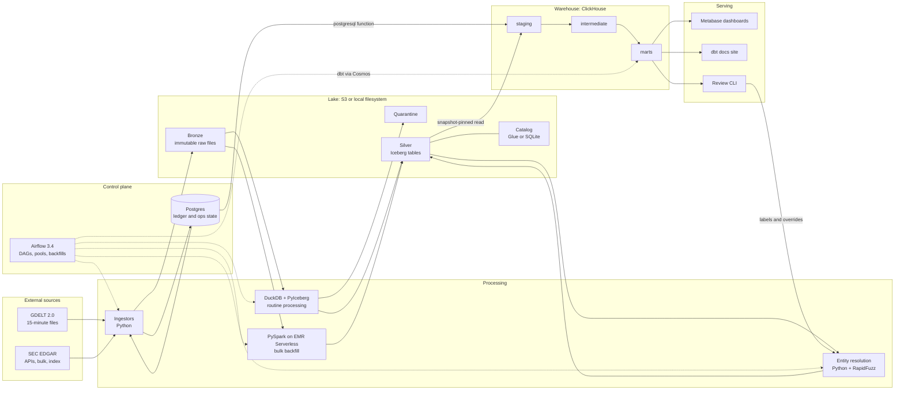
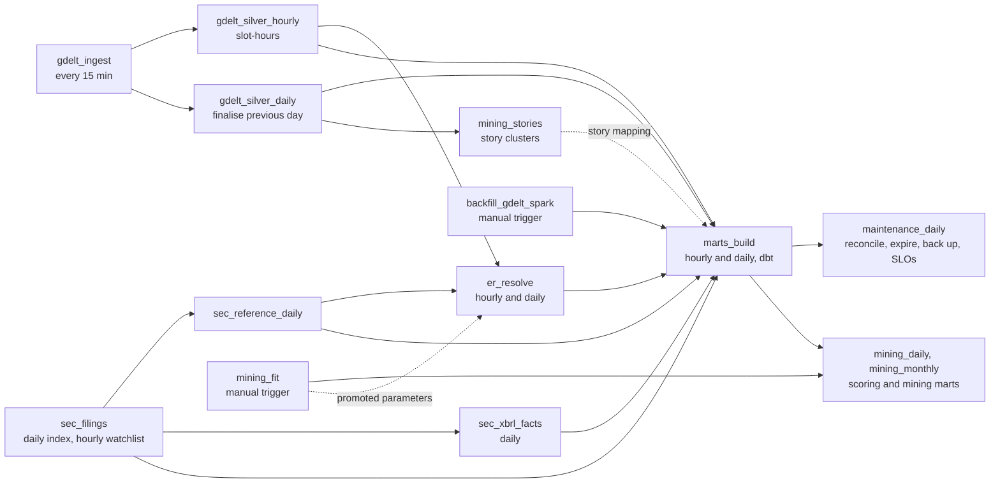
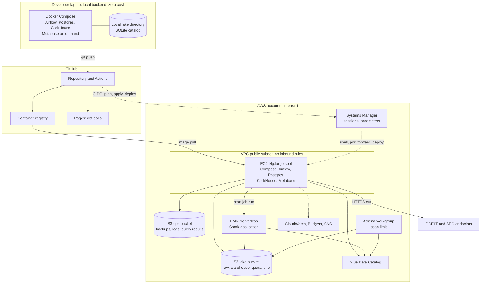
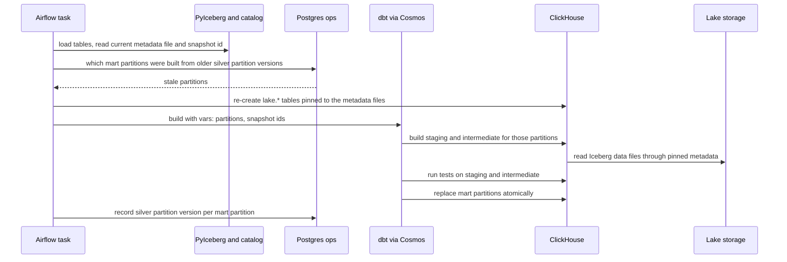
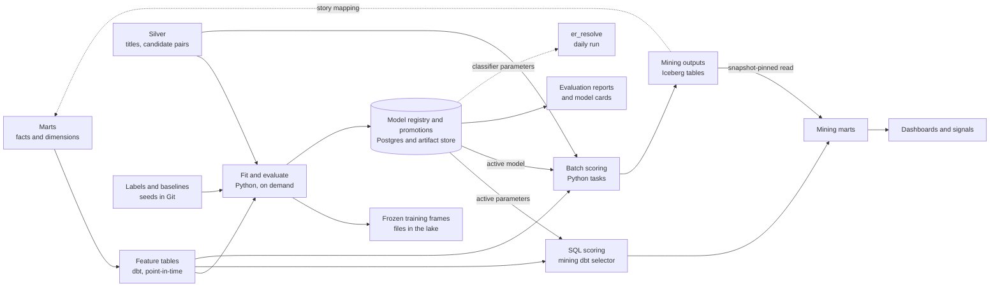
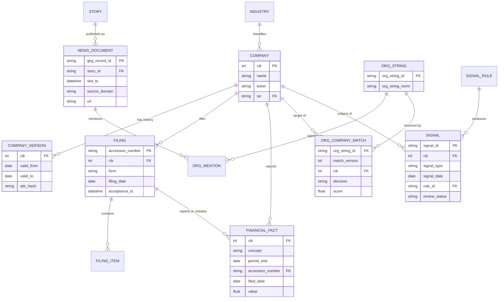
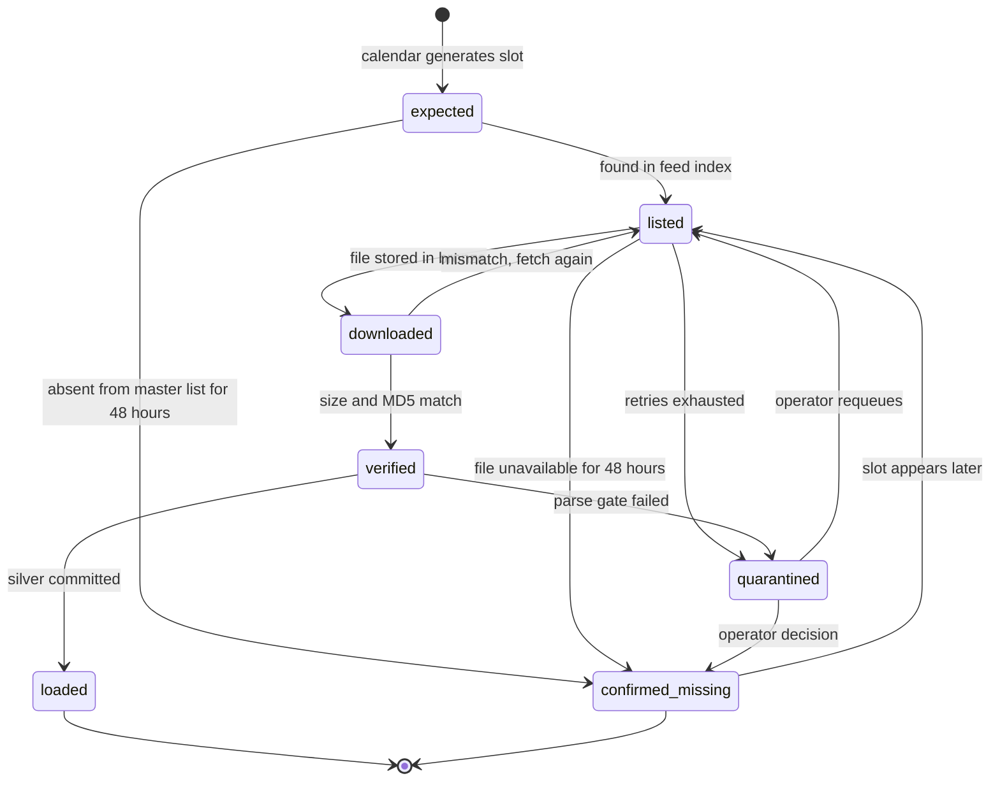
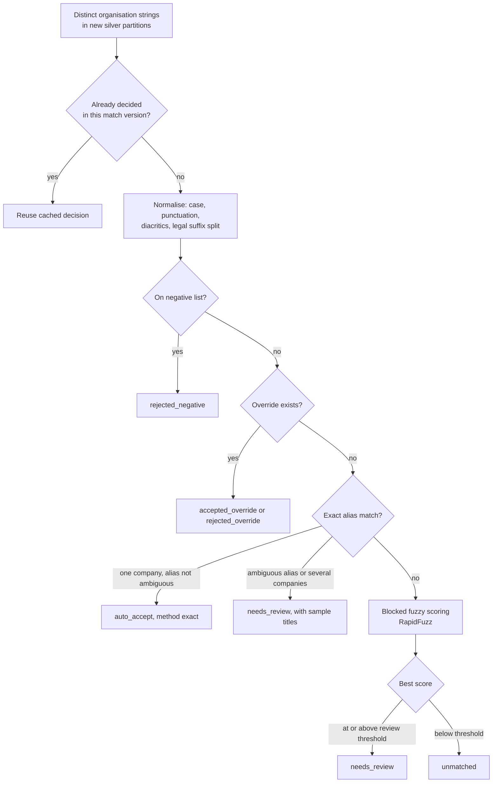
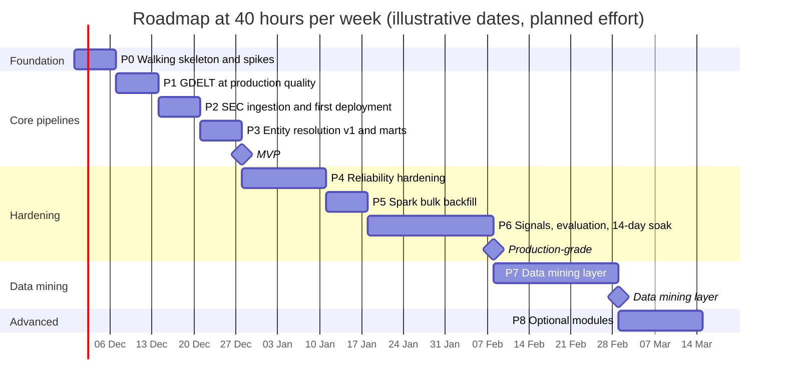

# Global Business & Market Intelligence Platform — Project Blueprint

| | |
|---|---|
| **Document** | Authoritative implementation blueprint (planning only; no code exists yet) |
| **Version / date** | 1.1 — 25 November 2026 (adds the data mining layer) |
| **Prepared for** | Jay Mercado (solo developer) |
| **Source brief** | `global_business_market_intelligence_brief.docx` (First Mate / Data Engineering) — treated as inspiration, not as a constraint |
| **Working name** | `gbmi-platform` (Python package `gbmi`) |
| **Confirmed constraints** | AWS budget ≈ USD 30/month · personal initiative · broad job-market target · 40+ hours/week · MacBook Pro M2 Pro, 16 GB RAM |

## How to read this document

Every factual statement that matters for a decision carries one of four tags.

| Tag | Meaning |
|---|---|
| **[V]** | Verified during research on 2026-11-25, either at a cited source (number in square brackets, listed in §17) or by direct measurement of the live source (cited as [1]) |
| **[R]** | Engineering recommendation or decision made in this blueprint |
| **[E]** | Estimate derived from verified inputs; must be replaced by a measurement during implementation |
| **[A]** | Assumption; listed again in §17.3 so it can be challenged |

**TBM** ("to be measured") marks a number that must come from the running system. The blueprint never states a performance result, because nothing has been built or measured yet.

Sections 5–11 and 16 are recommendations **[R]** throughout unless a statement is tagged otherwise.

## Contents

1. [Executive summary](#1-executive-summary)
2. [Assessment of the original project brief](#2-assessment-of-the-original-project-brief)
3. [Business and functional requirements](#3-business-and-functional-requirements)
4. [Data source strategy](#4-data-source-strategy)
5. [System architecture](#5-system-architecture)
6. [Technology stack](#6-technology-stack)
7. [Data architecture and modeling](#7-data-architecture-and-modeling)
8. [Data pipeline design](#8-data-pipeline-design)
9. [Infrastructure and deployment](#9-infrastructure-and-deployment)
10. [Repository and codebase structure](#10-repository-and-codebase-structure)
11. [Implementation roadmap](#11-implementation-roadmap)
12. [Cost analysis](#12-cost-analysis)
13. [Risks and trade-offs](#13-risks-and-trade-offs)
14. [Data engineering competency matrix](#14-data-engineering-competency-matrix)
15. [Portfolio and career positioning](#15-portfolio-and-career-positioning)
16. [Final recommendations](#16-final-recommendations)
17. [References](#17-references)

---

## 1. Executive summary

### 1.1 Recommended project concept

Build an **entity-resolved company-intelligence lakehouse**. The platform ingests two public, messy, real-world sources — GDELT 2.0 news metadata and SEC EDGAR filings — links noisy organisation names found in news to SEC registrants, derives explainable company signals, and serves dimensional models to a lightweight dashboard.

The hard and valuable part is not the dashboard. It is the engineering that makes two unrelated sources trustworthy together: ingestion that survives rate limits and source gaps, idempotent reprocessing, entity resolution whose accuracy is *measured*, models that are correct in time (restatements, name changes), and an operation that one person can run for about USD 30 a month.

On top of that platform sits a **data mining layer**. Five classical algorithm families — similar-item detection, classification, clustering, association and network mining, and anomaly detection — each answer one concrete question about the data. Each is compared with the simple rule already in production and is promoted into the dashboards only if it is measurably better.

### 1.2 Business problem and value proposition

Analysts, business-development teams and investors need a timely, explainable view of what is happening to companies: news attention, regulatory filings, financial trajectory, and events such as restructurings, financings and leadership changes. Open data contains all of this, but in a form that is hard to use:

- News metadata names organisations as free text. GDELT's organisation field is the noisiest field in its knowledge graph (identity F1 of 0.42 in a 2026 reconstruction study) **[V]** [2], and a live sample shows countries, courts and media bylines mixed in with companies **[V]** [1].
- Filings identify companies by CIK, not by the names used in the press, and financial facts are restated over time.
- Commercial platforms that solve this (for example AlphaSense, Crunchbase, PredictLeads) are priced for enterprises **[A]** (third-party price reports only; not verified at vendor pages).

The platform's value is the link and the evidence: every company-level number can be traced to the source file, the filing accession or the article URL, and to the version of the rule or match that produced it.

### 1.3 Project objectives

| # | Objective | Measured by |
|---|---|---|
| O1 | Demonstrate the full data-engineering lifecycle on real data: ingestion, storage, transformation, modeling, serving, operations | A deployed pipeline with documented runs (§11 milestones) |
| O2 | Close the developer's verified skill gaps: production Python, Airflow, dbt, columnar warehouse, lakehouse table format, Spark, Terraform, data quality | Competency matrix (§14) with a proof artifact per competency |
| O3 | Operate to explicit service-level objectives for freshness, completeness, correctness and cost | SLO dashboard and monthly cost report (§3.4, §12) |
| O4 | Make reliability claims reproducible | Scripted drills with assertions: backfill, kill-and-rerun, source gap, corrupt file, schema drift, disaster recovery (§9.8) |
| O5 | Produce evidence-based engineering decisions | 8–12 architecture decision records, each with alternatives and a measurement (§15.4) |
| O6 | Stay feasible for one person | About 370 hours of planned work to the production-grade milestone and 120 more for the data mining layer (about 555 and 180 with contingency); the core's scope is frozen at production-grade (§11) |
| O7 | Extract patterns with data mining algorithms that are evaluated, not assumed | Five mining tasks, each with a baseline comparison, a recorded promote-or-reject decision and a model card (§8.12) |

### 1.4 Expected technical outcomes

- A Python package with typed, tested ingestion clients for GDELT and SEC EDGAR, including a global rate limiter and a file ledger implemented as a state machine.
- A lake with immutable raw files and Apache Iceberg tables on Amazon S3, registered in the AWS Glue Data Catalog, with atomic whole-partition overwrites.
- A ClickHouse warehouse with a Kimball-style star schema built by dbt: a type-2 company dimension, bitemporal financial facts, news and filing facts, and a signals fact.
- An entity-resolution pipeline with a labelled evaluation set and a precision gate in continuous integration.
- Airflow DAGs with idempotent, backfillable tasks and level-triggered reconciliation.
- Terraform-managed AWS infrastructure, GitHub Actions pipelines, backups and a tested recovery procedure.
- A bulk-backfill job in PySpark on EMR Serverless, a cross-engine parity test suite, and a benchmark that states when Spark is and is not worth using.
- A data mining layer: point-in-time feature tables, a model registry with effective-dated promotions, MinHash near-duplicate detection, a logistic-regression match classifier, k-means company profiles scored in SQL, significance-tested co-mention associations with a network analysis, and seasonal and multivariate anomaly detection — each with a published evaluation.
- Documentation that a reviewer can verify: data dictionary (dbt docs), runbooks, decision records, benchmark and cost reports.

### 1.5 Key recommendations

1. **Keep the brief's backbone, change its foundations.** Retain Airflow, dbt, ClickHouse, Metabase and Docker Compose. Replace "Parquet on the local filesystem" with Apache Iceberg on S3, and add cloud, infrastructure-as-code and CI/CD, which the brief omits.
2. **Use Spark where volume justifies it, and prove it.** The English feed measures 13.3 GB per month compressed **[V]** [1], about 1.3 GB of raw text per day **[E]**. Routine processing runs on DuckDB with PyIceberg; PySpark on EMR Serverless handles 12-month backfills. A benchmark and a decision record make the boundary explicit.
3. **Make completeness a state, not a retry.** The GDELT archive has permanent gaps — June 2025 contains 1,311 of 2,880 expected file slots **[V]** [1] [3]. The ledger tracks every expected slot through an explicit state machine, including "confirmed missing".
4. **Treat entity resolution as the centrepiece.** Report precision at the auto-accept threshold on a held-out labelled set, and block merges that reduce it.
5. **Lead signals with SEC data.** Form 8-K item codes and form types are high-precision; news-derived signals are corroboration and always carry a review status.
6. **Never rewrite facts when matches change.** Facts store the raw organisation-string identifier and join to companies through a versioned bridge table.
7. **Design every hop to be idempotent** and prove it with a "run twice, compare checksums" test.
8. **Deploy early.** A thin end-to-end slice runs on AWS by week 3; the MVP is deployed by week 4.
9. **Cap cost in code.** Budgets with a stop action, a scheduled host, an Athena scan limit and an EMR Serverless capacity limit.
10. **Cut tooling that does not pay for itself.** No Kubernetes, managed Airflow, local S3 emulator, separate metrics stack, or second data-quality framework.
11. **Add data mining as a measured layer on top of the platform, not inside its core.** Fit models on demand, store them as versioned data, score them in SQL where the model allows, and promote an algorithm only when it beats the existing rule on a held-out measure. Promotions are effective-dated, so a new model never changes earlier results silently.

### 1.6 The design in one table

| Concern | Decision |
|---|---|
| Sources | GDELT 2.0 (Events, Mentions, GKG; English feed) and SEC EDGAR (submissions, daily index, XBRL company facts) |
| Ingestion | Python 3.12 package; Postgres ledger state machine; token-bucket rate limiting; checksum verification |
| Lake | Amazon S3; bronze = immutable raw files; silver = Apache Iceberg v2; AWS Glue Data Catalog |
| Routine processing | DuckDB 2.0 + PyIceberg (stage, audit, atomic partition overwrite) |
| Bulk processing | PySpark 4.1 on EMR Serverless (release `emr-spark-8.2.0`) |
| Warehouse and serving | ClickHouse 26.8 LTS, single node |
| Transformation | dbt Core 1.12 with dbt-clickhouse |
| Orchestration | Apache Airflow 3.4, LocalExecutor, Cosmos for dbt |
| Dashboard and dictionary | Metabase OSS; dbt docs on GitHub Pages |
| Infrastructure | Docker Compose; Terraform; one EC2 Graviton spot host; GitHub Actions |
| Data mining layer | Feature tables in dbt; models fitted with scikit-learn, datasketch, NetworkX and statsmodels; a model registry with effective-dated promotions in Postgres; scoring in SQL where the model allows |
| Optional modules | Streaming lab (Kafka), engine-interoperability lab (Athena, DuckDB, Snowflake trial), OpenLineage, Elementary, a title-signal classifier, mining at scale with Spark MLlib |

---

## 2. Assessment of the original project brief

### 2.1 What the brief asks for

The brief (one page) asks for a platform that processes public news and financial disclosures to identify company developments, industry trends and potential business opportunities. It names GDELT and SEC EDGAR as sources; a company watchlist, an industry trend dashboard, signal flags with human review, and filters as features; and Python + Airflow, PySpark in local mode, optional Kafka, Parquet on the local filesystem, dbt Core + ClickHouse, Metabase and pytest as the stack. The budget is zero and everything runs locally. Deliverables: a working pipeline for one month of GDELT data and SEC disclosures for a watchlist; a dashboard, data dictionary, Docker setup and README; a demonstrated backfill, failure recovery and benchmark; and reported data volume and runtime.

### 2.2 Strengths

| Strength | Why it matters |
|---|---|
| Two heterogeneous real sources | One high-volume append-only feed with no service contract, and one rate-limited API with bulk alternatives. Together they exercise most ingestion patterns. |
| Entity matching with retained uncertainty and provenance | This is the real intellectual problem in the domain, and the brief already asks for honesty about uncertainty. |
| Fundamentals named explicitly | Rate limits, retries, backfills, deduplication, partitioning, freshness checks, idempotent reruns. |
| Evidence-oriented deliverables | A demonstrated backfill, a failure recovery and a benchmark with actual volume and runtime. |
| Human review loop | Acknowledges that automated signals from news metadata are not reliable alone. |
| Mainstream tools | Airflow and dbt appear in 12–38% and 24–35% of 2026 data-engineer postings respectively **[V]** [4] [5] [6]. |

### 2.3 Weaknesses and limitations

| # | Weakness | Evidence | Consequence if followed literally |
|---|---|---|---|
| W1 | No cloud, infrastructure-as-code or CI/CD | AWS is named in 22–50% of postings, CI/CD in 17–32%, Terraform in 14–17% **[V]** [4] [7] [6]; a widely used portfolio rubric awards full marks only for cloud development with IaC **[V]** [8] | The developer's largest skill gap stays open |
| W2 | Plain Parquet on a local filesystem | No atomic partition replacement, schema evolution or snapshot history; local disks hide object-store behaviour | Idempotent reruns must be hand-built; failure recovery is hard to demonstrate cleanly |
| W3 | PySpark as the default engine | English feed measured at 13.3 GB/month compressed **[V]** [1]; about 1.3 GB/day of raw text **[E]** | Spark adds a JVM and several GB of memory for a workload one core handles; the choice is hard to defend in an interview |
| W4 | Signals "from available news metadata" only | The GKG theme taxonomy has bankruptcy, IPO, earnings, venture-capital and strike themes but none for layoffs, hiring or acquisitions **[V]** [1] [9]; GKG holds metadata and URLs, not article text **[V]** [10] | Low-precision signals with no way to quantify quality |
| W5 | Entity resolution is one sentence | No alias sources, method, thresholds, evaluation or versioning are specified | The central feature cannot be judged right or wrong |
| W6 | Kafka included without a requirement | The source publishes every 15 minutes **[V]** [11]; nothing in the features needs sub-minute latency | A streaming component with no purpose reads as tool collecting |
| W7 | dbt on ClickHouse treated as routine | ClickHouse has no multi-statement transactions; the adapter's partition-replace strategy is marked experimental **[V]** [12]; dbt Core 2.0 is not yet generally available and the adapter requires dbt-core below 2.0 **[V]** [13] [14] | Duplicates or gaps on rerun unless the incremental contract is designed deliberately (§7.7) |
| W8 | Source gaps not considered | 33 calendar months since 2015 are missing more than five 15-minute slots each; 14 June–2 July 2025 is missing entirely **[V]** [1] [3] | Endless retries, false alerts, or silently partial days |
| W9 | Laptop memory | Airflow alone needs at least 4 GB **[V]** [15]; adding Spark, Kafka, ClickHouse and Metabase exceeds 16 GB **[E]** | Out-of-memory kills that look like pipeline bugs |
| W10 | "Local filesystem" was also the practical choice because MinIO was the usual emulator | The MinIO community repository is marked "no longer maintained" **[V]** [16]; LocalStack requires an account token since March 2026 **[V]** [17] | The familiar local object-store path is no longer dependable |

### 2.4 Missing requirements

Service-level objectives; data contracts and a schema-drift policy; quarantine of bad records; reconciliation between layers; time semantics (GDELT batch timestamps are UTC; SEC acceptance times are UTC while filing dates follow US Eastern business days **[V]** [18] [1]); history management (company name, ticker and industry changes; restated financial facts); lineage and metadata; security and secrets; licence and attribution compliance (GDELT requires citation and a link **[V]** [19]; SEC requires a declared user agent and at most 10 requests per second **[V]** [20]); backup and recovery; cost controls; a definition of the company universe versus the watchlist; and an evaluation method for matching and signals.

### 2.5 Retain, modify, remove, introduce

| Action | Item | Rationale |
|---|---|---|
| **Retain** | GDELT and SEC EDGAR as the two sources | Free, open-licensed, real and complementary **[V]** [19] [21] |
| Retain | Airflow for orchestration | Most requested orchestrator; Dagster's ownership is changing (acquisition by Prefect announced July 2026 **[A]**, reported in secondary sources only) |
| Retain | dbt Core + ClickHouse for analytical models | One engine in every environment; strong lessons in columnar physical design |
| Retain | Metabase OSS, pytest, Docker Compose | Lightweight and sufficient |
| Retain | Raw storage, normalise, deduplicate, partition; uncertain matches with provenance; human review; backfill, recovery and benchmark demonstrations; data dictionary and README | These are the brief's best requirements |
| **Modify** | PySpark for all transformations → DuckDB for routine processing, PySpark on EMR Serverless for bulk backfills | Fit the engine to the measured volume (W3) and back the choice with a benchmark |
| Modify | Parquet on local filesystem → Apache Iceberg (Parquet files) on S3, with a local-filesystem backend for offline runs | Atomic overwrite, schema evolution, snapshots (W2); still runnable at zero cost |
| Modify | Signals from news metadata → SEC-first signals with news as corroboration | Precision and explainability (W4) |
| Modify | One month of data → one month for the MVP, 12 months via the bulk backfill | Gives the scale story and a real reprocessing exercise |
| Modify | Zero budget → zero-cost local mode plus an AWS deployment near USD 30/month | Closes the cloud gap (W1) |
| Modify | Optional Kafka replay → optional, time-boxed streaming lab whose deliverable is a stream-equals-batch test | Keeps the learning, removes the pretence of a requirement (W6) |
| Modify | "Selected watchlist" → two tiers: universe (about 8,000 ticker-bearing registrants) and watchlist (50 for the MVP, 500 later) | Industry trends need breadth; deep data and review effort need focus |
| **Remove** | Podman as an alternative | One container runtime to document and test |
| Remove | Spark local mode as the default execution path | W3, W9 |
| Remove | GDELT Events as the primary company lens | In a live sample only about 7% of events had a business or multinational actor type **[V]** [1]; Events remain for macro trend charts |
| **Introduce** | Ledger state machine with explicit missing states | W8 |
| Introduce | Typed contracts, quarantine, reconciliation and pre-publication audits | §2.4 |
| Introduce | Type-2 company dimension and bitemporal financial facts | Name changes and restatements are facts of the domain |
| Introduce | Versioned entity resolution with a labelled evaluation set and CI gate | W5 |
| Introduce | Terraform, AWS, GitHub Actions, backups and a recovery drill | W1 |
| Introduce | SLOs, operational marts, alerting, cost controls | §2.4 |
| Introduce | Decision records, runbooks, scripted drills, benchmark and cost reports | Evidence a reviewer can check |
| Introduce | A data mining layer after the production-grade milestone: near-duplicate detection, match classification, company clustering, association and network mining, anomaly detection | The brief's "industry trends" and "signals" benefit from pattern discovery; each algorithm is compared with a baseline, and the core keeps its own rule wherever no model has been promoted |

### 2.6 Traceability: where each brief deliverable is satisfied

| Brief deliverable | Satisfied in | Milestone |
|---|---|---|
| Working pipeline: one month of GDELT + SEC for a watchlist | Phases P1–P3 | MVP (week 4) |
| Dashboard | P3 (watchlist, industry trends), P4 (pipeline health), P6 (signal review) | MVP onwards |
| Source code, Docker setup, README with architecture and run instructions | P0 onwards; `make demo` on committed fixtures | MVP |
| Data dictionary | dbt docs published to GitHub Pages | MVP |
| Demonstrate a backfill | Drill DR1 (30 days, routine engine); P5 (12 months, Spark) | MVP; production-grade |
| Demonstrate failure recovery | Drills DR2–DR7 (§9.8) | MVP (DR2), production-grade (all) |
| Benchmark; actual data volume and runtime | Benchmarks B1–B7 (§15.6) | P1 first numbers; P5 full report |
| Optional Kafka replay | Streaming lab | Advanced (optional) |

---

## 3. Business and functional requirements

### 3.1 Business use cases

| ID | Use case | Primary user | Outcome |
|---|---|---|---|
| UC-1 | **Watchlist monitoring** — for one company, see recent news stories (syndication removed), filings with links to sec.gov, signals on a timeline and key financial metrics | Market or business-development analyst | A current, sourced picture of a company in one page |
| UC-2 | **Industry trend analysis** — story volume and tone by industry over time; median financial metrics by industry; GDELT event volumes by category and country | Analyst | Spot sectors gaining or losing attention and financial momentum |
| UC-3 | **Signal triage** — review flagged expansion, funding, hiring, contraction, distress and leadership signals with their evidence; accept or reject | Reviewer | A curated list of opportunities and risks, with an audit trail |
| UC-4 | **Match review** — review uncertain organisation-to-company matches, ranked by how many mentions they affect | Reviewer | Higher match precision and recall over time |
| UC-5 | **Point-in-time research** — ask what was known about a company's financials on a given date | Research analyst | Analyses free of look-ahead bias |
| UC-6 | **Platform operation** — monitor freshness, completeness, data-quality results and cost; rerun, backfill and recover | Data engineer (the developer) | A platform one person can keep healthy |
| UC-7 | **Pattern discovery** — find companies that behave alike, companies that are mentioned together, and company-days that are unusual | Analyst | Peer groups, related-company lists and ranked anomalies, each with the evidence behind it |

### 3.2 Target users

| User | Needs | Interface |
|---|---|---|
| Analyst (market, BD, investor relations) | Filters by company, industry, category and date; source links | Metabase dashboards |
| Reviewer (human in the loop) | Ranked queues, evidence, a fast accept/reject path | CSV round-trip through the `gbmi` CLI (MVP); Metabase queue views |
| Research analyst | As-of financial facts, stable keys, documented grain | ClickHouse SQL; dbt docs |
| Data engineer / operator | Health at a glance, runbooks, safe reruns | Airflow UI, pipeline-health dashboard, CLI, alerts |
| Portfolio reviewer (hiring manager, interviewer) | Understand and verify the work in minutes | README, `make demo`, dbt docs site, reports |

### 3.3 Functional requirements

Milestones: **M** = MVP, **P** = production-grade, **D** = data mining layer (planned, after production-grade), **A** = advanced (optional).

| ID | Requirement | Milestone |
|---|---|---|
| **Ingestion** | | |
| FR-01 | Ingest the GDELT 2.0 English Events, Mentions and GKG files for every 15-minute slot; verify size and MD5 against the feed index; store the original zip unchanged | M |
| FR-02 | Track every expected slot per feed in a ledger with explicit states, including `confirmed_missing` | M |
| FR-03 | Backfill any date range from the master file list; rerunning a backfill changes nothing | M (30 days), P (12 months) |
| FR-04 | Ingest SEC company reference data for the universe: tickers and exchanges, SIC code, state, fiscal-year end, former names | M |
| FR-05 | Ingest the filings index for all filers daily; ingest filing detail and Form 8-K item codes for watchlist companies | M (daily), P (hourly for watchlist) |
| FR-06 | Ingest XBRL company facts for watchlist companies, from the bulk archive initially and the API incrementally | M |
| FR-07 | Comply with SEC fair access: declared user agent, a global ceiling of 8 requests per second, back-off and a kill switch on refusal | M |
| **Processing** | | |
| FR-08 | Parse, type, deduplicate and partition raw data into silver Iceberg tables; route malformed records to quarantine with a reason | M |
| FR-09 | Reconcile counts between ledger, bronze and silver for every partition | M |
| FR-10 | Resolve organisation strings to companies; record decision, score, method and version; retain uncertain matches | M (v1), P (v2 with evaluation) |
| FR-11 | Collapse syndicated copies of an article into one story | M |
| FR-12 | Build dimensional marts (dimensions, facts, aggregates) with documented grain and tests | M (core), P (full) |
| FR-13 | Derive signals carrying evidence identifiers, rule identifier and version, confidence and review status | P |
| FR-14 | Provide as-of financial facts: first reported and latest known | P |
| **Serving** | | |
| FR-15 | Company watchlist dashboard with recent news, filings and source links | M |
| FR-16 | Industry trend dashboard with event volumes and historical financial metrics | M |
| FR-17 | Filters by company, industry, event or signal category and date range | M |
| FR-18 | Review workflow whose decisions feed back into matching and signals | M (matches), P (signals) |
| FR-19 | Published data dictionary with lineage between models | M |
| **Operations** | | |
| FR-20 | Scheduled incremental runs; any run can be repeated safely | M |
| FR-21 | Record freshness, completeness and data-quality results; alert on failures and SLO breaches | M (basic), P (full) |
| FR-22 | One command runs a demonstration on committed fixtures with no cloud account; one command deploys | M |
| FR-23 | Backups and a tested restore | P |
| FR-24 | Reprocess at least 12 months in bulk on a distributed engine | P |
| FR-25 | Replay historical events through a message broker with a stream-equals-batch check | A |
| **Data mining** | | |
| FR-26 | Build point-in-time feature tables from a versioned feature contract | D |
| FR-27 | Detect near-duplicate stories and expose a versioned document-to-story mapping | D |
| FR-28 | Score fuzzy match candidates with a supervised classifier that must pass the match-quality gate before any automatic acceptance | D |
| FR-29 | Group watchlist companies into behaviour profiles with a versioned clustering model whose assignments are computed in SQL | D |
| FR-30 | Mine company co-mentions with association measures, significance tests and network measures (centrality, communities) | D |
| FR-31 | Score company-days for anomalies with seasonal and multivariate detectors | D |
| FR-32 | Record every model fit (data snapshot, parameters, metrics, code version), publish its evaluation, and use a model's output in marts only after a recorded, effective-dated promotion that leaves earlier results unchanged | D |

The four dashboards are: (1) company watchlist (FR-15), (2) industry trends (FR-16), (3) review queues for matches and signals (FR-18), and (4) pipeline health and SLOs (FR-21). The data mining layer adds panels to dashboards (1), (2) and (4); it does not add a fifth.

### 3.4 Non-functional requirements

Targets are design goals **[R]**. Each has a service-level indicator (SLI) computed from data the platform records, so the result is measured, not asserted. Freshness and reliability objectives apply while the host is scheduled to run.

| Category | Requirement | SLI | Target |
|---|---|---|---|
| Freshness — GDELT | New slots reach silver and marts quickly | Minutes from ledger `listed_at` to silver commit and to mart partition build, 95th percentile | ≤ 45 min to silver; ≤ 90 min to marts |
| Freshness — SEC | Filings are available the next morning; watchlist filings sooner | Hours from filing acceptance to mart availability | Daily index by 12:00 UTC next day; watchlist ≤ 2 h during operating hours (production-grade) |
| Catch-up | Backlog clears after downtime | Minutes from host start to zero pending slots after a 24-hour stop | ≤ 120 min (TBM) |
| Completeness | No silent partial days | Share of expected slots in state `loaded` or `confirmed_missing`, evaluated 72 hours after the day ends | ≥ 99.5% |
| Accounting | Every raw row is explained | Raw lines = parsed rows + quarantined rows, per file | 100% |
| Correctness | Published marts are consistent | Duplicate primary keys per mart partition; failed error-severity tests on published models | 0; 0 |
| Determinism | Reprocessing is safe | Checksum difference between two builds of a closed day | 0 |
| Match quality | Automatic matches are trustworthy | Precision of auto-accepted matches on the held-out gold set, overrides disabled | Observed ≥ 0.95 with a 95% Wilson lower bound ≥ 0.90 on at least 150 auto-accepted strings; recall reported |
| Reliability | Runs succeed unattended | Share of scheduled DAG runs succeeding without manual action, trailing 30 days | ≥ 98% (error budget 2%) |
| Recoverability | Loss is bounded | Recovery point: bronze 0 (written before processing, bucket versioned); ledger and orchestration metadata ≤ 24 h. Recovery time: rebuild host and warehouse from S3 | RTO ≤ 4 h (TBM in drill DR7) |
| Cost | Spend is capped | Monthly AWS bill | ≤ USD 30 in a normal month; alerts at 50/80/100%; host stops at 100% |
| Performance | Dashboards feel instant | 95th-percentile query time for watchlist and industry pages | ≤ 2 s (TBM) |
| Scalability | One code path from a day to a year | Same transformation contract on the routine engine and on Spark, enforced by parity tests | Parity suite passes |
| Security | Least privilege, no standing secrets | Long-lived cloud keys in repository or CI; open inbound ports; secrets in images | 0; 0; 0 |
| Maintainability | Code is safe to change | Lint and type checks; unit-test coverage of parsers, ledger and matching modules | Clean; ≥ 80% |
| Reproducibility | Anyone can rebuild it | Locked dependencies, pinned images, IaC; offline demo on fixtures | `make demo` passes in CI |
| Portability | Storage backend is configuration | Local filesystem and S3/Glue backends pass the same integration tests | Both pass |
| Compliance | Sources' terms are met | GDELT citation and link present; SEC user agent declared and rate ceiling enforced; no article text stored | Checked in CI and README |
| Observability | Every number is traceable | Rows carry source file, load time and pipeline version; runs carry a run identifier in structured logs | 100% of silver and mart tables |
| Model promotion | A mined result reaches users only if it is better than the rule it replaces | Held-out measure of the candidate against the baseline, with an interval | The task's rule in §8.12 is met; otherwise the baseline stays |
| Mining reproducibility | A model can be rebuilt | Refit from the frozen training frame, seed and image | Same assignments and flags; scores equal within a stated tolerance |

### 3.5 Scope and exclusions

**In scope:** the GDELT English feed (three tables); SEC reference data, filings and XBRL facts; US-listed registrants with tickers as the universe; batch and micro-batch processing; one warehouse; one BI tool; AWS in one region; and, after the production-grade milestone, a data mining layer of five classical algorithm families built on the marts.

**Out of scope:**

| Excluded | Reason |
|---|---|
| Article full text, scraping publisher sites | Copyright and terms of use; GDELT supplies metadata only |
| Market prices and returns | No free source permits redistribution (§4.5) |
| Deep learning, language models in the core path, and forecasting of prices, returns or events | The data mining layer (§5.13) uses classical, explainable algorithms that can be evaluated with small labelled samples. Heavier models need labels and compute the project cannot justify, and predicting market outcomes is outside its purpose |
| A custom web application | Application development is already well represented in the developer's portfolio |
| GDELT translingual feed (initially) | Adds about 24 GB/month compressed **[V]** [1] without a new engineering lesson; listed as a scale extension |
| Private companies and non-US registries | Different identifiers and sources; listed as future expansion |
| Multi-tenant access control, personal data handling | Public data, single operator |
| High availability | A single host with tested recovery is the honest design at this budget |

### 3.6 Measurable success criteria

**MVP (end of week 4)**

1. Thirty consecutive days of GDELT English data and SEC data for a 50-company watchlist are queryable in the marts on the AWS host.
2. Completeness SLI ≥ 99.5% for those days; accounting SLI 100%.
3. Watchlist and industry dashboards answer UC-1 and UC-2 with working filters.
4. Drill DR1 (30-day backfill) and drill DR2 (kill and rerun) pass with identical checksums.
5. `make demo` runs end to end on fixtures in CI.
6. The data dictionary is published; the README states measured volume and runtime.

**Production-grade (end of week 10)**

7. A 14-day soak on the final configuration (500-company watchlist, hourly poll, signals) meets the freshness, completeness, correctness and reliability targets, shown on the SLO dashboard.
8. All drills DR1–DR10 pass and are documented as runbooks.
9. Twelve months of GDELT data are processed by the Spark job; the parity suite passes; the benchmark report is published.
10. Entity-resolution precision at auto-accept meets the match-quality target in §3.4 on the held-out set and is enforced in CI.
11. The AWS bill for a normal month is ≤ USD 30, with the cost report published.
12. At least eight decision records exist, each with alternatives and a measurement.

**Data mining layer (end of week 13)**

13. The five mining tasks in §8.12 are implemented on the feature tables, with every fit recorded in the model registry.
14. Each task has a published evaluation against its baseline and a recorded decision: promoted, kept as a candidate, or rejected.
15. Refitting any promoted model from its frozen training frame and seed reproduces its assignments and flags.
16. Promoted outputs appear in the dashboards with their model version; a promotion is shown to leave earlier dates unchanged, and a rollback to the previous version is demonstrated (drill DR11).

---

## 4. Data source strategy

### 4.1 Measurement method

Figures tagged [1] were measured on 2026-11-25 with read-only requests: the English master file list (1,215,788 lines) was streamed and file sizes were summed by month and feed; one 15-minute slice was downloaded and rows and bytes were counted per column; eight consecutive GKG slices (6,073 records) were scanned for titles and keywords. The scripts will be re-implemented under `benchmarks/source_profile/` so the numbers can be reproduced.

### 4.2 GDELT 2.0

**Shared characteristics**

| Attribute | Detail |
|---|---|
| Provider and URL | The GDELT Project — https://www.gdeltproject.org/data.html [24]; feed index https://data.gdeltproject.org/gdeltv2/lastupdate.txt [25]; full list https://data.gdeltproject.org/gdeltv2/masterfilelist.txt [26] |
| Format | Tab-delimited text, no header row, one zip per feed per 15-minute slot; file name `YYYYMMDDHHMMSS.<feed>.<ext>.zip` **[V]** [1] |
| Access | Anonymous HTTPS. Requests to `http://` return a 301 redirect to `https://`, while the index files still list `http://` URLs **[V]** [1] |
| Update frequency | Every 15 minutes **[V]** [11] [1] |
| History | GDELT 2.0 from February 2015; the English list holds 405,261 slots per feed **[V]** [1] |
| Index integrity | Each index line gives size in bytes, MD5 and URL **[V]** [1] |
| Rate limits | None documented for file downloads **[A]**; third-party reports of occasional HTTP 429 **[A]** |
| Pricing and licence | Free; "unlimited and unrestricted use for any academic, commercial, or governmental use"; redistribution permitted with a citation and a link to the project **[V]** [19] |
| Known gaps | 14 June–2 July 2025 missing (1,665 consecutive slots reported in the literature; 1,311 of 2,880 slots present in June 2025 by direct count) **[V]** [3] [1]; 33 months since 2015 are missing more than five slots each, including about 42% of October–November 2020 **[V]** [1] |
| Ingestion strategy | Poll `lastupdate.txt` every 15 minutes for new slots; once a day reconcile the ledger against `masterfilelist.txt`; download with bounded concurrency; verify size and MD5; write the zip unchanged to bronze; never parse before landing |

**Per table**

| Attribute | Events (`export`) | Mentions | Global Knowledge Graph (GKG) |
|---|---|---|---|
| Description | One row per coded event (actors, CAMEO action, location, tone); 61 columns **[V]** [1] [27] | One row per mention of an event in an article; 16 columns **[V]** [1] | One row per article: organisations, persons, themes, locations, tone, source, URL, extras; 27 columns **[V]** [1] [10] |
| Business relevance | Macro event volumes by category and country for trend charts | Links events to article URLs | The core feed: organisation mentions, themes, tone, titles and URLs per article |
| Volume, October 2026 | 202.8 MB compressed, 2,976 files **[V]** [1] | 283.9 MB compressed **[V]** [1] | 12.83 GB compressed **[V]** [1] |
| One slice (08:45 UTC) | 1,156 rows; 465 KB raw; 76 KB zip **[V]** [1] | 1,923 rows; 397 KB raw; 73 KB zip **[V]** [1] | 948 rows; 11.66 MB raw; 3.78 MB zip **[V]** [1] |
| Monthly estimate | ≈ 3.1 M rows **[E]** | ≈ 7.4 M rows **[E]** | ≈ 3.2 M rows; ≈ 40 GB raw **[E]** |
| Whole archive (English) | 40.3 GB compressed **[V]** [1] | 68.2 GB compressed **[V]** [1] | 2,896 GB compressed **[V]** [1] |
| Keys and time | `GlobalEventID` unique but not date-ordered; `DATEADDED` is the UTC time the event entered the database **[V]** [27] | `MentionTimeDate` is the batch timestamp, identical for every row in a file — not the publication time **[V]** [27] | `GKGRECORDID` = batch timestamp plus sequence (`-T` marks translated records) **[V]** [10] |
| Quality concerns | Coding accuracy and duplication are questioned in the literature **[A]** (secondary summaries); in a live slice only 81 of 1,156 events had a business or multinational first-actor type **[V]** [1] | Late mentions of old events are expected; no maximum lag is documented **[V]** [27] | See below |

**GKG findings that shape the design** **[V]** [1]

| Finding | Design consequence |
|---|---|
| The `V2GCAM` column is 70.4% of GKG bytes | Keep it in bronze only; silver drops it, cutting volume by about 70% |
| 72.7% of records list organisations; 2.94 distinct organisations per such record; 1,452 distinct strings in one slice | Organisation strings are exploded into their own silver table; matching works on the distinct set, not on every mention |
| Top strings include "United States", "Supreme Court", "Reuters", "Associated Press", "Instagram", "Nvidia", "Visa"; mis-parses such as "amazon autos international" occur | A negative list is the first matching stage; ambiguous names need corroboration; recall is limited by the source |
| `<PAGE_TITLE>` is present in 6,071 of 6,073 sampled records | Titles are available as metadata for story deduplication and a few versioned keyword rules |
| The same title appears five to seven times within two hours (syndication) | Count stories (normalised-title hash), not raw records |
| Naive keyword rules over 6,073 titles matched 86 expansion or M&A, 14 hiring, 11 funding, 9 distress and 3 contraction titles, with clear false positives ("expanding Supreme Court") | News rules produce candidates for review, never facts |
| The theme list (2,589 themes) includes `ECON_BANKRUPTCY`, `ECON_IPO`, `ECON_EARNINGSREPORT`, `ECON_CUTOUTLOOK`, `WB_383_ANGEL_AND_VENTURE_CAPITAL`, `STRIKE` and `UNEMPLOYMENT`, but no layoff, hiring or acquisition theme [9] | Themes cover distress, IPO, earnings and funding; hiring, expansion and contraction need SEC data or title rules |

**Alternatives for GDELT access**

| Alternative | Verdict | Reason |
|---|---|---|
| Google BigQuery public dataset (partitioned tables exist **[V]** [28]) | Not the primary path; optional reconciliation oracle | It removes the ingestion problem this project exists to demonstrate, and full-table scans are costly |
| GDELT DOC 2.0 API | Rejected | Rolling three-month window; at most 250 records per query **[V]** [29] |
| AWS Open Data copy (`gdelt-open-data`) | Rejected | Listed as "not currently being updated" **[V]** [30] |
| Translingual feed | Deferred | Separate files, about 24 GB/month compressed GKG **[V]** [1] |

### 4.3 SEC EDGAR

**Shared access policy** **[V]**

| Attribute | Detail |
|---|---|
| Provider and URL | U.S. Securities and Exchange Commission — https://www.sec.gov/search-filings/edgar-application-programming-interfaces [18] |
| Authentication | None; no API key. `data.sec.gov` does not support cross-origin browser calls [18] |
| Limits | "Current max request rate: 10 requests/second"; automated clients must declare a user agent in the form `Sample Company Name AdminContact@domain.com` [20]. Excess requests lead to an IP block that lifts after the rate stays below the threshold for 10 minutes [21] |
| Pricing and licence | Free. Content "is considered public information and may be copied or further distributed"; cite the SEC; do not use its seal or logos [21] |
| Platform policy | All SEC traffic runs in a one-slot Airflow pool, so one process calls SEC at a time; an in-process token bucket holds it to 8 requests/second; the client honours `Retry-After`, backs off exponentially with jitter, and on HTTP 403 or 429 persists a "blocked until" time (15 minutes) that every later task respects. The user agent is configuration, never a literal in code **[R]** |

**Datasets**

| Attribute | Company reference | Filings index and detail | XBRL company facts |
|---|---|---|---|
| Endpoints | `/files/company_tickers_exchange.json` [31]; `data.sec.gov/submissions/CIK##########.json`; nightly `submissions.zip` [18] | `/Archives/edgar/daily-index/` and `/Archives/edgar/full-index/` [32]; submissions JSON for detail; "latest filings" Atom feed | `data.sec.gov/api/xbrl/companyfacts/CIK##########.json`; nightly `companyfacts.zip`; `frames` API for cross-company periods [18] |
| Description | Ticker, exchange, name, SIC code, state, fiscal-year end, filer category, former names with date ranges, LEI where present **[V]** [18] | Every filing: form type, company, CIK, date, accession. Submissions add acceptance time, primary document and the `items` list for Form 8-K **[V]** [18] | Every tagged financial fact: concept, unit, period, value, accession, form, fiscal year and period, filing date **[A]** (field semantics from secondary sources; to be confirmed against payloads in P2) |
| Business relevance | The company dimension and its history; the alias dictionary | Filing timeline; high-precision signals from form types and 8-K items | Historical financial metrics; growth and contraction signals |
| Format | JSON; zip of JSON files | Fixed-width or pipe-delimited index files; JSON; Atom XML | JSON; zip of JSON files |
| Update frequency | Submissions in near real time (typically under one second); bulk zip rebuilt about 03:00 US Eastern **[V]** [18] | Daily index built from about 22:00 Eastern; filings after 17:30 Eastern appear in the next business day's index **[V]** [20] | Typically under one minute after dissemination; bulk zip nightly **[V]** [18] |
| History | Former names as recorded by EDGAR | Index from 1993 **[V]** [32] | Structured data from about 2009 onward **[A]** |
| Volume | 10,400 ticker rows; 7,988 distinct CIKs **[V]**. `submissions.zip` is 1.58 GB by HTTP HEAD on 2026-11-25 **[V]**, with about 999,000 member files per a 2026 third-party count **[A]** | Several thousand filings per business day **[E]** (TBM) | `companyfacts.zip` is 1.43 GB by HTTP HEAD **[V]**, covering about 20,600 filers per a third-party count **[A]**; 1–10 MB of JSON per large company **[E]** |
| Quality concerns | `recent` holds at least one year or 1,000 filings; older filings are in additional files **[V]** [18]; tickers change and are reused | `items` is populated for 8-K rows (for example "2.02,9.01") **[V]**; `acceptanceDateTime` is UTC while `filingDate` follows Eastern business days **[V]** | Inconsistent tags across companies (several revenue concepts), custom extensions, restatements appearing as additional rows, fiscal versus calendar periods **[A]**; a May 2026 SEC proposal would let companies report semiannually on a new Form 10-S **[V]** [33] |
| Ingestion strategy | One request for the ticker file daily. Initial universe load by streaming `submissions.zip` and extracting only universe CIKs; daily refresh of CIKs that filed the previous day; weekly full refresh from the bulk file | Daily: fetch the previous business day's form index. Hourly (production-grade): poll submissions for the watchlist (500 requests) | Initial load by streaming `companyfacts.zip` for watchlist CIKs. Incremental: when a watchlist company files a 10-K, 10-Q, 20-F, 40-F, an amendment or an 8-K with item 2.02, refetch its facts document |
| Alternatives | GLEIF and Wikidata for identifiers (optional, §4.4) | Financial Statement Data Sets (quarterly flat files) [34] — coarser cadence; full-text search — undocumented as an API | Financial Statement Data Sets [34]; third-party APIs — unnecessary cost |

**Form 8-K items used for signals** **[V]** [35] — 1.01 entry into a material definitive agreement; 1.02 termination of one; 1.03 bankruptcy or receivership; 1.05 material cybersecurity incidents; 2.01 completion of acquisition or disposition of assets; 2.03 creation of a direct financial obligation; 2.04 triggering events that accelerate an obligation; 2.05 costs associated with exit or disposal activities; 2.06 material impairments; 3.01 notice of delisting; 3.02 unregistered sales of equity securities; 4.02 non-reliance on previously issued financial statements; 5.01 changes in control; 5.02 departure or appointment of directors or officers. Reports are generally due within four business days. (The headings of 2.05 and 4.02 were not extracted from the PDF during research and are given from the form's standard wording **[A]**.)

### 4.4 Reference seeds and optional sources

| Source | Content | Access and licence | Use | Status |
|---|---|---|---|---|
| SEC SIC code list [36] | Code, industry title, reviewing office | Public page; SEC terms | `dim_industry`; committed as a dbt seed with a derived division hierarchy | Essential |
| Curated alias list, negative list, overrides | Authored in the repository | Own work, versioned in Git, changed by pull request | Entity resolution | Essential |
| Gold labels | At least 800 hand-labelled organisation strings (200 for the MVP), stratified and labelled blind | Own work | Evaluation and CI gate | Essential |
| Mining labels | About 800 document pairs labelled as the same story or not, about 600 organisation strings from the fuzzy-candidate band, up to 100 related-company pairs and up to 180 anomaly flags — all labelled blind | Own work, versioned in Git | Evaluation of the data mining tasks (§8.12) | Essential for the data mining layer |
| Wikidata | Labels and aliases for items with a CIK (property P5531); parent and brand relations | CC0; query service limited to 60 seconds per query; dumps for bulk **[V]** [37] [38] | Brand and subsidiary aliases (for example a product name to its parent) | Optional (advanced) |
| GLEIF | 3.5 million legal entities with names; daily files; no CIK mapping file **[V]** [39] [40] | CC0 | Legal-name variants via the `lei` field present in SEC submissions | Optional |
| SEC Form D data sets | Private offerings, quarterly, about 3.5 MB **[V]** [41] | SEC terms | Private funding signals | Optional |
| US Department of Labor LCA disclosure data | Quarterly spreadsheets of labour-condition applications **[V]** [42] | Public | A hiring proxy; needs its own employer matching | Optional |

### 4.5 Sources considered and rejected

| Source | Finding | Decision |
|---|---|---|
| NewsAPI.org | Free plan: 100 requests/day, 24-hour delay, development and testing only **[V]** [43] | Rejected |
| GNews | Free plan: 100 requests/day, non-commercial **[V]** [44] | Rejected |
| Common Crawl CC-NEWS | About 0.5 TiB of WARC per month; article text remains under publisher copyright **[V]** [45] | Rejected for now; a possible later source of text features |
| Market prices (for example Alpha Vantage: 25 requests/day **[V]** [46]) | Tight limits; redistribution not permitted **[A]** | Out of scope |
| Layoff notices (WARN Act) | No federal feed; state-level publications only **[V]** [47]; aggregators are paid or restrict redistribution **[A]** | Rejected; contraction comes from 8-K item 2.05 |
| OpenFIGI | 25 mapping requests/minute without a key **[V]** [48] | Not needed; SEC supplies tickers |
| Commercial company-data platforms | Enterprise pricing **[A]** | Out of scope; used only as conceptual comparables (§15) |

### 4.6 Sizing summary

| Quantity | Value | Tag |
|---|---|---|
| GDELT English, compressed, per month (October 2026) | 13.3 GB (GKG 96%) | [V] [1] |
| GDELT English GKG, raw, per day | ≈ 1.3 GB | [E] |
| GDELT English, compressed, November 2025–October 2026 | 165.5 GB (GKG 159.8 GB) | [V] [1] |
| Silver GKG after dropping GCAM, Parquet with ZSTD, per month | 2.5–4 GB | [E], TBM |
| Organisation-mention rows per month | ≈ 6.9 M | [E] |
| SEC universe / watchlist | 7,988 CIKs / 50 (MVP), 500 (production-grade) | [V] / [R] |
| SEC requests per day in steady state | ≈ 10,000 (hourly watchlist poll 500 × 16 operating hours = 8,000; daily refresh ≈ 2,000) | [E] |

### 4.7 Licence and compliance register

| Source | Obligation | How the platform meets it |
|---|---|---|
| GDELT | Cite the project and link to its site in any use or redistribution **[V]** [19] | README, dashboard footer and dbt source descriptions carry the citation and link |
| SEC EDGAR | Declared user agent; at most 10 requests/second; no use of SEC marks **[V]** [20] [21] | Single shared client; configured user agent; ceiling of 8 requests/second; test asserts the header and the limiter |
| Article publishers | Copyright in article text | No text is fetched or stored; only GDELT metadata, titles and URLs |
| Wikidata, GLEIF (optional) | CC0 | Attribution given as good practice |

---

## 5. System architecture

### 5.1 Principles

1. **Land first, transform later.** Raw files are written unchanged before any parsing, so every downstream table can be rebuilt.
2. **Partitions are the unit of work.** A silver or mart partition is always replaced as a whole, atomically; nothing is updated in place (the functional approach to batch processing [49]).
3. **Level-triggered, not edge-triggered.** Each run compares desired state (ledger, silver partition versions) with actual state (watermarks) and builds the difference. A missed event or a crashed run heals on the next run.
4. **State lives in one transactional store.** The Postgres ledger is the only place that knows what exists and what is pending.
5. **Audit before publishing.** Data that fails checks never becomes visible to the next layer (the write-audit-publish idea [50] [51]).
6. **One engine per job, chosen by measured volume.** A single-node engine for routine work; a distributed engine for bulk reprocessing.
7. **Same code, two backends.** Local filesystem and S3/Glue are selected by configuration; application code does not branch on environment (configuration in the environment [52]).
8. **Facts are immutable; interpretations are versioned.** Organisation-to-company matches and signal rules carry versions and never rewrite the underlying facts.
9. **Everything is traceable.** Each row can be followed back to a source file or filing and to the code version that produced it.
10. **Cost and blast radius are capped by infrastructure**, not by good intentions.
11. **Models are data.** A fitted model is a versioned set of parameters with a recorded evaluation. It is promoted deliberately, scored in SQL where its form allows, and rolled back like any other interpretation.

### 5.2 Logical architecture



| Layer | Responsibility | Technology |
|---|---|---|
| Ingestion | Discover, download, verify and land source files; respect source limits; record state | Python, httpx, tenacity, pydantic; Postgres ledger |
| Bronze | Immutable copy of exactly what the source served | Objects in S3 (or files locally), original names and compression |
| Silver | Parsed, typed, deduplicated, partitioned tables; entity-resolution outputs | Apache Iceberg (Parquet, ZSTD); Glue catalog |
| Warehouse | Business models: dimensions, facts, aggregates, signals, operational marts | ClickHouse; dbt |
| Data mining | Feature tables, model fitting and evaluation, pattern outputs (§5.13) | dbt and ClickHouse for features and SQL scoring; Python (scikit-learn and others) for fitting and batch scoring |
| Serving | Dashboards, data dictionary, review queues, ad hoc SQL | Metabase, dbt docs, CLI, Athena (lake) |
| Control | Scheduling, retries, backfills, reconciliation, maintenance | Airflow |

### 5.3 Processing model

**Batch and micro-batch.** GDELT publishes every 15 minutes, so ingestion runs every 15 minutes and transformation hourly. SEC reference data, indexes and facts are daily, with an hourly watchlist poll at the production-grade milestone.

**Stream processing is not justified by the requirements.** The fastest source cadence is 15 minutes and the freshness objective is 45–90 minutes. A message broker would add an always-on component without improving any SLI. Streaming is therefore offered only as an isolated lab (§8.11) whose value is educational and whose deliverable is a test, not a product feature.

**ETL into the lake, ELT in the warehouse.** Bronze-to-silver is a light transform (parse, type, deduplicate, explode) done outside the warehouse so that silver is engine-neutral. Silver-to-marts is ELT: ClickHouse reads silver and dbt transforms inside the warehouse.

**Distributed processing is justified in one place.** Reprocessing 12 months means reading about 160 GB of compressed files (roughly 480 GB of raw text) **[E]**. That is a parallel, shuffle-light job that benefits from elastic workers next to the data. Routine runs process about 1.3 GB per day **[E]** and do not.

### 5.4 Storage model: a two-tier lakehouse (lake plus warehouse)

| Question | Lake (S3 + Iceberg) | Warehouse (ClickHouse) |
|---|---|---|
| What lives here | Raw files; cleaned, source-shaped tables; match decisions | Business-shaped models and aggregates |
| Why | Cheap, durable, engine-neutral; the system of record | Sub-second analytical queries; one SQL dialect for modeling |
| Mutability | Bronze immutable; silver replaced by partition through atomic snapshot commits | Partitions replaced atomically; small tables rebuilt in full |
| Recovery role | Durable (versioned bucket) | Disposable — rebuilt from silver |
| Other readers | Athena, DuckDB, Spark, Snowflake (interoperability lab) | Metabase, SQL clients |

### 5.5 Orchestration model



- **Executor:** LocalExecutor on one host with `parallelism=4` to fit memory (§9.1).
- **Isolation:** one image with separate virtual environments — Airflow itself, the `gbmi` package, dbt and, from the data mining layer on, the mining libraries. Tasks call `gbmi` through `@task.external_python`; dbt runs through Cosmos with its own executable. No container-in-container and no Docker socket.
- **dbt in Airflow:** Cosmos renders models as grouped tasks from the dbt manifest, so nothing is parsed when DAG files load.
- **Scheduling:** time-based schedules with `catchup=False`. Downstream DAGs do not trust upstream "success" events; they ask the ledger and watermark tables what needs building. One DAG is deliberately date-scoped — `gdelt_silver_daily` is a pure function of its logical date — which is what makes Airflow's backfill meaningful for it. Airflow assets are declared for visibility in the UI, not as the correctness mechanism.
- **Concurrency controls:** `max_active_runs=1` per DAG; pools `sec_api` (1 slot), `silver_writer` (1 slot, taken by every job that commits to silver tables, including the Spark backfill) and `heavy` (1 slot for memory-intensive tasks).
- **Backfills:** bronze is backfilled by enqueueing ledger rows and letting ingestion drain them; silver by Airflow's scheduler-managed backfill over `gdelt_silver_daily` [53]; long ranges by the Spark job.
- **Operating window:** the host runs 08:00–24:00 UTC by default, which covers the US filing day and every daily job. After the nightly stop the first runs drain the ledger backlog.
- **Data mining DAGs:** `mining_stories` clusters each closed day before the daily mart build; `mining_daily` and `mining_monthly` apply active models and build the mining marts after it; `mining_fit` fits and evaluates candidates on demand. They write their own tables and never block the core DAGs (§5.13, §8.12).
- **Alerting:** task failure and retry-exhaustion callbacks post to a webhook; a heartbeat check detects a silent scheduler. Airflow's deadline alerts are still experimental **[V]** [54], so SLO breaches are detected from data by the maintenance DAG.

### 5.6 Idempotency contract for each hop

| Hop | Unit of work | Mechanism | Rerun effect |
|---|---|---|---|
| Source → bronze | One file (slot × feed) | Deterministic object key; skip if the object exists with the expected MD5; ledger transition in a transaction | None |
| Bronze → silver (routine) | One slot-hour (incremental); one slot-date (daily finalisation) | Read the unit's verified files; build in memory; audit; commit an overwrite filtered on the hour, or a whole-partition overwrite for the day — one Iceberg snapshot each | Same rows; new snapshot |
| Bronze → silver (bulk) | Many slot-date partitions | Spark `overwritePartitions()` on the same table and partition spec; optional audit branch | Same rows; new snapshot |
| Silver → entity resolution | One match version | Decisions keyed by (match version, organisation-string id); only unseen strings are scored | None for existing keys |
| Silver → marts (large facts) | One mart partition (day) | dbt builds the partition into a staging relation; ClickHouse `REPLACE PARTITION` swaps it in; watermark updated afterwards | Identical partition (checksum test) |
| Silver → marts (small tables) | Whole table | Full rebuild and atomic table exchange | Identical table |
| Mention fact + bridge → company and industry aggregates | Whole table daily; current month hourly | Rebuilt from immutable facts, the current bridge revision and the ledger-derived completeness model | Identical table |
| Review → system | One decision | Append-only decision rows; latest decision wins | None |
| Marts and features → mining outputs | One model version × one date or window | SQL-scored models are full rebuilds in dbt; batch-scored outputs are overwritten by filter in the lake; each date is scored by the version active on it; a fitted model is never changed | Identical assignments and flags |

### 5.7 Quality gates

| Gate | Where | Checks | On failure |
|---|---|---|---|
| G1 Landing | After download | Size and MD5 equal the index values; zip opens | File not promoted; retried; then `quarantined` |
| G2 Parse | During the silver build | Exact column count per feed; type coercion; required keys present | Row to quarantine with reason; file-level threshold (more than 1% bad rows) fails the file |
| G3 Pre-commit audit | Before the Iceberg commit | Parsed + quarantined = raw lines; primary-key uniqueness; non-null keys; row count within tolerance of the trailing median for the same weekday; partition contains only its date | No commit; previous partition version stays live; alert |
| G4 Model tests | During `dbt build` | Uniqueness, not-null, relationships, accepted values, unit tests, contracts | Downstream models are skipped, so marts keep their last good partitions |
| G5 Publication | Before partition replace | Staging partition row count and key checksum recorded; error-severity tests passed | Partition not replaced; alert |
| G6 Post-run reconciliation | Maintenance DAG | Ledger vs bronze listing vs silver partition versions vs mart watermarks | Drift reported; affected partitions queued for rebuild |
| G7 Model promotion | Before a mining output is used by marts | Evaluation against the baseline on held-out data; the task's rule (§8.12); reproducible refit | The model stays a candidate; marts keep the baseline or the previous version |

### 5.8 Governance, metadata and lineage

| Topic | Approach |
|---|---|
| Ownership and classification | All data is public-source and non-personal beyond names appearing in public filings and news. Each dbt model declares owner, layer, grain and sensitivity in `meta` |
| Technical metadata | Glue Data Catalog (tables, schemas); Iceberg metadata tables (snapshots, files, partitions); ClickHouse system tables |
| Business metadata | dbt descriptions for every model and column; published as the data dictionary |
| Lineage | Model-level lineage from dbt; file-to-row lineage from provenance columns and the ledger; snapshot-to-partition lineage from the watermark table. Cross-system event lineage (OpenLineage) is optional (§6.2, TD-11) |
| Contracts | pydantic models for SEC payloads; fixed positional schemas for GDELT; dbt contracts on marts; a short data-contract file per silver table in the Open Data Contract Standard layout [55] |
| Access control | ClickHouse roles: `dbt_rw` (build), `bi_ro` (read marts only, with query quotas), `ops_ro`. IAM roles split by duty (§5.9) |
| Retention | Declared per layer (§7.9) and enforced by lifecycle rules, snapshot expiry and table TTLs |
| Change management | Schema changes through reviewed pull requests with migration scripts; rule and alias changes are versioned data |
| Models | Registry with parameters, data snapshot, metrics, status and code version; one promoted version per task; a short model card per promoted model; labels versioned in Git |

### 5.9 Security

- **Identity:** no long-lived AWS keys. GitHub Actions assumes roles through OIDC; the host uses an instance profile; the developer uses short-lived SSO credentials.
- **Least privilege:** separate IAM policies for (a) writing bronze, (b) reading and writing the Iceberg warehouse prefix and Glue database, (c) backups to the ops bucket, (d) the EMR Serverless job role. On a single host all containers share the instance role, so ClickHouse's read-only use of the lake is enforced by its configuration, not by IAM; a separate assumed role for it is a listed hardening step.
- **Network:** the host's security group has no inbound rules. Shell access, port forwarding to Metabase and Airflow, and deployments go through Systems Manager Session Manager. An S3 gateway endpoint keeps lake traffic off the public path. There is no NAT gateway.
- **Data at rest and in transit:** S3 server-side encryption and bucket versioning; block public access; encrypted EBS; TLS for all external calls.
- **Secrets:** Parameter Store `SecureString` values on AWS; a git-ignored `.env` locally with `.env.example` committed; secrets injected at runtime, never baked into images.
- **Supply chain:** locked dependencies, pinned image digests, vulnerability and secret scanning in CI, Dependabot or Renovate.
- **Application surface:** Metabase and Airflow are never exposed publicly; ClickHouse listens only on the Compose network.

### 5.10 Observability

| Signal | Source | Destination |
|---|---|---|
| Run metrics (duration, rows, bytes, retries) | Written by each task to `ops.pipeline_run` | Pipeline-health dashboard |
| Slot status and completeness | Ledger | Completeness and freshness charts; SLO calculation |
| Data-quality results | Gate outcomes and dbt `run_results.json` loaded to `ops.dq_result` | Dashboard; alerts on error severity |
| Logs | Structured JSON with run identifier | Airflow task logs (S3 remote logging on AWS); CloudWatch for host logs, 30-day retention |
| Host health | CloudWatch agent: CPU, memory, disk | CloudWatch alarms → SNS email |
| Liveness | Maintenance DAG pings a heartbeat URL | healthchecks.io free plan (20 checks **[V]** [56]) |
| Cost | AWS Budgets with thresholds | Email; stop action on the host at 100% |
| Mining runs and model health | Registry and scoring tasks record metrics; daily summaries of score distributions, accept rates and cluster sizes | Pipeline-health dashboard; alert on large shifts |

A separate metrics stack (Prometheus, Grafana) is deliberately excluded: the operational marts and one dashboard answer the same questions with tools already in the stack.

### 5.11 Deployment views



### 5.12 Snapshot-pinned mart build

Reading "the latest" lake table while it is being written would make runs irreproducible. Each mart build therefore pins the exact Iceberg metadata file it reads. ClickHouse supports this through the `iceberg_metadata_file_path` setting, which overrides all other metadata resolution **[V]** [57].



### 5.13 Data mining layer

The data mining layer sits on top of the marts and is built after the production-grade milestone. It follows the usual knowledge-discovery process — understand the question, prepare the data, model, evaluate, deploy [121] — with one rule added: every algorithm is compared with the simple rule already in production, and replaces it only if it is measurably better.



**The five tasks**

| Task | Question | Algorithm family | Replaces or adds |
|---|---|---|---|
| DM-1 | Which documents are the same story? | Similar items: shingling, MinHash, locality-sensitive hashing | The exact title hash |
| DM-2 | Which fuzzy match candidates are true matches? | Classification: logistic regression | Review-only handling of fuzzy matches |
| DM-3 | Which companies behave alike? | Clustering: k-means, with hierarchical clustering as a check | New: peer groups |
| DM-4 | Which companies appear together more often than chance, and how is that network organised? | Association measures (support, confidence, lift) with significance tests; network centrality and community detection | New: related companies |
| DM-5 | Which company-days are unusual? | Anomaly detection: seasonal robust z-score, STL residuals, Isolation Forest | The plain robust z-score |

These cover the standard families of data mining [122], and each has a baseline or a check available inside the platform. Forecasting and deep learning are excluded (§3.5).

**Design rules**

| Rule | Meaning |
|---|---|
| Fit on demand, score routinely | Fitting is a manual task; scoring is part of the scheduled pipelines |
| Models are data | Parameters (centroids, coefficients, thresholds, scaling values) live in registry tables; artifacts that cannot be rows, such as a fitted forest, are stored as files with a checksum |
| Score in SQL where the model allows | Nearest-centroid assignment, a seasonal z-score and pair association counts are joins and aggregates, so dbt computes them and they are idempotent and testable. A logistic score is a weighted sum computed where its features are produced. Algorithms that are neither (MinHash clustering, network algorithms, tree ensembles) run as batch Python tasks that write versioned tables to the lake |
| Point-in-time features | A feature for an as-of date uses only source data known on that date: news by slot date, filings by acceptance time, financial facts by `known_at`. Features are computed under one stated match version and one story-key version, both recorded |
| Frozen training frames | At fit time the training frame is written to the lake with a checksum. A refit reads that frame, so reproducing a model does not depend on tables that have been rebuilt since |
| Baseline first | Each task names the rule it must beat and the held-out measure; the result is published whatever it shows |
| Effective-dated promotion | A promotion records the date from which a model applies. Every reader uses, for each date, the version that was active on that date, so promoting or rolling back a model does not change earlier results. Re-scoring earlier dates is a separate, logged restatement |
| No leakage | Splits are by time or by group (story, organisation string, company), never by random row. Held-out labels are fixed before any fitting, and every string or document in a held-out set is excluded from every training source |
| Closed days only | Mining features, anomaly rules and the signals built on them use closed days. A day takes the cluster story key in the first daily build after it closes; until then it is counted with the exact-hash key and marked provisional |

**Where the core reads mining results**

| Extension point | What changes in the core | Fallback |
|---|---|---|
| Story key | News aggregates count stories through a document-to-story mapping that the core builds from the lake table `mining.story_cluster`, using for each date the version active on it | The exact title hash. If clustering fails for a day, that day stays on the hash key until the rerun |
| Match method | The daily `er_resolve` run scores fuzzy candidates with the active classifier's stored parameters, read from the registry | Fuzzy candidates go to review |
| Spike rule | On dates with an active detector the core raises no plain-rule `attention_spike` signals; the detector's signals are built by the mining selector and shown with the others through one view | Dates with no active detector use the plain rule. If the detector's run fails, that day's spike signals wait for the rerun |

The core pipelines change only at these three points, each behind a promotion. The core reads registry tables and one lake table; it never runs, or waits for, a mining model. Mining models have their own dbt selector, built by `mining_daily` after the core build has published. A failed mining run therefore cannot block the core build; what it can delay is limited to the outputs that a promoted model drives, as the table states.

---

## 6. Technology stack

### 6.1 Stack and version pins

Versions are the latest verified on 2026-11-25 **[V]**; re-check at implementation and record changes in a decision record.

| Component | Version | Role | Class |
|---|---|---|---|
| Python | 3.12 | All pipeline code; common supported version across Airflow 3.4 (3.11–3.14), PySpark 4.1 (3.10+), dbt-core 1.12 (3.10+) [58] [59] [13] | Essential |
| uv, ruff, mypy, pytest, pre-commit, sqlfluff | current | Dependency locking, lint, types, tests, SQL lint | Essential |
| Apache Airflow | 3.4.0 [60] | Orchestration | Essential |
| astronomer-cosmos | 1.16.0 | Runs dbt models as Airflow tasks | Essential (fallback: plain command task) |
| PostgreSQL | 17 | Airflow metadata; ledger and ops state; Metabase application data | Essential |
| DuckDB | 2.0.x [61] | Routine transformations and audits | Essential |
| PyIceberg | 0.12.0 [62] | Iceberg commits, catalog access, maintenance | Essential |
| Apache Iceberg table format | v2 | Silver tables | Essential |
| AWS Glue Data Catalog | managed | Production catalog | Essential (AWS backend) |
| ClickHouse | 26.8 LTS [63] | Warehouse and serving | Essential |
| dbt Core + dbt-clickhouse | 1.12.7 + 1.10.4 [13] [14] | Transformations, tests, documentation | Essential |
| Metabase OSS | 0.65.x; ClickHouse driver bundled since v54 [64] | Dashboards | Essential |
| PySpark / Iceberg runtime | 4.1.3 / 1.11.0, as bundled in EMR Serverless `emr-spark-8.2.0` [65] | Bulk backfill; parity tests | Essential (production-grade milestone) |
| Terraform | 1.17.x [66] | Infrastructure as code | Essential |
| Docker Compose | current | Local and host runtime | Essential |
| GitHub Actions, GHCR, Pages | hosted | CI/CD, images, docs | Essential |
| RapidFuzz | 3.14.x [67] | Fuzzy string scoring | Essential |
| scikit-learn | 1.9.1 [123] | Classification, clustering, Isolation Forest, calibration, metrics | Data mining layer |
| datasketch | 2.0.0 [124] | MinHash and locality-sensitive hashing | Data mining layer |
| SciPy | 1.18.1 [152] | Exact tests and distributions; installed with scikit-learn and used directly in DM-4 | Data mining layer |
| NetworkX | 3.7 [126] | Centrality and community detection | Data mining layer |
| statsmodels | 0.15.0 [127] | STL decomposition; multiple-testing correction | Data mining layer |
| Apache Kafka | 4.4.0 [68] | Streaming lab | Optional |
| Elementary OSS | 0.26.1 [69] | Test-result history and anomaly monitors | Optional |
| OpenLineage | 1.55.0 [70] | Cross-system lineage events | Optional |

**Compatibility constraints that fixed these pins** **[V]**

- Iceberg 1.12.0 ships Spark runtimes for Spark 3.5, 4.0 and 4.1 only [71], although Spark 4.2 and 4.3 exist [72]; EMR Serverless 8.2.0 bundles Spark 4.1.3 with Iceberg 1.11.0 [65]. Local Spark tests pin the same pair.
- dbt-clickhouse 1.10.4 requires `dbt-core>=1.9,<2.0` and supports features up to 1.12; dbt Core 2.0 is at release-candidate stage [14] [13]. The project stays on 1.12.x and treats 2.0 as a later upgrade.
- ClickHouse reads Iceberg with partition pruning, schema evolution, time travel and delete files; its Iceberg writes are beta or experimental [73]. The platform only reads Iceberg from ClickHouse.
- The five data mining libraries are permissively licensed (BSD or MIT) and support Python 3.12; NetworkX 3.7 and SciPy 1.18 require Python 3.12 or later [126] [152], which fixes the floor for the mining environment.

### 6.2 Decision records

Each table is one decision. "Relevance" cites the share of 2026 data-engineer postings naming the technology where a figure exists **[V]** [4] [7] [5] [6].

**TD-01 Language and tooling — Python 3.12 with uv, ruff, mypy, pytest**

| Aspect | Assessment |
|---|---|
| Purpose | One language for ingestion, transformation glue, matching, orchestration and tests |
| Justification | Python is the working language of data engineering and the developer's largest gap |
| Alternatives | TypeScript (existing strength; weak data ecosystem), Go (being learned; few data libraries), Scala (Spark-native; steep) |
| Advantages / disadvantages | Universal library support, first-class in Airflow, dbt, Spark / slower than compiled languages, irrelevant at this volume |
| Relevance | 50–74% of postings |
| Learning curve / operations / cost | Moderate for an experienced developer / low / USD 0 |

**TD-02 Orchestration — Apache Airflow 3.4**

| Aspect | Assessment |
|---|---|
| Purpose | Schedule, retry, backfill and observe every pipeline |
| Justification | Most requested orchestrator; version 3 has scheduler-managed backfills and assets [53] [74]; a vendor survey of 5,800 users reports dbt as its most common pairing [75] |
| Alternatives | Dagster (asset-first, pleasant locally; lower demand; acquisition by Prefect announced in 2026 **[A]**), Prefect, cron plus scripts, AWS Step Functions |
| Comparison | Dagster models data assets more naturally, but Airflow's adoption, managed offerings on every cloud and interview familiarity outweigh that for a portfolio |
| Advantages / disadvantages | Ubiquity, mature UI, providers for AWS / heavier than alternatives (at least 4 GB of memory [15]); DAG-as-code has sharp edges |
| Relevance | 12–38% of postings |
| Learning curve / operations / cost | Moderate / moderate (four processes plus a database) / USD 0 licence |

**TD-03 Routine processing — DuckDB with PyIceberg**

| Aspect | Assessment |
|---|---|
| Purpose | Parse and normalise about 1.3 GB of raw text per day into Iceberg partitions; run audits |
| Justification | Fits in one process with under 2 GB of memory **[E]**; no cluster, no JVM; SQL transformations are testable on fixtures |
| Alternatives | PySpark local mode (JVM, 3–6 GB, slower start-up), Polars (comparable; less SQL), pandas (memory-bound) |
| Comparison | A single-node engine is the right size; Spark local mode would be chosen only to list Spark. DuckDB's own Iceberg writer needs a REST catalog and its Glue support is experimental [61], so PyIceberg performs the commit |
| Advantages / disadvantages | Fast, simple, cheap host / two engines exist in the project (mitigated by the parity suite, §9.6); PyIceberg is younger than the Java implementation |
| Relevance | DuckDB is rarely named in postings (3.3% of developers use it [76]); the transferable skill is engine selection |
| Learning curve / operations / cost | Low / very low / USD 0 |

**TD-04 Bulk processing — PySpark 4.1 on EMR Serverless**

| Aspect | Assessment |
|---|---|
| Purpose | Reprocess months of bronze in parallel; provide the benchmark's distributed data point |
| Justification | Elastic workers next to the data, pay per second with a one-minute minimum [77], no cluster to keep; the Airflow provider has a deferrable operator [78] |
| Alternatives | AWS Glue jobs (Spark 3.5 in Glue 5.1 **[V]**; USD 0.44 per DPU-hour [79]), EMR on EC2 (cluster lifecycle), Databricks (Free Edition is serverless-only with daily quotas [80]), fanning out DuckDB tasks |
| Comparison | EMR Serverless gives real Spark with the least operations; Glue lags on Spark version; a DuckDB fan-out could finish the job but would not teach or benchmark distributed execution |
| Advantages / disadvantages | Real distributed runs for a few dollars **[E]**; same Iceberg tables / cold start per job; a second implementation of the transformation |
| Relevance | Spark 19–49% of postings |
| Learning curve / operations / cost | Steep (execution model, partitioning, tuning) / low (serverless) / about USD 0.053 per vCPU-hour and USD 0.0058 per GB-hour [77] |

**TD-05 Table format and catalog — Apache Iceberg v2 with AWS Glue**

| Aspect | Assessment |
|---|---|
| Purpose | Atomic partition replacement, schema evolution, snapshots and engine-neutral tables |
| Justification | Supported by every engine in the design (PyIceberg, Spark, ClickHouse, Athena, DuckDB, Snowflake) **[V]** [73] [81] [82]; Glue is free at this scale [79] and needs no service to run |
| Alternatives | Plain partitioned Parquet (no atomicity or history), Delta Lake (strongest inside Databricks), Hudi, DuckLake (new in 2026); catalogs: self-hosted REST catalogs (Polaris, Lakekeeper), S3 Tables |
| Comparison | A REST catalog locally plus Glue in the cloud would double integration work; one managed catalog plus a file-based test catalog is simpler. S3 Tables hides maintenance that is worth learning |
| Advantages / disadvantages | Clean idempotency and recovery story; portability / more concepts than Parquet files; maintenance (expiry, compaction) is the operator's job |
| Relevance | Iceberg about 23% in one small 2026 sample; 9% of analytics teams run it in production [83] |
| Learning curve / operations / cost | Moderate / low with Glue and Athena maintenance / USD 0 |

**TD-06 Storage — Amazon S3, with a local-filesystem backend**

| Aspect | Assessment |
|---|---|
| Purpose | Durable lake storage; zero-cost offline mode for development, CI and reviewers |
| Justification | S3 is the reference object store; the local backend (PyIceberg SQL catalog on SQLite, `file://` warehouse) needs no extra service |
| Alternatives | S3-compatible emulators — MinIO community is unmaintained [16], LocalStack needs an account token [17], newer options (RustFS, SeaweedFS) are unproven with this exact stack **[A]**; Cloudflare R2 (cheaper egress, less relevant) |
| Advantages / disadvantages | No emulator to operate or debug / local mode does not exercise S3 semantics, so integration tests against real S3 run in CI on a schedule |
| Relevance | AWS 22–50% of postings |
| Learning curve / operations / cost | Low / low / USD 0.023 per GB-month, requests extra [84] |

**TD-07 Warehouse and serving — ClickHouse 26.8 LTS (self-hosted, single node)**

| Aspect | Assessment |
|---|---|
| Purpose | Analytical models and sub-second dashboard queries |
| Justification | Identical engine on the laptop, in CI and on AWS; Apache-2.0; teaches columnar physical design (sort keys, partitions, merge engines) that maps to concepts in every warehouse; reads Iceberg directly [73] |
| Alternatives | Snowflake (12–33% of postings; no permanent free tier **[A]**), BigQuery (generous sandbox; no local equivalent), Athena or Trino on Iceberg (serverless, AWS-native; slower dashboards; second dialect locally), DuckDB/MotherDuck, PostgreSQL (already known), Redshift |
| Comparison | A cloud warehouse would match more postings by name, but breaks local reproducibility and the budget or adds a second SQL dialect. Market relevance is addressed by the interoperability lab and a concept-mapping note (§15) |
| Advantages / disadvantages | Fast, cheap, reproducible / no transactions; idiosyncratic SQL; the adapter's partition-replace strategy is experimental [12]; named in about 9% of postings (small sample) |
| Learning curve / operations / cost | Moderate / moderate (one stateful container, backups) / USD 0 licence |

**TD-08 Transformation — dbt Core 1.12 with dbt-clickhouse, run by Cosmos**

| Aspect | Assessment |
|---|---|
| Purpose | Versioned SQL models, tests, contracts, documentation, lineage |
| Justification | De facto standard; the adapter supports incremental models, snapshots and contracts up to dbt 1.12 [14]; Cosmos gives per-model tasks and retries in Airflow |
| Alternatives | SQLMesh (same owner as dbt since 2025–26 **[A]**; less demand), dbt Core 2.0 / Fusion (not yet GA; adapter beta), plain SQL scripts |
| Advantages / disadvantages | Shared vocabulary with employers; documentation for free / Jinja SQL is awkward to test; adapter-specific behaviour must be learned |
| Relevance | 24–35% of postings |
| Learning curve / operations / cost | Low–moderate / low / USD 0 |

**TD-09 Dashboards and dictionary — Metabase OSS and dbt docs**

| Aspect | Assessment |
|---|---|
| Purpose | Four dashboards and a browsable data dictionary |
| Justification | Quick to build, ClickHouse driver maintained by Metabase [64], arm64 image; dbt docs publish as a static site at no cost [85] |
| Alternatives | Superset (heavier), Grafana (time-series first), Evidence or Streamlit (code-first; more work) |
| Advantages / disadvantages | Low effort / JVM uses about 1–1.5 GB **[E]**, so it runs on demand locally; dashboards are not code by default (exports are committed) |
| Learning curve / operations / cost | Low / low / USD 0 |

**TD-10 Data quality and observability — built-in gates, dbt tests, operational marts**

| Aspect | Assessment |
|---|---|
| Purpose | Stop bad data before publication; measure SLOs |
| Justification | The gates in §5.7 are a few hundred lines of SQL and Python and are specific to this data; dbt covers model tests; the ledger already holds what an observability tool would collect |
| Alternatives | Great Expectations (Apache-2.0; heavy for this scope), Soda Core (now Elastic License 2.0 **[V]** [86]), Elementary (optional add-on; ClickHouse appears in its profile list [69]), Prometheus and Grafana |
| Advantages / disadvantages | Minimal moving parts; every check is understood / fewer ready-made checks; no vendor name on the resume — "data quality" as a skill appears in 20–43% of postings regardless of tool |
| Learning curve / operations / cost | Low / low / USD 0 |

**TD-11 Lineage and metadata — catalog, dbt docs and provenance columns; OpenLineage optional**

| Aspect | Assessment |
|---|---|
| Purpose | Answer "where did this number come from?" |
| Justification | Model lineage (dbt), file lineage (ledger and provenance columns) and snapshot lineage (watermarks) cover the questions asked of this platform |
| Alternatives | OpenLineage with Marquez (Marquez's last tagged release is October 2024 **[V]** [87]), DataHub or OpenMetadata (several extra services) |
| Advantages / disadvantages | No extra services / no single cross-system lineage graph unless the optional module is added |
| Learning curve / operations / cost | Low / none / USD 0 |

**TD-12 Infrastructure as code — Terraform**

| Aspect | Assessment |
|---|---|
| Purpose | Reproducible AWS resources, reviewed as code |
| Justification | The name employers ask for; S3 backend with native lock files, no DynamoDB table **[V]** [88] |
| Alternatives | OpenTofu (compatible fork, MPL-2.0; code is written to work with both), AWS CDK, CloudFormation, Pulumi |
| Relevance | 14–17% of postings |
| Learning curve / operations / cost | Moderate / low / USD 0 |

**TD-13 CI/CD — GitHub Actions, GHCR, deployment through Systems Manager**

| Aspect | Assessment |
|---|---|
| Purpose | Test every change; build images; plan and apply infrastructure; deploy without SSH keys |
| Justification | Already familiar; standard runners, including arm64, are free for public repositories **[V]** [89]; OIDC removes stored cloud credentials |
| Alternatives | Jenkins (used previously), GitLab CI, AWS CodePipeline |
| Relevance | CI/CD 17–32% of postings |
| Learning curve / operations / cost | Low / low / USD 0 for a public repository |

**TD-14 Cloud and compute — AWS us-east-1; one Graviton spot host plus serverless bursts**

| Aspect | Assessment |
|---|---|
| Purpose | Run the platform unattended within about USD 30 a month |
| Justification | AWS is the most requested cloud and matches the developer's certification; one t4g.large (8 GB) runs the Compose stack; Athena and EMR Serverless cost nothing when idle |
| Alternatives | MWAA (about USD 358/month for the small environment [90]), ECS/Fargate per service, GCP or Azure, a Hetzner VM (CX33 at EUR 8.99/month [91]; cheaper, but no AWS learning) |
| Advantages / disadvantages | Real IAM, S3, Glue, Athena, EMR, SSM, Budgets experience / single point of failure by design; spot interruptions (handled as a recovery drill) |
| Relevance | AWS 22–50% of postings |
| Learning curve / operations / cost | Moderate / moderate / §12 |

**TD-15 Container runtime — Docker Compose (no Kubernetes)**

| Aspect | Assessment |
|---|---|
| Purpose | Identical service definitions on the laptop and the host |
| Justification | Three to four long-running services on one machine do not need a scheduler |
| Alternatives | Kubernetes (7–29% of postings; large operational overhead for one node), Podman, ECS |
| Advantages / disadvantages | Simple, reproducible / the project does not demonstrate Kubernetes (stated in §14.2) |
| Learning curve / operations / cost | Low / low / USD 0 |

**TD-16 Entity matching — rule cascade with RapidFuzz**

| Aspect | Assessment |
|---|---|
| Purpose | Link organisation strings to a company dictionary |
| Justification | The task is entity linking against a dictionary with one usable field (the name); a transparent cascade is easy to evaluate and explain. Practitioner guidance recommends normalisation, multi-key blocking and string similarity before any probabilistic model [92] [93] |
| Alternatives | Splink (probabilistic linkage; best with several comparison fields [94]), Zingg (AGPL), Senzing (500-record evaluation limit), LLM adjudication (2026 research reports high accuracy on entity pairs [95]; kept as a measured later experiment) |
| Advantages / disadvantages | Explainable, fast, cheap / limited recall for brands and subsidiaries until alias sources are extended |
| Learning curve / operations / cost | Low / none / USD 0 |

**TD-17 Streaming lab (optional) — Apache Kafka with the ClickHouse Kafka engine**

| Aspect | Assessment |
|---|---|
| Purpose | Practise broker semantics with a verifiable result |
| Justification | Kafka is the name in postings (12–29%); the ClickHouse Kafka engine keeps the consumer small [96]; the deliverable is a parity test against batch |
| Alternatives | Redpanda (source-available licence), Spark Structured Streaming to Iceberg (heavier), Flink, Kinesis |
| Advantages / disadvantages | One week of work, isolated behind a Compose profile / not a production requirement and labelled as such |
| Learning curve / operations / cost | Moderate / low in a lab / USD 0 |

**TD-18 Data mining layer — classical algorithms in Python, models stored as data, scoring in SQL where possible**

| Aspect | Assessment |
|---|---|
| Purpose | Fit, evaluate and apply the five mining tasks (§8.12) |
| Justification | After aggregation the data is small — about 500 companies and roughly 75,000 titles a day **[E]** — so single-node libraries are enough. Storing parameters as rows lets ClickHouse score k-means and z-score models without a model server, and keeps scoring idempotent and testable |
| Alternatives | Spark MLlib (FP-Growth, MinHash LSH [128] [129]) — right for the full universe or the translingual feed, oversized here; ClickHouse's built-in n-gram MinHash functions [130] — compared with datasketch inside DM-1; MLflow for experiment tracking — capable, but another tool and UI when registry tables and one dashboard page are enough; mlxtend's FP-Growth [125] [140] — not needed, because the task uses company pairs only, and pair counts are a SQL self-join; PyOD, HDBSCAN, igraph — more methods than the tasks need; deep learning and language models — excluded (§3.5) |
| Comparison | Single-node Python wins on simplicity and cost at this size; Spark MLlib is the documented scale-out path and an optional module |
| Advantages / disadvantages | Explainable models, cheap evaluation, no new services / five small libraries to pin; batch-scored models need the mining environment at run time; results depend on label quality |
| Relevance | Machine learning is named in 29.9% of data-engineer postings in one US sample **[V]** [131] and AI-related skills in 9–39% across analyses [4] [22]; the transferable skills are feature pipelines, evaluation and model operations |
| Learning curve / operations / cost | Moderate / low (no services; one extra virtual environment) / USD 0 |

### 6.3 Comparative summary of the main choices

Qualitative ratings **[R]**: ●●● strong, ●● adequate, ● weak. "Fit" means fit to the measured data volume; "Solo" means operable by one person; "Local" means reproducible on a laptop without a cloud account.

| Decision | Option | Fit | Solo | Local | Market relevance | Cost at this scale |
|---|---|---|---|---|---|---|
| Orchestration | **Airflow 3 (chosen)** | ●●● | ●● | ●●● | ●●● | ●●● |
| | Dagster | ●●● | ●●● | ●●● | ● | ●●● |
| | Prefect | ●●● | ●●● | ●●● | ● | ●●● |
| | Amazon MWAA | ●●● | ●●● | ● | ●●● | ● |
| Routine processing | **DuckDB + PyIceberg (chosen)** | ●●● | ●●● | ●●● | ●● | ●●● |
| | PySpark local mode | ● | ●● | ●● | ●●● | ●● |
| | Polars | ●●● | ●●● | ●●● | ● | ●●● |
| Bulk processing | **PySpark on EMR Serverless (chosen)** | ●●● | ●●● | ●● | ●●● | ●●● |
| | AWS Glue jobs | ●●● | ●●● | ● | ●● | ●● |
| | Databricks Free Edition | ●● | ●● | ● | ●●● | ●●● |
| | Fan-out of single-node tasks | ●● | ●●● | ●●● | ● | ●●● |
| Table format and catalog | **Iceberg + Glue (chosen)** | ●●● | ●●● | ●● | ●●● | ●●● |
| | Plain partitioned Parquet | ●● | ●●● | ●●● | ●● | ●●● |
| | Delta Lake | ●●● | ●● | ●● | ●●● | ●●● |
| | Iceberg + self-hosted REST catalog | ●●● | ● | ●●● | ●● | ●●● |
| Warehouse | **ClickHouse (chosen)** | ●●● | ●● | ●●● | ● | ●●● |
| | Snowflake | ●●● | ●●● | ● | ●●● | ● |
| | BigQuery | ●●● | ●●● | ● | ●● | ●●● |
| | Athena on Iceberg | ●● | ●●● | ● | ●● | ●●● |
| | DuckDB / MotherDuck | ●●● | ●●● | ●●● | ● | ●●● |
| | PostgreSQL | ● | ●●● | ●●● | ●● | ●●● |
| Dashboards | **Metabase (chosen)** | ●●● | ●●● | ●●● | ●● | ●●● |
| | Apache Superset | ●●● | ●● | ●● | ●● | ●●● |
| | Grafana | ●● | ●●● | ●●● | ●● | ●●● |
| Data mining | **Single-node Python, SQL scoring (chosen)** | ●●● | ●●● | ●●● | ●● | ●●● |
| | Spark MLlib | ● | ●● | ●● | ●●● | ●● |
| | SQL only, inside the warehouse | ●● | ●●● | ●●● | ● | ●●● |
| | Managed machine-learning platform | ●● | ●● | ● | ●●● | ● |

The warehouse row is the one real compromise: ClickHouse wins on reproducibility and cost and loses on name recognition, which §14.2 and the optional interoperability lab address.

---

## 7. Data architecture and modeling

### 7.1 Storage layout

```text
s3://gbmi-prod-lake-<account>/                 (local backend: ./data/lake/)
├── raw/                                       BRONZE — immutable, original bytes
│   ├── gdelt/v2/export/dt=2026-11-25/20261125084500.export.CSV.zip
│   ├── gdelt/v2/mentions/dt=2026-11-25/20261125084500.mentions.CSV.zip
│   ├── gdelt/v2/gkg/dt=2026-11-25/20261125084500.gkg.csv.zip
│   ├── sec/reference/dt=2026-11-25/company_tickers_exchange.json
│   ├── sec/submissions/dt=2026-11-25/CIK0000320193.json
│   ├── sec/index/dt=2026-11-24/form.idx
│   ├── sec/companyfacts/dt=2026-11-25/CIK0000320193.json
│   └── sec/bulk/dt=2026-11-25/{submissions,companyfacts}.manifest.json
├── quarantine/<source>/<feed>/dt=.../         rejected files and rows, with reason
├── warehouse/                                 Iceberg tables (data/ and metadata/)
│   ├── silver.db/<table>/                     SILVER
│   └── mining.db/<table>/                     data mining outputs, by model version
└── models/<task>/<model_version>/             frozen training frame; fitted artifacts that are not rows; checksums

s3://gbmi-prod-ops-<account>/
├── backups/{postgres,clickhouse}/             nightly dumps and incremental backups
├── airflow-logs/                              remote task logs
├── athena-results/                            query output (7-day expiry)
├── artifacts/{dbt,benchmarks,drills}/         manifests, run results, reports
└── emr/{code,logs}/                           Spark job packages and logs
```

Naming conventions: lower snake case; Glue databases `gbmi_prod_silver` and `gbmi_prod_mining`; ClickHouse databases `lake` (pinned Iceberg tables), `staging`, `intermediate`, `marts`, `features`, `ops`, `seeds`; dbt models `stg_<source>__<entity>`, `int_<area>__<verb>`, `dim_*`, `fct_*`, `bridge_*`, `ops_*` following dbt's layering guidance [97]. Bulk SEC archives are not stored whole; the job streams them, extracts needed members to bronze, and records a manifest (source size, entry count, extraction list).

### 7.2 Layers

| Layer | Contents | Format | Mutability | Written by | Read by |
|---|---|---|---|---|---|
| Bronze (raw) | Source files exactly as served | Original (zip, JSON, idx) | Immutable; bucket versioning on | Ingestors | DuckDB, Spark |
| Quarantine | Files or rows that failed gates G1–G2, with reason and run id | Original files; Parquet for rows | Append-only | Ingestors, silver jobs | Operator |
| Silver | Source-shaped, typed, deduplicated tables; alias dictionary; match decisions | Iceberg v2, Parquet, ZSTD | Whole-partition overwrite through snapshot commits | DuckDB + PyIceberg; Spark | ClickHouse, Athena, DuckDB |
| Gold (marts) | Dimensions, facts, aggregates, signals | ClickHouse MergeTree family | Partition replace or full rebuild | dbt | Metabase, SQL clients |
| Operational state | Ledger, partition versions, watermarks, run metrics, quality results, reviews | PostgreSQL | Transactional | `gbmi` tasks | dbt (through `postgresql()`), operator |
| Features | Point-in-time feature tables for the data mining layer | ClickHouse MergeTree family | Full rebuild | dbt | Mining jobs; SQL scoring models |
| Mining outputs | Batch-scored results by model version: story clusters, associations, network measures, anomaly scores | Iceberg v2, Parquet | Overwrite by filter per model version and date or window | Mining jobs | ClickHouse |
| Model registry and artifacts | Fitted models: parameters as rows; frozen training frames and other artifacts as files; effective-dated promotions | PostgreSQL; files in the lake | Append-only; a promotion adds a row | Mining jobs | dbt, `er_resolve`, mining jobs |

This is the bronze–silver–gold layering commonly called a medallion architecture [98], used here with one refinement: silver stops at source-shaped data, and all business modeling happens in the warehouse.

### 7.3 Operational state (PostgreSQL schema `ops`)

| Table | Grain | Purpose |
|---|---|---|
| `source_slot` | Source × feed × 15-minute slot | The ledger state machine (below) |
| `slot_transition` | One state change | Append-only audit trail of the ledger |
| `source_object` | One non-slot source object (SEC file per day or per CIK) | Same lifecycle for SEC downloads |
| `silver_partition` | Table × partition × snapshot | Which snapshot last rewrote each partition, with row count and file-set hash |
| `mart_watermark` | Model × partition | Silver partition version, match version and rule version each mart partition was built from; row count; checksum |
| `pipeline_run` | One task execution | Duration, rows, bytes, retries, code version |
| `dq_result` | One check execution | Gate, check, status, observed value, threshold |
| `er_eval_run` | One evaluation | Precision, recall, queue rate per match version |
| `signal_review` | One review decision | Signal id, decision, reviewer, time |
| `source_circuit` | One row per source | Circuit-breaker state ("blocked until") respected by every task that calls the source |
| `mining_model` | One fitted model version | Task, algorithm, parameters, feature-set version, match version, story-key version, training-frame location and checksum, seed, metrics, artifact location and checksum, code version |
| `mining_promotion` | Task × effective-from date | Model version, effective-to date, reason, restatement number, who and when; one version is active per task and date |
| `mining_model_param` | Model version × parameter | Numeric parameters for SQL scoring in long form: scaling values, clip bounds, centroids, coefficients, thresholds |
| `mining_run` | One fit, scoring or evaluation run | Inputs, row counts, duration, metrics, outcome |

```sql
-- Illustrative DDL; managed by migrations under db/postgres/migrations/
CREATE TABLE ops.source_slot (
    source              text        NOT NULL,            -- 'gdelt'
    feed                text        NOT NULL,            -- 'export' | 'mentions' | 'gkg'
    slot_ts             timestamptz NOT NULL,            -- 15-minute slot, UTC
    state               text        NOT NULL CHECK (state IN
        ('expected','listed','downloaded','verified','loaded','quarantined','confirmed_missing')),
    url                 text,
    expected_bytes      bigint,
    expected_md5        text,
    bronze_uri          text,
    attempts            integer     NOT NULL DEFAULT 0,
    last_error          text,
    listed_at           timestamptz,
    verified_at         timestamptz,
    loaded_at           timestamptz,
    silver_snapshot_id  bigint,
    decided_by          text,                            -- 'auto' or the operator who confirmed a missing slot
    decision_note       text,
    reserved_for        text,                            -- claim such as 'spark_backfill'; routine jobs skip reserved slots
    updated_at          timestamptz NOT NULL DEFAULT now(),
    PRIMARY KEY (source, feed, slot_ts)
);
CREATE INDEX source_slot_pending ON ops.source_slot (state, slot_ts)
    WHERE state NOT IN ('loaded', 'confirmed_missing');
```

### 7.4 Silver tables (Iceberg)

All GDELT tables are partitioned by `slot_date` (identity transform on the UTC date of the 15-minute slot) and carry a `slot_hour` column. A partition is exactly the files of one UTC day, which makes whole-partition overwrite deterministic; within the day, each hour is written as its own files so that an hour can be replaced by an overwrite filtered on (`slot_date`, `slot_hour`). The partition spec never evolves (§7.8).

| Table | Logical key | Partition | Main columns |
|---|---|---|---|
| `gdelt_event` | `global_event_id` | `slot_date` | `slot_ts`, `event_date`, actor 1 and 2 code/name/type, `event_code`, `event_base_code`, `event_root_code`, `quad_class`, `goldstein_scale`, `num_mentions`, `num_sources`, `num_articles`, `avg_tone`, action-geo country and name, `source_url` |
| `gdelt_mention` | (`global_event_id`, `mention_identifier`, `slot_ts`) | `slot_date` | `event_time_date`, `mention_type`, `mention_source_name`, `mention_identifier` (URL), `confidence`, `mention_doc_tone` |
| `gdelt_gkg_doc` | `gkg_record_id` | `slot_date` | `slot_ts`, `doc_date`, `source_common_name`, `document_url`, `page_title`, `story_id` (hash of normalised title), tone fields, `word_count`, `themes` (array of distinct theme codes), `countries` (array), `org_count`, `is_translated` |
| `gdelt_gkg_org` | (`gkg_record_id`, `org_string_id`) | `slot_date` | `org_string_raw`, `org_string_norm`, `org_string_id` (hash of the normalised string), `first_offset`, `mention_count` |
| `sec_company_snapshot` | (`snapshot_date`, `cik`) | `snapshot_date` | `name`, `tickers`, `exchanges`, `sic`, `sic_description`, `state_of_incorporation`, `fiscal_year_end`, `category`, `entity_type`, `lei`, `attr_hash` |
| `sec_company_former_name` | (`cik`, `former_name`, `valid_from`) | none | `valid_to` |
| `sec_filing` | `accession_number` | `filing_year` | `cik`, `form`, `filing_date`, `report_date`, `acceptance_ts` (UTC), `primary_document`, `is_xbrl`, `items` (array), `detail_source` |
| `sec_xbrl_fact` | (`cik`, `taxonomy`, `concept`, `unit`, `period_start`, `period_end`, `accession_number`) | none (sorted by `cik`) | `value`, `value_text`, `fiscal_year`, `fiscal_period`, `form`, `filed_date`, `frame` |
| `ref_company_alias` | (`alias_snapshot_id`, `alias_norm`, `cik`, `alias_type`) | `alias_snapshot_id` | `alias_raw`, `source`, `is_ambiguous`, `valid_from`, `valid_to`; a snapshot is used for matching only after it is promoted |
| `er_org_match` | (`match_version`, `org_string_id`) | `match_version` | `org_string_norm`, `cik` (nullable), `decision`, `method`, `score`, `evidence`, `decided_at` |
| `er_candidate_pair` | (`match_version`, `org_string_id`, `cik`) | `match_version` | Comparison features logged when the pair was scored: similarity measures, length and token features, alias type and ambiguity, candidate rank and margin, string volume and context shares over the trailing 90 days |

Every silver table also carries the provenance columns in §7.12. The GKG `V2GCAM`, image, video and quotation columns stay in bronze only.

**Mining output tables** (Iceberg namespace `mining`, written by the data mining layer and read by ClickHouse through the pinned mechanism of §5.12)

| Table | Logical key | Partition | Main columns |
|---|---|---|---|
| `story_cluster` | (`model_version`, `gkg_record_id`) | `slot_date` | `story_cluster_id` (the leader's record id), `similarity_to_leader` |
| `company_association` | (`model_version`, `window_end`, `window_days`, `cik_a`, `cik_b`) | `window_end` | Story counts, support, confidence in both directions, lift, p-value, adjusted p-value |
| `company_graph_metric` | (`model_version`, `window_end`, `window_days`, `cik`) | `window_end` | Weighted degree, PageRank, community |
| `company_anomaly_score` | (`model_version`, `date`, `cik`) | `date` | Method, score, rank within the day, flag |

### 7.5 Conceptual model



### 7.6 Logical model: dimensions, bridge and facts

The warehouse follows Kimball's dimensional techniques [99]: conformed dimensions, facts with a declared grain, and a bridge for the many-to-many relationship between organisation strings and companies.

| Model | Type | Grain (one row per…) | Key measures and attributes | Build |
|---|---|---|---|---|
| `dim_company` | Dimension, type 2 | Company × validity interval | Name, primary ticker, exchange, SIC, state, fiscal-year end, `valid_from`, `valid_to`, `is_current`, `is_watchlist` | Full rebuild |
| `dim_industry` | Dimension | SIC code | Industry title, major group, division, SEC office | Seed + model |
| `dim_date` | Dimension | Calendar day | Week, month, quarter, year, business-day flag | Model |
| `dim_form_type` | Dimension | SEC form | Category (periodic, current, registration, ownership, exit) | Seed |
| `dim_signal_type` | Dimension | Signal type | Family, polarity, default confidence | Seed |
| `dim_news_source` | Dimension | Source domain | First seen, document count | Full rebuild |
| `dim_cameo_event` | Dimension | CAMEO code | Root, base and description | Seed |
| `bridge_org_company` | Bridge | Organisation string (current match version) | `cik`, `decision`, `method`, `score`, `match_version` | Full rebuild |
| `fct_news_org_mention` | Fact | Organisation string × GKG document | `slot_date`, `story_id`, source, tone, theme flags | Partition replace (day) |
| `fct_company_news_daily` | Aggregate fact | Company × UTC day | Stories, documents, sources, mean tone, `completeness_pct` (joined from the ledger-derived model), `bridge_revision` | Full rebuild daily; current month replaced hourly |
| `fct_industry_news_daily` | Aggregate fact | Industry × UTC day | Stories, companies mentioned, mean tone | As above |
| `fct_filing` | Fact | Filing (accession) | Form, dates, acceptance time, document link | Full rebuild |
| `fct_filing_item` | Fact | Filing × 8-K item | Item code | Full rebuild |
| `fct_financial_fact` | Fact, bitemporal | Company × concept × unit × period (start and end) × accession | `value`; `known_at` (knowledge time: filing acceptance time where available, otherwise filing date); `period_end` (valid time) | Full rebuild |
| `fct_financial_metric` | Derived fact | Company × standard metric × fiscal period | `value_first_reported`, `value_latest`, both filing dates, year-on-year change | Full rebuild |
| `fct_company_signal` | Fact | Signal instance | Type, date, source system, rule id and version, confidence, evidence ids, corroboration flag, review status, `as_of_ts`, `completeness_at_compute` | Full rebuild |
| `fct_gdelt_event_daily` | Aggregate fact | UTC day × country × CAMEO root × actor type | Events, mentions, mean tone | Partition replace (month) |
| `fct_company_feature_snapshot` | Fact, long form | Company × as-of date × feature | `value` (null when missing), `feature_set_version` | Full rebuild |
| `fct_company_feature_daily` | Fact, dense | Watchlist company × closed UTC day, zero-story days included | Stories, sources, tone, theme mix, share of new sources, each with its trailing baseline; `story_key_kind` | Full rebuild daily |
| `bridge_doc_story_cluster` | Bridge (core selector) | GKG document | Story key: the cluster from the model version active on the document's date, otherwise `story_id`; `story_key_kind` | Full rebuild daily |
| `fct_company_cluster_assignment`, `dim_cluster` | Fact and dimension | Company × as-of date × model version; cluster × model version | Cluster, distance to centroid, margin to the next centroid, missing-feature count; cluster label and profile | Full rebuild |
| `fct_company_similar` | Fact | Company × as-of date × rank | The five nearest companies in scaled feature space | Full rebuild |
| `fct_company_association`, `fct_company_graph_monthly` | Facts | Company pair × window; company × window | Support, confidence, lift, adjusted p-value; weighted degree, PageRank, community | Full rebuild |
| `fct_company_anomaly_daily` | Fact | Company × closed UTC day × model version | Method, score, rank, flag | Full rebuild daily |
| `fct_company_signal_mining` | Fact (mining selector) | Signal instance | The columns of `fct_company_signal`, for signals driven by active models: `attention_spike` from the active detector and `profile_shift`. Dashboards read both signal tables through the view `v_company_signal` | Full rebuild daily |
| `ops_slo_daily`, `ops_slot_status_daily`, `ops_dq_results`, `ops_pipeline_runs`, `ops_er_metrics`, `ops_mining_models`, `ops_mining_monitor` | Operational marts | Day (or run, or model version) | SLIs and their inputs; model registry and model-health summaries | Full rebuild |

"Full rebuild" is the default because it is trivially idempotent. Only tables that are too large to rebuild every hour use partition replacement.

### 7.7 Physical design in ClickHouse and the incremental contract

| Table | Engine | `ORDER BY` (sort key) | `PARTITION BY` | Reasoning |
|---|---|---|---|---|
| `fct_news_org_mention` | MergeTree | (`org_string_id`, `slot_date`, `gkg_record_id`) | `slot_date` | Joins and filters start from an organisation string; a day is the replace unit. About 730 partitions over two years is acceptable at this size **[E]** |
| `fct_company_news_daily` | MergeTree | (`cik`, `date`) | `toYYYYMM(date)` | Company time-series lookups |
| `fct_filing` | MergeTree | (`cik`, `filing_date`, `accession_number`) | none | Small; company timeline queries |
| `fct_financial_fact` | MergeTree | (`cik`, `concept`, `period_end`, `period_start`, `known_at`) | none | Supports as-of queries with `argMax` over knowledge time |
| `fct_company_signal` | MergeTree | (`cik`, `signal_date`, `signal_type`) | none | Small |
| `dim_company` | MergeTree | (`cik`, `valid_from`) | none | Range join on validity; ASOF JOIN is available in ClickHouse **[V]** [100] |
| `bridge_org_company` | MergeTree | `org_string_id` | none | Join key; may be exposed as a dictionary for speed |

**The incremental contract for partition-replaced models**

1. Each model declares its partition column and the silver table it depends on.
2. The orchestrating task computes the set of stale partitions: those where `ops.silver_partition` shows a newer version than `ops.mart_watermark` records, plus any partition named explicitly in a backfill.
3. dbt builds exactly those partitions and replaces them. The preferred mechanism is the adapter's `insert_overwrite` strategy, which stages new data and requires `partition_by`; it is marked experimental **[V]** [12]. If it fails the idempotency test in phase P0, a small custom materialisation performs the same steps explicitly: create a staging table with the target's structure, insert, then `ALTER TABLE target REPLACE PARTITION p FROM staging`.
4. `delete+insert` and `append` are not used for facts: the first is two non-atomic steps, the second duplicates on rerun.
5. After success the task writes the new watermark with row count and checksum. A crash between replace and watermark write only causes one redundant rebuild.
6. A CI test builds the same partition twice and asserts equal checksums.
7. Aggregates that join through the bridge or carry completeness are outside this mechanism: they are rebuilt in full every day and their current month every hour, so later match decisions and ledger changes always reach them (§8.8).

```sql
-- Illustrative model header (dbt-clickhouse); exact options confirmed in phase P0
{{ config(
    materialized         = 'incremental',
    incremental_strategy = 'insert_overwrite',
    partition_by         = 'slot_date',
    order_by             = '(org_string_id, slot_date, gkg_record_id)',
    engine               = 'MergeTree()'
) }}
select ...
from {{ ref('int_news__org_mentions') }}
where slot_date in ( {{ stale_partitions('fct_news_org_mention') }} )
```

```sql
-- Pin step run before each build: one ClickHouse table per silver table,
-- bound to an exact Iceberg metadata file (local backend uses IcebergLocal)
CREATE OR REPLACE TABLE lake.gdelt_gkg_org
ENGINE = IcebergS3('https://<bucket>.s3.amazonaws.com/warehouse/silver.db/gdelt_gkg_org/')
SETTINGS iceberg_metadata_file_path = 'metadata/00042-<uuid>.metadata.json';
```

If engine-level pinning proves unreliable in the P0 spike, the fallback is to pass the same setting at query level in each staging model (each staging model reads exactly one lake table), or to use the ClickHouse data-lake catalog database for Glue [101].

### 7.8 Schema evolution policy

| Layer | Rule |
|---|---|
| Bronze | No schema; bytes are stored as served |
| GDELT parsing | Positional schema with an exact column count per feed (61, 16, 27). A different count quarantines the file and raises an alert; the parser never guesses |
| SEC parsing | pydantic models with unknown fields allowed and counted; a missing required field quarantines the document; drift counts are reported daily |
| Silver (Iceberg) | Additive only: new nullable columns through a versioned, idempotent migration script. Renames and type changes are done as add-new, backfill, deprecate-old. The partition spec is fixed, because PyIceberg's dynamic partition overwrite has a known defect after partition-spec evolution **[V]** [62] |
| Marts | dbt contracts on every mart; a breaking change creates a new model version with a deprecation date; column removals need a decision record |
| Demonstration | Phase P4 includes a scripted schema-evolution drill: add a column in silver, flow it through staging and a contract, and show old snapshots still readable |

### 7.9 Retention

| Data | Retention | Mechanism |
|---|---|---|
| Bronze GKG files | Indefinite. S3 Standard until the bulk backfill and its benchmarks are finished; afterwards objects older than 30 days move to Glacier Instant Retrieval. A full re-read from that class then costs about USD 4.40 in retrieval fees **[E]** | S3 lifecycle rule on the `raw/gdelt/v2/gkg/` prefix, enabled after phase P5 |
| Bronze Events, Mentions, SEC | Indefinite in S3 Standard | The files are far below the 128 KB minimum billable size of the infrequent-access classes **[A]**, so tiering would cost more |
| Local bronze | Rolling 90 days | CLI prune command |
| Quarantine | 180 days | Lifecycle rule |
| Silver snapshots | 7 days, keeping at least the last 5 | `expire_snapshots` daily; orphan-file cleanup with Athena `VACUUM` weekly while no writer is active [81] |
| Silver data | Indefinite (12–24 months expected) | — |
| News facts in marts | 24 months | ClickHouse TTL |
| Filings, financial facts, signals | Indefinite | — |
| Ledger and audit tables | Indefinite | — |
| Logs | 30 days | CloudWatch retention; S3 lifecycle |
| Airflow metadata | 90 days | `airflow db clean` weekly |
| Backups | 14 daily, 8 weekly | Lifecycle rules on the ops bucket |
| Model registry rows and labels | Indefinite | Postgres backups; Git |
| Model artifacts, training frames and mining outputs | Versions that were ever active: indefinitely; candidates never activated: 90 days | Lifecycle rule on the candidate prefix; partition expiry by model version |

### 7.10 Historical data management

**Company history (type 2).** The dimension is derived, not accumulated: silver keeps a daily snapshot of company attributes, and a dbt model collapses consecutive identical snapshots into validity intervals using a hash over a chosen attribute set (name, primary ticker, exchange, SIC, state, fiscal-year end). Because it is a pure function of snapshot history it can be rebuilt at any time, which stateful dbt snapshots cannot. Snapshots begin on the project's first day; earlier name history comes from EDGAR's former-name date ranges and is flagged as such.

```sql
-- Illustrative (ClickHouse dialect). The explicit frame matters: with the default frame,
-- leadInFrame would return its default value for every row.
with changes as (
    select cik, snapshot_date, attr_hash, name, primary_ticker, exchange, sic,
           lagInFrame(attr_hash, 1, '') over w as prev_hash
    from {{ ref('stg_sec__company_snapshot') }}
    window w as (partition by cik order by snapshot_date
                 rows between unbounded preceding and unbounded following)
),
versions as (
    select * from changes where prev_hash = '' or prev_hash != attr_hash
)
select cik, name, primary_ticker, exchange, sic,
       snapshot_date as valid_from,
       leadInFrame(snapshot_date, 1, toDate('9999-12-31')) over w as valid_to
from versions
window w as (partition by cik order by snapshot_date
             rows between unbounded preceding and unbounded following)
```

A dbt unit test covers a company whose attributes change from A to B and back to A; it must produce three intervals.

**Financial facts (bitemporal).** A fact has two times: the period it describes (`period_start` to `period_end`) and the moment it became known (`known_at` — the filing's acceptance time where available, otherwise its filing date). A restatement is a new row with a later `known_at` and a different accession; nothing is overwritten. Two derived views are provided — first reported and latest — and any signal or analysis joins facts *as of* its own date to avoid look-ahead bias, a well-documented error in financial data work [102]. A filing can report the same concept and period end for different durations (a quarter and the year to date), so queries always group by both period bounds.

```sql
-- What was known at the end of 2026-03-31 about one company's revenue, by period
select period_start, period_end,
       argMax(value, (known_at, accession_number)) as value_known,
       max(known_at)                               as known_since
from marts.fct_financial_fact
where cik = 320193
  and concept = 'Revenues'
  and known_at < toDateTime('2026-04-01 00:00:00', 'UTC')
group by period_start, period_end
order by period_end, period_start;
```

**Match history.** `er_org_match` is append-only by `match_version`; within a version, each publication of new decisions increments a `bridge_revision`. The bridge exposes the current version; the previous version is kept so that each release reports what changed (strings gained, lost, re-pointed). Aggregates record the match version they were built with.

**Rule history.** Signal rules are seed data with `rule_id` and `rule_version`; every signal row stores both.

**Model history.** A fitted model is never changed; a refit is a new version. Promotions are effective-dated rows in `ops.mining_promotion`: each date is served by the version that was active on it, so a promotion or a rollback changes nothing before its effective date. Re-scoring earlier dates is an explicit, numbered restatement. Outputs carry `model_version`, and the registry keeps every version's evaluation and frozen training frame, so any published number can be traced to the model and the data behind it.

### 7.11 Time policy

- All timestamps are stored in UTC.
- GDELT day boundaries are UTC days of the slot timestamp (`slot_date`). The article's own date (`doc_date`) is kept as an attribute, not used for partitioning.
- SEC `filing_date` is the SEC's business date and is stored as a date with that meaning; `acceptance_ts` is UTC **[V]**.
- Cross-source windows (for example "news within five days of a filing") are computed on dates and documented as approximate at day granularity.
- Display time zone is a Metabase setting, not a data transformation.

### 7.12 Provenance columns

| Column | On | Meaning |
|---|---|---|
| `_source_file`, `_source_md5` | Silver | Bronze object the row came from |
| `_slot_ts` | Silver (GDELT) | Slot of the source file |
| `_ingested_at`, `_run_id` | Silver | Load time and orchestrator run |
| `_pipeline_version` | Silver, marts | Git commit of the code |
| `_silver_snapshot_id` | Marts | Iceberg snapshot the partition was built from |
| `_match_version`, `_rule_version` | Marts that depend on them | Interpretation versions |
| `_model_version`, `_feature_set_version` | Mining outputs and the marts that use them | Model and feature definitions behind the value |
| `_built_at`, `_dbt_invocation_id` | Marts | Build time and dbt run |

---

## 8. Data pipeline design

### 8.1 Conventions shared by all pipelines

| Topic | Convention |
|---|---|
| Task shape | A task is a thin Airflow wrapper around one `gbmi` CLI entry point; all logic is importable and unit-tested without Airflow. Tasks are treated as transactions: they finish completely or leave no visible effect [103] |
| Retries | Default `retries=3` (four attempts in total) with delays of 1, 5 and 15 minutes plus jitter. HTTP calls have their own inner retry (5 attempts, capped at 60 seconds) and honour `Retry-After` |
| Timeouts | Every task has an execution timeout sized at three times its expected duration |
| Concurrency | `max_active_runs=1` and `catchup=False` on every DAG; pools `sec_api`, `silver_writer` and `heavy` with one slot each (§5.5) |
| Error classes | *Transient* (network, 5xx, 429): retry. *Source data* (corrupt file, unexpected schema): quarantine and continue with the rest. *Logic* (bug, failed audit): fail fast, publish nothing. *Capacity* (memory, disk): fail, alert, do not retry blindly |
| Catch-up | Pipelines drain a backlog recorded in the ledger in bounded batches, so the nightly stop (about 32 slots per feed) or a longer outage is recovered without special handling |
| Metrics | Each task writes one row to `ops.pipeline_run` |
| Alerts | Failure after retries, audit failure, circuit-breaker trip, overdue slots, SLO breach — posted to a webhook and emailed through SNS |

**Schedule (UTC; the host runs 08:00–24:00 by default)**

| DAG | Schedule | Typical duration (TBM) |
|---|---|---|
| `gdelt_ingest` | Minutes 3, 18, 33, 48 of every hour; master-list reconciliation daily at 08:10 | Under 1 minute |
| `gdelt_silver_hourly` | Hourly at :20 — dirty slot-hours of the trailing 7 days | 1–3 minutes |
| `gdelt_silver_daily` | Daily at 08:25 for the previous UTC day — date-scoped finalisation; the target of Airflow backfills | 3–10 minutes |
| `er_resolve` | Hourly at :30 (unseen strings only); daily at 11:15 with evaluation and review export; on demand for a new version | Seconds; 1–5 minutes |
| `marts_build` | Hourly at :40 (news, filing and signal models); daily at 11:45 (all models, full rebuild of aggregates) | 2–10 minutes |
| `sec_filings` | Daily at 08:30 (previous business day's index); watchlist poll hourly at :10 from the production-grade milestone | 1–5 minutes |
| `sec_reference_daily` | Daily at 09:30 (after the bulk archives are rebuilt at about 03:00 US Eastern) | 5–15 minutes |
| `sec_xbrl_facts` | Daily at 10:30; full watchlist refresh on Sundays | 2–20 minutes |
| `maintenance_daily` | Daily at 23:00 | 10–20 minutes |
| `backfill_gdelt_spark` | Manual trigger with parameters; holds the `silver_writer` pool | 30–90 minutes |
| `mining_stories` (data mining layer) | Daily at 09:00, after `gdelt_silver_daily` and before the daily mart build: story clusters for the closed day | 2–5 minutes |
| `mining_daily` (data mining layer) | Daily at 12:15, after the daily mart build: feature tables, anomaly scores, SQL scoring, mining marts | 2–10 minutes |
| `mining_monthly` (data mining layer) | First day of each month at 13:00: association tests, network measures, model-health summaries | 5–20 minutes |
| `mining_fit` (data mining layer) | Manual trigger: fit, evaluate and register a candidate model | Under 10 minutes |

### 8.2 The ledger state machine



Rules:

- **Expected slots** come from a calendar (96 per day per feed), not from the source's list, so absence is detectable.
- **Transitions** are guarded updates (`UPDATE … WHERE state = <from>`) inside a transaction and are appended to `ops.slot_transition`.
- **Overdue:** a slot that is not `verified` six hours after its time is reported.
- **Automatic confirmation:** a slot absent from the master list in two consecutive daily reconciliations (48 hours), or listed but unavailable for 48 hours, moves to `confirmed_missing` with `decided_by = 'auto'`. The operator can confirm earlier or requeue with `gbmi ledger confirm-missing` and `gbmi ledger requeue` (range and note required). A quarantined slot is confirmed missing only by operator decision.
- **Reopening:** if a confirmed-missing slot later appears in the master list, reconciliation moves it back to `listed` and it is processed normally.
- **Claims:** a slot can carry `reserved_for` (for example `spark_backfill`); routine silver jobs skip reserved slots.
- **Completeness:** a day is complete when every slot is `loaded` or `confirmed_missing`. For a day, completeness = loaded slots ÷ (96 × number of feeds − confirmed-missing slots). It is computed by a fully rebuilt model over the ledger and joined into news aggregates at build time, so it cannot go stale when a slot's state changes. The completeness SLI is evaluated 72 hours after the day ends.

### 8.3 Pipeline PL-1 — `gdelt_ingest`

| Attribute | Specification |
|---|---|
| Purpose | Land every GDELT file unchanged, verified and tracked |
| Input → output | `lastupdate.txt`, `masterfilelist.txt`, file URLs → bronze objects, ledger rows, run metrics |
| Stages | (1) Generate `expected` rows for the interval. (2) Read the feed index; mark slots `listed` with URL, size, MD5. (3) Select pending slots, oldest first, up to a batch limit. (4) Download with bounded concurrency (4–8) to a temporary file. (5) Verify size, MD5 and that the zip opens. (6) Upload to the deterministic bronze key. (7) Commit state transitions |
| Dependencies | Postgres, outbound HTTPS, lake storage. No upstream DAG |
| Frequency | Every 15 minutes; daily reconciliation of the trailing 7 days against the master list |
| Transformation | None — bytes are stored as served. `http://` URLs from the index are rewritten to `https://` |
| Validation | Gate G1 |
| Idempotency | Deterministic keys; upload skipped when an object with the expected MD5 exists; guarded state transitions |
| Deduplication | Ledger primary key (source, feed, slot) |
| Error handling | Checksum mismatch: fetch again up to three times, then `quarantined`. HTTP 404 for a listed slot: remains `listed`, is reported overdue after six hours and is confirmed missing automatically after 48 hours (§8.2). HTTP 429: back off and reduce concurrency for the run |
| Retries | Inner HTTP retry; task-level retry |
| Backfill | `gbmi gdelt enqueue --from --to` creates ledger rows from the master list (`--reserve spark_backfill` claims the range for the bulk job); the same DAG drains them with a larger batch limit. Thirty days is about 8,600 objects and 13 GB **[E]** |
| Failure recovery | A crash before upload changes nothing; a crash after upload is repaired on the next run, which finds the object and completes the transition |
| Monitoring | Pending count, age of oldest pending slot, bytes per second, failures by class |
| SLO | Listed → verified within 10 minutes at the 95th percentile; feeds the completeness objective |

### 8.4 Pipeline PL-2 — `gdelt_silver_hourly` and `gdelt_silver_daily`

| Attribute | Specification |
|---|---|
| Purpose | Turn verified files into typed, deduplicated silver data — incrementally by slot-hour, then finalised by day |
| Input → output | Verified bronze files → `gdelt_event`, `gdelt_mention`, `gdelt_gkg_doc`, `gdelt_gkg_org`; quarantine rows; `ops.silver_partition`; slots marked `loaded` |
| Stages | **Hourly:** (1) Find dirty slot-hours in the trailing 7 days: hours with verified, unreserved, unloaded slots, or whose verified file set differs from the recorded hash. (2) Per hour and feed, unzip in Python and parse with the positional schema in DuckDB, all columns as text. (3) Cast with safe conversions; rows that fail go to quarantine. (4) Derive columns. (5) Deduplicate on the logical key. (6) Run the pre-commit audit. (7) Commit through PyIceberg an overwrite filtered on (`slot_date`, `slot_hour`); because each hour is written as its own files, this replaces whole files in one snapshot. (8) In one Postgres transaction, record the partition version and mark the slots `loaded`. **Daily (date-scoped):** rebuild the whole partition of the logical date from all its verified files, run the full-day audit, and commit a whole-partition overwrite, which also compacts the day's hourly files |
| Dependencies | PL-1 (ledger); catalog; `silver_writer` pool |
| Frequency | Hourly; daily for the previous UTC day. Each file is parsed twice, about 2.6 GB of raw text a day **[E]** |
| Transformation | Slot timestamp and hour from the file name; typed event and mention fields; GKG: split tone, collect distinct theme codes and countries, extract `<PAGE_TITLE>` from the extras XML, compute `story_id` from the normalised title, explode organisations into `gdelt_gkg_org` with normalised string and identifier; drop GCAM and media columns. Normalisation and hashing are pure Python functions in `gbmi.core` shared with the Spark job |
| Validation | Gates G2 and G3; the daily run adds cross-hour duplicate checks and row totals against the ledger |
| Idempotency | Each unit's output is a deterministic function of its file set; overwrite by hour filter or by whole partition; file-set hashes stored with the partition version |
| Deduplication | Logical keys within the unit; the daily finalisation removes cross-hour duplicates; a weekly audit checks for cross-partition duplicates |
| Error handling | Bad rows quarantined with reason; a file with more than 1% bad rows is quarantined whole; audit failure aborts the commit and leaves the previous version live. Data is passed to the Iceberg writer in record batches so memory stays bounded |
| Retries | Two task retries; commit conflicts retried up to three times |
| Backfill | Enqueue ledger rows, let PL-1 drain them, then run Airflow's backfill over `gdelt_silver_daily` for the date range (two or three dates at a time). Ranges beyond about 60 days are reserved for PL-9 |
| Failure recovery | Until the commit, nothing is visible. If the process dies between the Iceberg commit and the Postgres update, the next run rebuilds the same unit and then records it. A bad publication found later is reverted by rolling the table back to the previous snapshot (runbook) |
| Monitoring | Rows per table and date, quarantine rate, duration, peak memory |
| SLO | Verified → silver within 35 minutes at the 95th percentile; daily finalisation of one day in under 10 minutes on the host (TBM) |

### 8.5 Pipeline PL-3 — `sec_reference_daily`

| Attribute | Specification |
|---|---|
| Purpose | Maintain the company universe, its attributes over time, and the alias dictionary inputs |
| Input → output | Ticker file; submissions JSON (bulk archive weekly, per-company daily) → bronze; `sec_company_snapshot` partition for the date; `sec_company_former_name`; `ref_company_alias` |
| Stages | (1) Fetch the ticker file; universe = CIKs with a ticker. (2) Choose CIKs to refresh: new CIKs, CIKs present in the previous day's filing index, and all CIKs on Sundays by streaming `submissions.zip`. (3) Fetch, validate with pydantic, land in bronze. (4) Build a complete snapshot for the date, carrying forward the last known attributes of companies not refreshed. (5) Compute `attr_hash`. (6) Commit the partition. (7) Rebuild former names and write a dated alias-dictionary snapshot, which matching uses only after promotion (§8.8) |
| Dependencies | PL-4 (previous day's index) for the changed-company list; `sec_api` pool |
| Frequency | Daily |
| Transformation | Flatten JSON; choose a primary ticker and exchange; normalise names into alias candidates (legal suffix split off) |
| Validation | Universe size within 5% of the previous day; required fields present; one row per CIK; SIC code known or flagged |
| Idempotency | Bronze keyed by date and CIK; snapshot partition overwritten for the date; alias snapshot written for the date |
| Deduplication | (`snapshot_date`, `cik`) |
| Error handling | HTTP 404 for a CIK: mark inactive, keep history. HTTP 403 or 429: trip the shared circuit breaker (15 minutes), then resume. Partial refresh: carry-forward with an `is_stale` flag |
| Retries | Inner HTTP retry; three task retries |
| Backfill | Not possible before the project's first day — the source is not versioned. Former-name ranges supply earlier name history. Stated as a limitation |
| Failure recovery | Rerun the date |
| Monitoring | Companies changed, requests made, limiter waits, breaker trips |
| SLO | Snapshot committed by 11:00 UTC |

### 8.6 Pipeline PL-4 — `sec_filings`

| Attribute | Specification |
|---|---|
| Purpose | Filing timeline for all filers; detail and 8-K items for the watchlist |
| Input → output | Daily form index; submissions JSON for watchlist CIKs → bronze; `sec_filing` |
| Stages | Daily: fetch the index for the previous business day, parse, land, and atomically overwrite the rows for that filing date. Hourly (production-grade): fetch submissions for each watchlist CIK, extract accessions not yet seen with acceptance time, primary document and items, and overwrite the affected filing dates, preferring submission detail over index rows |
| Dependencies | `sec_api` pool; watchlist seed |
| Frequency | Daily; hourly watchlist poll (500 requests, about one minute at the 8 requests/second ceiling) |
| Transformation | Fixed-width index parsing; accession normalisation; 8-K items split into an array; document URL construction |
| Validation | Accession format; form known or flagged; index rows all carry the requested date; count within tolerance of recent business days |
| Idempotency | Overwrite by filter on `filing_date` in a single snapshot |
| Deduplication | `accession_number` |
| Error handling | No index on weekends and US federal holidays is expected (holiday calendar plus tolerant 404 handling, recorded as `not_published`) |
| Retries | As PL-3 |
| Backfill | Quarterly full-index files (one request per quarter) for history; submissions "older filings" files for the watchlist |
| Failure recovery | Rerun the date or the hour |
| Monitoring | Filings per day, new watchlist filings, lag from acceptance to load |
| SLO | Index filings in marts by 12:00 UTC next day; watchlist filings within 2 hours during operating hours |

### 8.7 Pipeline PL-5 — `sec_xbrl_facts`

| Attribute | Specification |
|---|---|
| Purpose | Financial facts for the watchlist, with full reporting history |
| Input → output | `companyfacts.zip` (initial and weekly), company-facts API → bronze; `sec_xbrl_fact` |
| Stages | (1) Select watchlist CIKs with a new 10-K, 10-Q, 20-F, 40-F, amendment or 8-K item 2.02 since their last facts load. (2) Fetch and validate. (3) Flatten taxonomy → concept → unit → facts into rows. (4) Deduplicate. (5) Atomically overwrite the rows of all refreshed companies in one commit |
| Dependencies | PL-4; `sec_api` pool |
| Frequency | Daily; full watchlist refresh weekly from the bulk archive |
| Transformation | Flattening only. Standardising concepts into metrics (revenue, net income, assets, equity, operating income, cash, employees) happens in dbt from a seed that lists candidate concepts per metric in priority order; quarter values for flow metrics are taken from three-month facts where present and otherwise derived, with a flag |
| Validation | Numeric parse; `period_end` ≥ `period_start`; `filed_date` ≥ `period_end` (warn otherwise); the number of facts for a company must not fall by more than 2% between loads |
| Idempotency | One overwrite per run, filtered on the refreshed CIKs, in a single snapshot |
| Deduplication | (`cik`, `taxonomy`, `concept`, `unit`, `period_start`, `period_end`, `accession_number`) |
| Error handling | A document failing validation is quarantined and the previous facts stay in place |
| Retries | As PL-3 |
| Backfill | The bulk archive contains full history; no date-range backfill is needed |
| Failure recovery | Rerun; the overwrite is repeatable |
| Monitoring | Companies refreshed, facts added, restated facts detected |
| SLO | Facts available within 24 hours of the triggering filing |

### 8.8 Pipeline PL-6 — `er_resolve`



| Attribute | Specification |
|---|---|
| Purpose | Link organisation strings to companies with a recorded decision, and measure how well |
| Input → output | `gdelt_gkg_org` (distinct strings with volumes), the promoted alias snapshot of `ref_company_alias`, seeds (negative list, overrides, ambiguity list), gold labels → `er_org_match` for the match version; `er_candidate_pair` (every scored pair with its comparison features); a new bridge revision; evaluation metrics; review export |
| Stages | (1) Determine the match version: a hash of the *promoted* alias-snapshot identifier, the seeds, the thresholds and the code version. Alias snapshots are promoted deliberately — weekly or by command — never implicitly, so daily changes in SEC data do not change the version. (2) Hourly: run the cascade for strings without a decision in the current version, log every scored candidate pair with its comparison features, and publish a new bridge revision. (3) Daily: also evaluate on the gold set and export the review queue ranked by affected mentions, including the top unmatched strings by volume (to discover missing aliases). (4) On a version change: rescan all historical distinct strings, evaluate, publish only if the gate passes, and write a diff report against the previous version |
| Dependencies | PL-2, PL-3 |
| Frequency | Hourly (incremental); daily (evaluation and export); on alias promotion or seed change (new version) |
| Transformation | Normalisation: Unicode NFKC, case-fold, strip punctuation and diacritics, collapse whitespace, split a trailing legal suffix (Inc, Corp, Co, Ltd, PLC, LLC, LP, SA, AG, NV and variants) into a separate field. Blocking: first token and character 3-grams. Scoring: token-set ratio and Jaro-Winkler with a length guard. Initial thresholds: review at 92 and above; fuzzy matches are never auto-accepted in version 1. Once a match classifier has been promoted (DM-2, §8.12), the daily run scores fuzzy candidates from its stored parameters and accepts those above its threshold, with the method recorded as `classifier` |
| Validation | Each string has exactly one decision per version; every accepted CIK exists in the universe; evaluation gate |
| Idempotency | Decisions keyed by (version, string); rescoring a string in the same version is skipped; bridge revisions are numbered monotonically |
| Deduplication | Works on distinct normalised strings (thousands per day, not millions of mentions) |
| Propagation | Facts store only the string identifier and are never rewritten. Aggregates that join through the bridge are rebuilt in full every day and for the current month every hour, so a decision made after a partition was first built still reaches it |
| Error handling | Gate failure: the new version is not published, the bridge keeps the previous version, an alert is raised |
| Retries | Two task retries (pure computation) |
| Backfill | A new version rescans all historical distinct strings |
| Failure recovery | Rerun; unpublished versions are discarded |
| Monitoring | Auto-accept rate, review-queue size, unmatched volume share, watchlist coverage (companies with at least one matched mention), precision and recall per version |
| SLO | The match-quality target in §3.4 |

**Evaluation design.** The gold set holds at least 800 organisation strings at the production-grade milestone (200 at the MVP), stratified: highest-volume strings, a random sample, ambiguous short names (for example names that are also common words), subsidiaries and brands, and non-companies. It is labelled *blind*: the labelling sheet shows the string and sample titles, not the system's decision. Half is used for tuning and half is held out; thresholds are tuned only on the first half. Evaluation runs on the cascade's automatic decisions with overrides disabled, so the reviewer's own overrides cannot inflate the result; effective precision including overrides is reported separately. The gate is observed precision at auto-accept of at least 0.95 with a 95% Wilson lower bound of at least 0.90 on at least 150 auto-accepted held-out strings; with fewer, the figure is reported with its interval and the gate is advisory. Also reported: recall over strings that truly denote a universe company, review-queue rate, and a confusion breakdown by stratum. Ambiguous strings are accepted or rejected as a whole after the reviewer inspects a sample of article titles; document-level disambiguation is a listed future improvement. No published evaluation of linking GKG organisations to company identifiers was found during research **[A]**, so these numbers will be new evidence, not a comparison.

**Review workflow (MVP).** `gbmi er export-queue --top 200` writes a CSV with the string, candidate company, score, volume and five sample titles. The reviewer fills a decision column. `gbmi er import-decisions` validates the file and appends to the overrides seed through a pull request, so every human decision is versioned and reviewable. Gold labels come from a separate command (`gbmi er sample-gold`) that draws the stratified sample without showing system output; review decisions are never copied into the gold set.

### 8.9 Pipeline PL-7 — `marts_build` (including signals)

| Attribute | Specification |
|---|---|
| Purpose | Build and publish dimensional models, aggregates, signals and operational marts |
| Input → output | Pinned silver tables; ops tables through `postgresql()` [104]; seeds → ClickHouse `staging`, `intermediate`, `marts`, `ops`; watermarks; test results |
| Stages | (1) Resolve current metadata files and stale partitions. (2) Pin step: re-create `lake.*` tables. (3) `dbt build` through Cosmos — hourly selector for news, filing and signal models; daily selector for all models, including a full rebuild of the company and industry aggregates. (4) Tests run with each model; failures skip dependants. (5) Replace partitions or exchange tables. (6) Write watermarks. (7) Load `run_results.json` into `ops.dq_result`. (8) Daily: generate dbt docs and upload the artifact for publication. Models tagged `mining` are excluded from both selectors: `mining_daily` builds them after the daily run has published, so they cannot block it. The daily run does pin the lake table `mining.story_cluster` and rebuilds the document-to-story mapping from it (§5.13) |
| Dependencies | PL-2 to PL-6 (through state tables, not task success) |
| Frequency | Hourly and daily |
| Transformation | Staging: rename, cast, light cleaning, one model per source table. Intermediate: joins through the bridge, story collapsing, metric standardisation, SCD2 intervals, rule application. Marts: §7.6 |
| Validation | Gates G4 and G5: uniqueness and not-null on keys, relationships to dimensions, accepted values, unit tests for SCD2 intervals, as-of logic, quarter derivation and each signal rule; contracts on marts |
| Idempotency | §7.7 |
| Deduplication | Keys enforced by tests; stories collapse syndicated documents |
| Error handling | Failed tests block publication of dependants; previous partitions remain |
| Retries | Cosmos retries individual models twice; the pin step and watermark write are idempotent |
| Backfill | Pass a partition list; or clear watermarks for a range and let reconciliation rebuild |
| Failure recovery | Rerun; any partition replaced without a watermark is simply rebuilt |
| Monitoring | Models built, rows, durations, failures by severity, staleness of each mart |
| SLO | Silver → marts within 45 minutes at the 95th percentile |

**Signal rules (seed data, versioned).** SEC-derived signals are published as facts; news-derived signals start as `needs_review`.

| Source | Rule | Signal type | Initial confidence |
|---|---|---|---|
| 8-K item 1.01 | Material definitive agreement entered | `material_agreement` | 0.6 |
| 8-K item 1.03 | Bankruptcy or receivership | `distress` | 0.99 |
| 8-K item 2.01 | Acquisition or disposition completed | `m_and_a` | 0.9 |
| 8-K items 2.03, 3.02 | New financial obligation; unregistered equity sale | `funding_debt`, `funding_equity` | 0.8 |
| 8-K item 2.05 | Exit or disposal costs | `contraction` | 0.9 |
| 8-K items 2.04, 2.06, 3.01, 4.02 | Accelerated obligation; impairment; delisting notice; non-reliance on statements | `distress` (sub-typed) | 0.8–0.9 |
| 8-K items 5.01, 5.02 | Change in control; officer or director change | `change_of_control`, `leadership_change` | 0.9 |
| Form types | S-1 or F-1; 424B4; 15 family; 25; NT 10-K or NT 10-Q | `ipo_registration`, `ipo_priced`, `deregistration`, `delisting`, `late_filing` | 0.9 |
| XBRL metrics | Revenue up 20% or more year on year; down 10% or more | `expansion_financial`, `contraction_financial` | 0.7 |
| XBRL employees | Tagged employee count changes by 10% or more (coverage of `dei:EntityNumberOfEmployees` is unknown **[A]** [105]) | `hiring`, `contraction_headcount` | 0.6 |
| News volume | Distinct stories for a company exceed a robust z-score of 3.5 against the trailing 28-day median, with at least five stories; suppressed when completeness is below 95% | `attention_spike` (on dates with an active DM-5 detector, its flags replace this rule — §5.13) | review |
| News themes | Share of a company's stories carrying bankruptcy, IPO, venture-capital, strike or outlook-cut themes above a threshold | `distress_news`, `ipo_news`, `funding_news`, `labor_dispute_news`, `outlook_cut_news` | review |
| News titles | At most five versioned regular-expression rules (layoffs, hiring, acquisition, funding round, new facility) | `contraction_news`, `hiring_news`, `m_and_a_news`, `funding_news`, `expansion_news` | review |

A news signal is marked **corroborated** when an SEC signal of a compatible type exists for the same company within five business days. Thresholds and confidences are starting values **[R]** to be revisited with review outcomes. A descriptive analysis mart (for example, how often an attention spike precedes an 8-K item 2.05 filing) is part of phase P6; it reports lead–lag counts and makes no causal claim.

### 8.10 Pipelines PL-8 and PL-9

**PL-8 — `maintenance_daily`**

| Attribute | Specification |
|---|---|
| Purpose | Keep state consistent, storage tidy, backups current and SLOs measured |
| Input → output | Ledger, bronze listing, master list, catalog metadata, watermarks, run and quality tables, billing data → repair queue, expired snapshots, backups in the ops bucket, `ops_slo_daily`, daily cost rows, alerts |
| Stages | (1) Reconcile ledger, bronze listing, master list, silver partition versions and mart watermarks; queue repairs; apply automatic missing-slot confirmation and reopening (§8.2). (2) Report overdue slots. (3) Expire Iceberg snapshots; once a week, clean orphan files with Athena `VACUUM` while holding the `silver_writer` pool so that no writer is active [81]. Compaction is not scheduled, because daily finalisation already rewrites each partition compactly. (4) ClickHouse incremental `BACKUP … TO S3` [106]; `pg_dump` of all databases to the ops bucket. (5) `airflow db clean`. (6) Compute SLIs into `ops_slo_daily` and raise breaches. (7) Record daily cost by service. (8) Ping the heartbeat |
| Dependencies | State tables of all other pipelines; ops bucket; Athena on the AWS backend |
| Frequency | Daily at 23:00 UTC; orphan-file cleanup weekly |
| Transformation | SLI computation only (latency percentiles, completeness ratios, test pass rates); no business data is changed |
| Validation | Each backup exists, is non-empty and passes a listing check; snapshot expiry never removes the current snapshot; reconciliation totals balance |
| Idempotency | Every step is a reconciliation or an overwrite of a dated artifact |
| Deduplication | Repair queue keyed by table and partition; SLO rows keyed by date |
| Error handling | Steps are independent tasks; a failed backup alerts but does not block reconciliation |
| Retries | Two per task; a backup that still fails raises an alert |
| Backfill | SLI computation can be rerun for any date; backups are not backfilled |
| Failure recovery | Rerun the DAG; anything skipped is done on the next run |
| Monitoring | Age of the latest backup, snapshots expired, drift items found, SLO status, daily cost |
| SLO | Completes before 23:45 UTC; backups no older than 26 hours |

**PL-9 — `backfill_gdelt_spark`**

| Attribute | Specification |
|---|---|
| Purpose | Reprocess months of bronze into silver in one distributed job; produce the benchmark's Spark data point |
| Input → output | Bronze files for a date range, listed in a manifest generated from the ledger (no S3 listing) → the same silver tables and partitions as PL-2; a result manifest |
| Stages | (1) Pre-check: every slot in the range is `verified`, `loaded` or `confirmed_missing`, and unloaded slots carry the claim `reserved_for = 'spark_backfill'`, which keeps the routine job away from them. (2) Take the `silver_writer` pool for the whole run, so the tables' main branch does not move underneath the job. (3) Submit the packaged job with the deferrable EMR Serverless operator [78]. (4) Spark reads files as binary, unzips and parses in vectorised Python with the same positional schema and the shared `gbmi.core` functions. (5) Writes go to an audit branch (`spark.wap.branch`); audits compare rows per date with ledger expectations; on success the main branch is fast-forwarded [51]. (6) The job writes a result manifest; a task records partition versions, marks slots `loaded` and releases the claim. (7) Mart rebuilds follow through reconciliation |
| Dependencies | PL-1 complete for the range; job package published by CI; parity suite green. Freshness objectives are suspended for the announced backfill window, because routine silver jobs wait for the pool |
| Frequency | On demand |
| Transformation | The same contract as PL-2: positional parse, safe casts, derivations through the shared core functions, GCAM dropped |
| Validation | The audits of gate G3, plus a post-run cross-check: three random dates are recomputed with the routine engine and must produce equal checksums |
| Idempotency | Dynamic partition overwrite on the same partition spec |
| Deduplication | Logical keys within each partition, as in PL-2 |
| Error handling | Job failure leaves the main branch untouched; the audit branch is dropped and the claim stays in place for a rerun |
| Retries | No automatic resubmission; the operator reruns after inspecting logs |
| Backfill | This pipeline is the bulk backfill mechanism; a range can be split by month and run independently |
| Failure recovery | Fix and resubmit. Partitions already published are unaffected; the table can be rolled back to the pre-job snapshot if a problem is found later |
| Cost guards | Application-level maximum capacity (for example 64 vCPU and 256 GB), job timeout, budget alarm |
| Monitoring | vCPU-hours, GB-hours, runtime, rows per second, cost per GB processed (all TBM) |
| SLO | None — batch on demand |

Reading zipped files is a deliberate learning point: Spark cannot split or natively read `.zip` archives, so the job reads whole files, controls partition counts for roughly 105,000 small objects per year **[E]**, and avoids listing S3 by using a manifest.

### 8.11 Optional streaming lab

| Item | Design |
|---|---|
| Goal | Understand broker semantics with a verifiable outcome; not part of the platform's SLOs |
| Components | Kafka 4.4 in KRaft mode (one container, Compose profile `streaming`); a deterministic replayer; a ClickHouse Kafka-engine table feeding a materialised view |
| Flow | The replayer reads matched organisation mentions for a chosen day from silver and publishes them keyed by company, at an adjustable speed, with optional reordering and duplicate injection. ClickHouse consumes at least once and aggregates by event time and distinct record identifier |
| Deliverable | A test asserting that the streamed aggregates for the replayed day equal the batch aggregates, including after forced consumer restarts and injected duplicates |
| What it teaches | Offsets and consumer groups, at-least-once delivery and idempotent aggregation, event time versus processing time, replay |
| Time box | One week; skip without affecting any other deliverable |

### 8.12 Data mining layer: tasks DM-1 to DM-5 and pipelines PL-10 to PL-12

The layer adds five mining tasks on top of the marts. It is built the way a data engineer supports models: a feature contract, a versioned model registry, deterministic scoring, and an evaluation that is published whatever it shows. Thresholds below are starting values **[R]**; every result is to be measured.

**Shared components**

| Component | Design |
|---|---|
| Feature contract | A seed lists every feature: name, source model, transform, window, version. dbt builds `fct_company_feature_snapshot` (company × month end × feature) and `fct_company_feature_daily` (one row per watchlist company and closed day, zero-story days included) from it |
| Point-in-time rule | Features use only source data known on their as-of date, under one recorded match version and story-key version (§5.13). A test injects a later restatement and a late file and asserts that, within those versions, past features do not change |
| Frozen training frame | Each fit writes its training frame to the lake as Parquet with a checksum, keyed by model version. Refits and audits read the frame, not the rebuilt tables |
| Model registry | `ops.mining_model`, `ops.mining_model_param`, `ops.mining_promotion` and `ops.mining_run` (§7.3), with a JSON copy and any non-row artifact under `models/`. A parameter set without fitted values (DM-1) is registered the same way |
| Evaluation toolkit | Splits by time (rolling origin) and by group; estimates weighted by sampling rate; Wilson intervals and bootstraps that resample whole groups; paired comparison with the baseline; a generated report per fit |
| Labels | Blind labelling sheets produced by `gbmi mining sample-labels`; labels are seeds in Git. Each sample is split into a tuning part and a held-out part by group before any fitting, and an assertion keeps held-out items out of every training frame |
| Batch outputs | Iceberg tables in the `mining` namespace (§7.4), committed with the same overwrite-by-filter mechanism as silver and read by ClickHouse through pinned metadata (§5.12) |
| Separate dbt selector | Feature tables, SQL scoring, mining marts and mining-driven signals are tagged `mining` and built by `mining_daily` after the core build has published |
| Environment | The optional extra `gbmi[mining]` in its own virtual environment; core tasks never import it |
| Reports | One evaluation section per task in `docs/reports/mining-evaluation.md` and a model card per promoted model |

**History and promotion**

| Topic | Rule |
|---|---|
| Promotion | `gbmi mining promote` writes a row to `ops.mining_promotion`: task, model version, effective-from date, reason. One version is active per task and date |
| Reading | Every reader uses, for each date, the version active on that date. Earlier dates keep the version, or the baseline, they had |
| Restatement | Re-scoring earlier dates with a newer model is a separate command that records the range, the reason and a restatement number. DM-1 is always promoted as a restatement of the whole retained history, so each series uses one story key |
| Rollback | Close the faulty version's interval and reopen the previous one; the batch tasks then re-score the dates in the gap for the restored version |
| Retention | Any version that was ever active is kept with its parameters, artifacts and outputs |
| Match classifier | DM-2 follows the match-version mechanism of §8.8: the classifier version is part of the match version, and a new match version is published with a report of what changed |
| Reviews | The identifier of a news-volume or mining-driven signal is derived from company, signal type and date, so a review decision stays attached when a restatement rebuilds the signal tables |

**Labels to be produced** (all blind; about 14 hours in total **[E]**)

| Task | Sample | Size | Split by |
|---|---|---|---|
| DM-1 | Pairs of documents with different titles: 500 with similarity of 0.6 or more, 200 between 0.4 and 0.6, 100 at random | About 800 | Document group |
| DM-2 | Organisation strings drawn from the fuzzy-candidate band | About 600 | Organisation string |
| DM-4 | The union of the top 50 pairs of the two rankings being compared | Up to 100 | Not split (comparison only) |
| DM-5 | Flags on which the compared methods disagree, 60 per compared method | Up to 180 | Not split (comparison only) |

**Pipelines**

| Attribute | PL-10 `mining_fit` | PL-11 `mining_stories` and `mining_daily` | PL-12 `mining_monthly` |
|---|---|---|---|
| Purpose | Fit and evaluate a candidate model for one task and register it | Apply active models to each closed day and build the mining marts | Recompute window-based results and model-health references |
| Input → output | Feature tables, silver titles or logged candidate pairs, labels, parameters → frozen training frame, registry rows, artifact, evaluation report | Silver titles of the closed day, daily feature table, active models → `mining.story_cluster`, `mining.company_anomaly_score`, mining marts and signals, run metrics | Pair counts for the trailing 90 and 365 days, daily features → `mining.company_association`, `mining.company_graph_metric`, a candidate forest for drift reference, drift summaries |
| Stages | (1) Record the inputs: mart watermarks, silver snapshot ids, match version, story-key version, label commit. (2) Build the training frame under the point-in-time rule and freeze it. (3) Split by time or group. (4) Fit with a fixed seed. (5) Evaluate against the baseline. (6) Write registry rows, artifact and report; the version stays a candidate until a promotion names it | `mining_stories` (09:00): cluster every closed day whose silver partition is newer than the one last clustered — normally the day finalised at 08:25 — and recompute the days that depend on it. `mining_daily` (12:15): (1) build the feature tables; (2) batch anomaly scores for the closed day with the active detector; (3) build SQL scoring, mining marts and mining-driven signals; (4) record the run and its summaries | (1) Read pair counts built by dbt. (2) DM-4: tests, false-discovery control and network measures per window. (3) DM-5: fit a forest on the trailing 12 months as a drift reference. (4) Compare score distributions and rates with fit-time references. (5) Overwrite outputs by model version and window |
| Dependencies | Current marts; committed labels; mining environment; pool `heavy` | `gdelt_silver_daily` before `mining_stories`; the daily core build before `mining_daily`; pool `heavy` | The daily builds of the month end; pool `heavy` |
| Frequency | On demand | Daily at 09:00 and 12:15 UTC | First day of each month at 13:00 UTC |
| Transformation | Task-specific preparation: scaling, shingling, pair building | Leader clustering; anomaly scoring; SQL scoring | Significance tests, centrality, community detection |
| Validation | Feature coverage and row-count thresholds; label file schema; an assertion that no held-out item is in the training frame | Every input document has exactly one cluster; scores are finite; the number of flags is within the alert budget | Counts of tested and significant pairs and network size within expected ranges; every company in at most one community |
| Idempotency | The model version is a hash of the frozen frame, parameters, seed and code version; an existing version is not refitted | Overwrite by filter on model version and date; fixed order and seeds; each closed day is scored once by the version active that day | Overwrite by filter on model version and window |
| Deduplication | By model version | Keys (model version, record id) and (model version, date, company) | Keys (model version, window, pair or company) |
| Error handling | A failed validation writes no registry row; the report states why | A failed task leaves earlier outputs in place. Until the rerun, a day without clusters stays on the exact-hash key, and a day without detector output raises no spike signals | A failed window leaves the previous month's results in place |
| Retries | None; the computation is deterministic | Two | Two |
| Backfill | A model can be refitted from its frozen frame at any time | By date range, in date order, because a day depends on the leaders of the previous 72 hours | Any past month end can be recomputed |
| Failure recovery | Rerun | Rerun the dates | Rerun the window |
| Monitoring | Registry row with metrics; duration | Share of documents merged, flags per day, score summaries, duration | Tested and significant pairs, communities per window, drift indicators |
| SLO | None | `mining_stories` completes before the daily core build; `mining_daily` within 30 minutes; both outside the platform's SLOs | None |

**DM-1 — Near-duplicate story detection (similar items)**

| Item | Design |
|---|---|
| Question | Which documents are the same story with small differences — syndicated copies with edited titles or site names? |
| Why it matters | Story counts feed every news measure. In a two-hour sample the same title appeared five to seven times **[V]** [1]; the exact hash catches those, but not copies whose titles differ slightly. How common those are is unknown (TBM) |
| Unit | A GKG document with at least one organisation: roughly 75,000 a day **[E]**, read from silver |
| Method | Normalise the title (case, punctuation, trailing site name). Build character 5-gram shingles. Compute MinHash signatures with 128 permutations and index them for a Jaccard threshold (start: 0.7) [132] [122] [133]. Verify candidates with exact Jaccard similarity. Cluster by leader in time order: a document joins the earliest leader it matches among leaders whose slot time is within the preceding 72 hours, otherwise it becomes a leader. Leader clustering avoids the chaining that connected components allow. An optional guard refuses to merge two titles that differ in a number or in a name-like word, because templated headlines ("X reports third-quarter results") are similar without being the same story; the evaluation compares the method with and without it |
| Also compared | ClickHouse's built-in n-gram MinHash functions, as a SQL-only variant [130] |
| Baseline | Exact hash of the normalised title (`story_id`) |
| Labels and evaluation | About 800 pairs of documents with different normalised titles, drawn from sample days: 500 with similarity of 0.6 or more, 200 between 0.4 and 0.6, and 100 at random. Each pair is labelled blind as the same story or not. Pairs are split into a tuning half and a held-out half by document group, so that no document appears in both. Method, threshold and guard are chosen on the tuning half and measured once on the held-out half; a candidate that fails is not tuned again on the same half. Precision is the share of true pairs among the held-out pairs that the method merges. Recall is estimated among pairs with similarity of at least 0.4, weighted by each band's sampling rate, so fully rewritten headlines are outside the measure; the report says so. Intervals come from a bootstrap that resamples document groups, because pairs that share a document are not independent |
| Promotion rule | On the held-out half, the 95% lower bound of pair precision is at least 0.95 — with about 200 merged pairs that allows roughly three errors. The gain must also be material: at least 3% of documents join a story that the exact hash would not have given them. Among methods that qualify, the simplest wins. If the gain is not material, the exact hash stays, and that is the reported result |
| Scoring and output | Batch (`mining_stories`) at 09:00 for the day finalised at 08:25, before the daily core build. Output `mining.story_cluster`. The core builds `bridge_doc_story_cluster` from it, and news aggregates count distinct story keys and expose `story_key_kind`. A day takes the cluster key in the first daily build after it closes; until then it keeps the exact-hash key and is marked provisional |
| Determinism | Fixed order (slot time, record id) and fixed hash seeds; a day's result depends only on its documents and the leaders of the preceding 72 hours. If an earlier day is finalised again, it is re-clustered and the following three days are recomputed, stopping early once the leaders are unchanged |
| History | Promotion requires clusters for the whole retained history, so that no series mixes two story keys: a one-off run of about 12 host-hours **[E]**, recorded as a restatement. News aggregates and the signals derived from them are rebuilt once on the new key, and the restatement report lists every past signal that appears or disappears |
| Effort | 18 hours |

**DM-2 — Match classifier for entity resolution (classification)**

| Item | Design |
|---|---|
| Question | Which fuzzy match candidates — an organisation string paired with a company — are true matches? In version 1 none is accepted automatically; all go to review |
| Unit | A candidate pair logged by `er_resolve` in `er_candidate_pair`. Volume and context features are computed over a fixed trailing 90-day window, in fitting and in scoring alike. The classifier is applied in the daily run to strings with at least five documents in that window; younger strings wait in review |
| Features | Token-set ratio, Jaro–Winkler similarity, character 3-gram cosine similarity, normalised edit distance, length ratio, token-count difference, first-token equality, rarity weight of shared tokens, legal-suffix agreement, alias type, alias ambiguity flag, number of competing candidates and margin to the runner-up, string volume (log), share of the string's documents with business themes, share of documents in which another alias of the same company also appears |
| Method | Logistic regression with an L2 penalty on standardised features [134]. The decision is a threshold on the linear score, chosen on the tuning half. Standardisation values, coefficients, intercept and threshold are stored as parameters. A two-parameter sigmoid calibration [135] is stored only to show probabilities to reviewers. Cross-validation is grouped by organisation string [136]. A gradient-boosted tree model is fitted only as a challenger, to show what a more flexible model would add [137] |
| Baseline | Cascade version 1 (exact matches accepted; fuzzy candidates reviewed) and a single-score threshold |
| Labels | A dedicated blind sample of about 600 strings from the fuzzy-candidate band, split by string into tuning and held-out halves; the true company gives the positive pair, the other candidates give negatives. Training rows come only from pairs logged by the most recent full rescan, so all share one match version. Review decisions may be added as down-weighted rows; results are reported with and without them. Every string in any held-out set — this sample and the gold set — is excluded from all training sources |
| Evaluation | On the held-out half: precision of the classifier's acceptances with a Wilson interval, recall among true matches in the band, and the reduction of the review queue. The overall match-quality gate of §3.4 must still pass on the gold set with classifier acceptances included |
| Phase-in | First the score only orders the review queue, which carries no risk. Automatic acceptance is enabled only after promotion. With fewer than about 60 positive training pairs the model stays advisory |
| Promotion rule | On the held-out half, the 95% Wilson lower bound of precision among the classifier's acceptances is at least 0.90, on at least 60 accepted strings — at 60 that allows one error, at 100 four — and the overall gate still passes. Otherwise the model only orders the queue |
| Scoring and output | Inside the daily `er_resolve` run: a weighted sum of the logged features with the stored parameters, so no model library is needed in the routine path. Decisions are written with method `classifier` in a new match version |
| Determinism | The classifier version is part of the match-version hash |
| Effort | 18 hours |

**DM-3 — Company behaviour profiles (clustering)**

| Item | Design |
|---|---|
| Question | Which watchlist companies behave alike across news, filings and financials, beyond their industry code? |
| Unit | Company × as-of date (each month end, plus the latest closed day): about 500 companies and about 20 features |
| Features | Defined in the feature contract and built into `fct_company_feature_snapshot`; story counts use the story key in force (the cluster key once DM-1 is promoted), which is why this task follows DM-1. **News**, trailing 90 days, weighted by completeness: stories per day (log), share of active days, variability of weekly volume, mean and spread of tone, sources per story, shares of stories with earnings, distress and funding themes. **Filings**, trailing 365 days: 8-K filings per quarter; shares of financing, leadership and restructuring items; share of amendments. **Financials**, as known on the as-of date: revenue growth, net margin, asset growth, leverage, revenue size (log) |
| Preparation | Counts are log-transformed in the feature model. At fit time values are clipped to the 1st–99th percentile and scaled by median and interquartile range, with the scale floored at a small constant (standard deviation is used when the interquartile range is zero). Clip bounds, centres and scales are stored with the model. A missing value takes the training median and is counted; companies missing more than a quarter of the features are left out and reported |
| Method | k-means with a fixed seed for 3 to 10 clusters, fitted on the month ends whose windows are complete [138]; Ward hierarchical clustering as an agreement check |
| Validation | For each number of clusters: silhouette coefficient [139], Davies–Bouldin and Calinski–Harabasz indices. Stability: 50 refits on random 80% subsamples drawn by company, because a company's months are not independent, compared with the full fit by adjusted Rand index. Agreement with the hierarchical result. Sensitivity: with and without the size feature; standard instead of robust scaling. Month-to-month share of companies changing cluster. Cross-tabulation with SIC divisions, as a description, not a score. The number of clusters is chosen by stability first and the internal indices second |
| Baseline | SIC division is the existing grouping; there is no rule to replace |
| Promotion rule | Mean bootstrap agreement of at least 0.6 and no cluster smaller than 5% of companies. A model that fails stays a candidate, and the report states that no stable structure was found for this feature set |
| Scoring and output | In SQL (mining selector), for every version that has ever been active: each feature is scaled with the stored values and each company is assigned to the nearest centroid. Outputs: `fct_company_cluster_assignment` (cluster, distance, margin to the next centroid, missing-feature count), `dim_cluster` (label and profile written by the analyst after reading the centroids, kept as a seed) and `fct_company_similar`. Dashboards show, for each date, the version active on that date |
| Use | A "peer groups" panel on the industry-trends dashboard and "companies like this one" on the watchlist page. A `profile_shift` candidate signal is raised only when a company's new cluster persists for two consecutive month ends and its margin to the next centroid is above the 75th percentile of training margins; the expected rate of such signals is reported before the signal is switched on. A change of model version never raises it |
| Determinism | Cluster identities stay stable over time because every month is assigned to the same stored centroids; a refit is a new version |
| Tests | SQL assignment equals the library's prediction on fixtures; refitting from the frozen frame with the same seed gives the same labels; the features of a past month do not change when a later restatement is injected |
| Effort | 16 hours |

```sql
-- Illustrative (ClickHouse dialect): nearest-centroid assignment in SQL.
-- Assumes join_use_nulls = 1, so a feature with no row for a company arrives as NULL.
with scaled as (
    select g.cik, g.as_of_date, s.model_version, s.feature,
           f.value is null as is_missing,
           (least(greatest(coalesce(f.value, s.center), s.lower_clip), s.upper_clip) - s.center) / s.scale as z
    from {{ ref('int_mining__company_dates') }} as g            -- watchlist companies × as-of dates
    cross join {{ ref('stg_ops__mining_scaler') }} as s         -- one row per model version and feature; scale floored at fit time
    left join {{ ref('fct_company_feature_snapshot') }} as f
        on f.cik = g.cik and f.as_of_date = g.as_of_date and f.feature = s.feature
),
distances as (
    select x.cik, x.as_of_date, x.model_version, c.cluster_id,
           sqrt(sum(pow(x.z - c.value, 2))) as distance,
           countIf(x.is_missing)            as missing_features,
           count()                          as features
    from scaled as x
    inner join {{ ref('stg_ops__mining_centroid') }} as c
        on c.model_version = x.model_version and c.feature = x.feature
    group by x.cik, x.as_of_date, x.model_version, c.cluster_id
)
select cik, as_of_date, model_version,
       argMin(cluster_id, distance)                        as cluster_id,
       min(distance)                                       as distance_to_centroid,
       arraySort(groupArray(distance))[2] - min(distance)  as margin_to_next,
       any(missing_features)                               as missing_features
from distances
group by cik, as_of_date, model_version
having any(missing_features) <= 0.25 * any(features)
```

**DM-4 — Co-mention mining: association measures and network analysis**

| Item | Design |
|---|---|
| Question | Which companies are mentioned together more often than chance would explain, and how is that network organised? |
| Unit | A story — one basket per story key (the cluster key once DM-1 is promoted), so syndication does not inflate counts — holding the companies matched in it; windows of the trailing 90 and 365 days at each month end |
| Preparation | Stories that list more than 15 matched companies are market round-ups that would link everything to everything; they are removed before any counting. Pair counts, each company's story count and the total all use the remaining stories with at least one matched company |
| Method | Pair counts, support, confidence in both directions and lift are computed in SQL (a self-join on baskets) — the two-item case of association-rule mining. Companies with at least 10 stories in the window are eligible. Every pair of eligible companies is tested, including pairs never mentioned together, with a one-sided Fisher exact test [142]; the false-discovery rate is controlled at 5% with the Benjamini–Hochberg procedure over that whole family [143]. A display floor (at least 5 shared stories on at least 3 days) is applied only afterwards. Network: companies as nodes, significant pairs as edges weighted by log lift; weighted degree as the centrality measure, with PageRank [144] [145] reported for comparison — on an undirected network it stays close to degree; Louvain communities [146] [147] with fixed seeds, keeping the partition with the highest modularity of ten runs |
| Baseline | Ranking pairs by raw co-occurrence count, which favours the largest companies |
| Labels and evaluation | The union of the top 50 pairs of both rankings is labelled blind as related or not: competitor, partner, supplier or customer, or same corporate group. Appearing together in one event does not count. Precision at 50 for each ranking, with a paired bootstrap interval for the difference. Community stability across seeds and adjacent windows by adjusted Rand index; modularity; comparison with SIC divisions by adjusted mutual information, as a description |
| Promotion rule | The tested ranking's precision at 50 is above the raw-count ranking's with a paired-bootstrap 95% interval for the difference that excludes zero. Otherwise pairs are published in raw-count order with lift and adjusted p-value as attributes, and the report says so. Communities are published only if their stability is at least 0.6 |
| Scoring and output | Batch, monthly (PL-12): `mining.company_association` and `mining.company_graph_metric`; marts `fct_company_association` and `fct_company_graph_monthly`; a "related companies" panel on the watchlist page |
| Scale note | Frequent itemsets of three or more companies need a pattern-mining algorithm such as FP-Growth [141]; that, and the full universe, are left to optional module J with Spark MLlib [128] |
| Effort | 10 hours |

**DM-5 — Anomaly detection for company news**

| Item | Design |
|---|---|
| Question | Which company-days are unusual once the weekly rhythm and several measures are taken into account? |
| Unit | Company × closed UTC day, from `fct_company_feature_daily`, which has a row for every watchlist company and day, zero-story days included |
| Methods | **A — seasonal robust z-score (SQL):** compare a day with the median and the median absolute deviation of the same weekday over the trailing eight weeks. **B — STL residuals:** decompose the log of one plus the story count with a weekly period and robust fitting, using data up to the scored day only, and apply a robust z-score to the remainder of that last day [148] [149]. **C — Isolation Forest** [150] [151] on daily features expressed relative to each company's own trailing baseline: story-count and source-count z-scores, change in tone, share of sources not seen in the trailing 28 days, divergence of the theme mix from the trailing 28 days |
| Baseline | The production rule in §8.9, unchanged: a robust z-score of 3.5 or more against the trailing 28-day median |
| Evaluation | No ground truth exists, so a proxy is used and named as one: "event days" are days within one day of an SEC filing that signals an event. Each candidate's threshold is set so that it raises the same number of flags per month as the production rule, and every method keeps that rule's floor of five stories and its completeness condition. Measures: the share of flags on event days and the share of event days flagged, with bootstrap intervals drawn by company — reported both with and without earnings releases (item 2.02), because news on a filing day is partly caused by the filing. The forest is evaluated with rolling-origin splits: fitted on the months up to m − 1 and scored on month m. A blind review covers 60 flags per compared method, drawn from the flags the methods do not share. The proxy misses news-only events, so it ranks methods; it does not give absolute precision |
| Promotion rule | The share of flags on event days is above the production rule's with a bootstrap 95% interval for the difference that excludes zero, and reviewer acceptance is no more than 10 points lower. The simplest method that qualifies wins: A before B before C |
| Scoring and output | A in SQL (mining selector). B and C in batch (`mining_daily`) to `mining.company_anomaly_score`. Each closed day is scored once, by the version active that day, and is scored again only if that day's inputs change. A promoted forest is frozen; monthly refits serve only as drift references. Mart `fct_company_anomaly_daily`. On dates with an active detector, its flags become the `attention_spike` signals, built in the mining selector (§5.13); flags are still suppressed when completeness is below 95% |
| Effort | 12 hours |

```sql
-- Illustrative (ClickHouse dialect): method A, a seasonal robust z-score per company and day.
-- fct_company_feature_daily is dense: a zero-story day is a row with stories = 0.
with base as (
    select cik, date, stories, toDayOfWeek(date) as weekday
    from {{ ref('fct_company_feature_daily') }}
),
history as (
    select a.cik, a.date, any(a.stories) as stories,
           groupArray(b.stories) as past            -- same weekday, previous eight weeks
    from base as a
    inner join base as b on b.cik = a.cik and b.weekday = a.weekday
    where b.date < a.date and b.date >= a.date - 56
    group by a.cik, a.date
)
select cik, date, stories,
       arrayReduce('medianExact', past)                                       as median_past,
       arrayReduce('medianExact', arrayMap(x -> abs(x - median_past), past))  as mad_past,
       (stories - median_past) / greatest(1.4826 * mad_past, 1)               as seasonal_z
from history
where length(past) >= 6
```

**Model health.** Daily summaries cover the share of documents merged by DM-1, the classifier's accept rate, cluster sizes and the share of companies changing cluster, and flags against the alert budget. Monthly, score distributions are compared with their fit-time references, and evaluations are refreshed when new labels exist. A large shift raises an alert.

**What the layer is not.** It forecasts nothing and makes no causal claim. Clusters, association measures and communities describe similarity and co-occurrence. Where a proxy stands in for ground truth, it is named. A model that does not beat its baseline is a valid result and is reported as one.

---

## 9. Infrastructure and deployment

### 9.1 Local development environment

**Prerequisites.** Docker Desktop (installed; free for personal use **[V]** [107]), Python 3.12, Java 17 (installed; needed only for local Spark parity tests), plus tools to install: uv, Terraform, AWS CLI v2 with the Session Manager plugin.

**Compose profiles**

| Profile | Services | When |
|---|---|---|
| core (default) | `postgres`, `airflow-apiserver`, `airflow-scheduler`, `airflow-dag-processor`, `airflow-triggerer`, `clickhouse` | Always |
| `bi` | `metabase` | When viewing or editing dashboards |
| `streaming` | `kafka` | Streaming lab only |

**Memory budget (estimates, to be measured in P0)**

| Component | Laptop (16 GB; Docker VM set to 9 GB) | AWS host (t4g.large, 8 GB + 2 GB swap) |
|---|---|---|
| Airflow (four processes, `parallelism=4`) | 2.5 GB | 2.0 GB |
| PostgreSQL | 0.5 GB | 0.4 GB |
| ClickHouse (`max_server_memory_usage` set) | 2.5 GB | 2.0 GB |
| Task processes (DuckDB `memory_limit` with spill directory, record batches to the Iceberg writer, dbt subprocesses) | 2.0 GB | 1.5 GB |
| Operating system, Docker, page cache | Outside the VM | 1.0 GB |
| Metabase (on demand; JVM heap capped) | 1.2 GB | 1.0 GB |
| Total | 7.5 GB core; 8.7 GB with BI | 6.9 GB core; 7.9 GB with BI |

Airflow alone is documented as needing at least 4 GB for its full reference Compose file **[V]** [15]; this stack omits the Celery worker and Redis, which is why it fits. Metabase runs on demand on the host as well. Phase P0 measures peak memory during a full GKG day build running alongside a mart build. If the host proves too tight, the fallback is a t4g.xlarge on a shorter schedule (§12). Data mining tasks run in the `heavy` pool inside the task-process budget; the largest, near-duplicate clustering of roughly 75,000 titles, is expected to stay under 1.5 GB **[E]** and is measured in P7.

**Local lake backend.** `GBMI_LAKE_BACKEND=local` selects a PyIceberg SQL catalog on SQLite and a warehouse under `./data/lake`, mounted at the same path (`/lake`) in every container so that file URIs in Iceberg metadata resolve identically for writers and for ClickHouse.

**Developer commands**

| Command | Effect |
|---|---|
| `make setup` | Create virtual environments, install hooks, build images |
| `make up` / `make down` | Start or stop the core profile |
| `make demo` | Run the whole pipeline on committed fixtures (four GDELT slots, five companies) with the local backend and open the dashboard |
| `make test` / `make lint` / `make e2e` | Unit and contract tests; ruff, mypy, sqlfluff; end-to-end run on fixtures |
| `make dbt-build` / `make docs` | Build models; generate dbt docs |
| `make bench B=2` / `make drill DR=2` | Run a benchmark or a drill and write a report |
| `make plan` / `make deploy` | Terraform plan; deploy the current image tag to the host |

### 9.2 Cloud infrastructure (AWS, us-east-1)

| Resource | Configuration | Purpose |
|---|---|---|
| S3 lake bucket | Versioning, server-side encryption, public access blocked; lifecycle: GKG raw files to Glacier Instant Retrieval after 30 days (enabled after phase P5), quarantine expiry at 180 days, non-current versions expire after 30 days | Bronze, quarantine, Iceberg warehouse |
| S3 ops bucket | Same protections; expiry rules per prefix | Backups, logs, artifacts, Athena results, EMR code and logs |
| Glue Data Catalog | Database `gbmi_prod_silver` | Iceberg catalog; free below one million objects **[V]** [79] |
| Athena workgroup | Engine version 3; per-query scan cut-off (10 GB); result expiry 7 days | Ad hoc lake SQL; weekly `VACUUM`; interoperability lab |
| VPC | One public subnet, internet gateway, S3 gateway endpoint; security group with no inbound rules | Outbound-only host networking without a NAT gateway (USD 0.045/hour avoided **[V]** [108]) |
| EC2 host | t4g.large Graviton, persistent spot request with stop-on-interruption, 50 GB encrypted gp3, instance profile, CloudWatch agent, Docker and Compose installed by user data; burstable CPU in unlimited mode with an alarm on any surplus-credit charge | Runs Airflow, Postgres, ClickHouse and, on demand, Metabase |
| EventBridge Scheduler | Start at 08:00 UTC, stop at 24:00 UTC (configurable) | Host schedule: 16 hours a day by default |
| Data Lifecycle Manager | Daily EBS snapshot, 7 retained | Fast host restore |
| EMR Serverless application | Release `emr-spark-8.2.0`, ARM64, auto-stop when idle, maximum capacity set | Bulk Spark jobs |
| Systems Manager | Session Manager, Run Command, Parameter Store (standard parameters are free **[V]** [109]) | Access, deployment, secrets |
| CloudWatch and SNS | Alarms on CPU, memory, disk and status checks; log groups with 30-day retention; email topic | Host monitoring |
| AWS Budgets | Monthly budget as a Terraform variable (default USD 30) with alerts at 50/80/100% and an action that stops the host at the action threshold. Billing data lags by hours and the action covers the host only. Budget monitoring is free; two action-enabled budgets are free **[V]** [110] | Spend limit on the host |
| IAM | Roles below | Least privilege |

| IAM role | Trusted by | Allowed |
|---|---|---|
| `gbmi-host` | EC2 | Put objects under `raw/` and `quarantine/`; read/write `warehouse/`; Glue table operations on the one database; write under the ops bucket's backup and log prefixes; start and read EMR Serverless job runs; pass the job role; read its own parameters; SSM and CloudWatch agent basics |
| `gbmi-emr-job` | EMR Serverless | Read `raw/`; read/write `warehouse/`; Glue table operations; write EMR logs |
| `gbmi-ci-plan` | GitHub OIDC (pull requests) | Read-only access needed for `terraform plan` |
| `gbmi-ci-deploy` | GitHub OIDC (main branch, protected environment) | Apply Terraform; send SSM commands to the host; put job packages in the ops bucket |
| Developer SSO role | Identity Center | Administrative access with short-lived credentials |

### 9.3 Containerisation

| Image | Base | Contents |
|---|---|---|
| `gbmi-airflow` | `apache/airflow:3.4.0-python3.12` | Airflow with providers (amazon, standard, cosmos) under its constraints file; `/opt/venvs/gbmi` with the locked `gbmi` wheel; `/opt/venvs/dbt` with dbt-core 1.12.7 and dbt-clickhouse 1.10.4; from the data mining layer on, `/opt/venvs/mining` with `gbmi[mining]` (scikit-learn, datasketch, NetworkX, statsmodels); DAGs and the dbt project baked in for deployment (bind-mounted in development) |
| `clickhouse` | Official 26.8 image | Configuration fragments: memory limits, users and roles, S3 credentials from the environment or instance role |
| `postgres` | Official 17 image | Databases `airflow`, `gbmi`, `metabase` created at first start |
| `metabase` | Official 0.65 image (arm64 available **[V]** [64]) | Heap cap; application data in Postgres |

All images are arm64 (laptop and host share the architecture), pinned by digest, built in CI on arm64 runners and pushed to GHCR. Separate virtual environments avoid the well-known dependency conflicts between Airflow and dbt without needing container-in-container execution.

### 9.4 Infrastructure as code

```text
infra/terraform/
├── bootstrap/            state bucket, GitHub OIDC provider, CI roles (applied once, by hand)
├── modules/
│   ├── lake_s3/          buckets, lifecycle, policies
│   ├── glue_catalog/     database
│   ├── athena/           workgroup, limits
│   ├── network/          VPC, subnet, gateway endpoint, security group
│   ├── iam/              roles and policies
│   ├── ec2_host/         launch template, spot request, schedule, snapshots, user data
│   ├── emr_serverless/   application, capacity limits, logging
│   ├── monitoring/       alarms, log groups, SNS
│   ├── budgets/          budget, notifications, stop action
│   └── params/           Parameter Store entries (values supplied out of band)
└── envs/prod/            composition, variables, backend configuration
```

- **State:** S3 backend with native lock files (`use_lockfile`, Terraform 1.10 or later); no DynamoDB table **[V]** [88].
- **Compatibility:** no features exclusive to Terraform's licence line, so OpenTofu can run the same code.
- **Checks in CI:** `fmt`, `validate`, tflint, a policy scanner, and `plan` on every pull request; `apply` only from the main branch behind a manual approval.
- **Tagging:** every resource carries `project=gbmi` and `env=prod` for cost allocation.
- **Destroy path:** `terraform destroy` removes everything except the buckets, which have deletion protection; the lake survives and costs only storage.

### 9.5 Environment management

| Environment | Lake backend | Catalog | Warehouse | Purpose |
|---|---|---|---|---|
| `local` | Filesystem | SQLite | Compose ClickHouse | Development, demo |
| `ci` | Filesystem (fixtures) | SQLite | Service-container ClickHouse | Tests and end-to-end run |
| `prod` | S3 | Glue | Host ClickHouse | The deployed platform |

Configuration follows the environment-variable convention [52] through a single typed settings class: `GBMI_ENV`, `GBMI_LAKE_BACKEND`, `GBMI_LAKE_URI`, `GBMI_CATALOG_URI`, `GBMI_PG_DSN`, `GBMI_CH_URL`, `GBMI_SEC_USER_AGENT`, `GBMI_WATCHLIST_SIZE`, `GBMI_ALERT_WEBHOOK`. dbt has matching targets (`local`, `ci`, `prod`). A scheduled CI job runs the lake integration tests against real S3 and Glue under a `ci/` prefix so that the AWS backend is exercised outside production.

### 9.6 Testing strategy

| Level | Scope | Tools | Runs |
|---|---|---|---|
| Unit | Parsers, normalisers, title hashing, rate limiter (fake clock), ledger transitions (property-based), scoring | pytest, hypothesis | Every push |
| Contract | pydantic models against recorded SEC payloads; positional GDELT schemas against recorded slots; silver table contracts | pytest, fixtures | Every push |
| Transformation | DuckDB SQL on fixture slots versus expected Arrow tables | pytest | Every push |
| **Parity** | The same fixture day through the DuckDB path and the PySpark path; row counts and order-independent per-column checksums must match | pytest, local Spark | Pull requests touching transforms; nightly |
| dbt | Schema tests, unit tests, contracts; "build twice, compare checksums" | dbt, ephemeral ClickHouse | Every pull request |
| Integration | Lake backend (commit, overwrite, pinning), ClickHouse reads, Postgres ledger | pytest with service containers; real S3/Glue on schedule | Pull requests; weekly for AWS |
| End-to-end | `make demo` on fixtures with assertions on mart contents | Compose on an arm64 runner | Pull requests to main |
| DAG | Import without errors, no cycles, required arguments and pools set | pytest | Every push |
| Infrastructure | Format, validate, lint, policy scan, plan | Terraform tooling | Pull requests touching `infra/` |
| Entity resolution | Precision gate on the held-out gold set | pytest + evaluation module | Pull requests touching matching, aliases or seeds |
| Data mining | Point-in-time feature tests; SQL scoring equals the library's prediction on fixtures; refit determinism from a frozen frame; metric functions against known values; an assertion that held-out labels never enter a training frame; a promotion leaves earlier dates unchanged; a failing mining model leaves the core build green; promotion gates | pytest, dbt | Pull requests touching mining code, feature models or label seeds |
| Drills | Scenarios in §9.8 | Scripts with assertions | DR2, DR4, DR5, DR6, DR8, DR9 in CI; the rest on the host |
| Smoke | Health checks and a one-slot run after deployment | CLI | Every deployment |

### 9.7 CI/CD and deployment

| Workflow | Trigger | Jobs |
|---|---|---|
| `ci` | Push, pull request | Lint, types, unit, contract, transformation and DAG tests; sqlfluff |
| `dbt` | Pull request | Build and test against an ephemeral ClickHouse; idempotency test |
| `e2e` | Pull request to main | `make demo` with assertions |
| `parity` | Changes under `transforms/`; nightly | DuckDB versus PySpark on fixtures |
| `images` | Merge to main; tags | Build arm64 images, scan, push to GHCR with the commit hash |
| `terraform` | Changes under `infra/` | Plan on pull request (OIDC, read-only); apply on main after approval |
| `deploy` | Manual or tag | SSM Run Command on the host: pull images, run database migrations, run ClickHouse initialisation, restart services, wait for health, smoke test |
| `docs` | Merge to main | Generate dbt docs from the latest production artifacts; publish to GitHub Pages |
| `mining` | Changes to mining code, feature models or label seeds | Unit and parity tests; a smoke fit on fixtures; gate checks for promoted models |
| `security` | Weekly; pull request | Secret scan, dependency audit, image and IaC scans |

**Deployment strategy.** Images are immutable and tagged by commit. Database changes are additive and forward-only, so rolling back means redeploying the previous tag. Because every task is idempotent, in-flight work interrupted by a deployment is simply retried. GitHub's standard runners, including arm64, are free for public repositories **[V]** [89].

### 9.8 Failure and recovery drills

Each drill is a script under `drills/` that injects a fault, runs the documented recovery, and asserts the outcome. The write-up becomes a runbook.

| ID | Scenario | Injection | Assertion |
|---|---|---|---|
| DR1 | Backfill | Enqueue 30 days, drain the ledger, then run Airflow's backfill of `gdelt_silver_daily` over the range | Completeness ≥ 99.5%; marts equal a second full rebuild |
| DR2 | Crash during processing | `SIGKILL` during the silver commit and during a mart partition replace | No partial partition visible; rerun yields identical checksums |
| DR3 | Source gap | Remove slots from a fixture feed index (modelled on June 2025) | Slots are reported overdue, then confirmed missing automatically after the grace period (or earlier by command); the day completes; news anomalies are suppressed |
| DR4 | Corrupt file | Alter bytes of a downloaded zip | MD5 gate rejects; slot quarantined after retries; alert raised; requeue succeeds with the good file |
| DR5 | SEC throttling | Mock server returns 429, then 403 | Limiter backs off; circuit breaker opens and closes; no request exceeds the ceiling; run completes |
| DR6 | Schema drift | Fixture GKG file with 28 columns; additive Iceberg column | File quarantined; additive change flows through a contract update |
| DR7 | Disaster recovery | Terminate the host and delete its volume | Rebuild from Terraform, restore Postgres from backup, rebuild ClickHouse from silver; row counts match; recovery time recorded |
| DR8 | Rerun determinism | Rebuild a closed day twice | Equal partition checksums in silver and marts |
| DR9 | Restatement | Inject an amended financial fact with a later filing date | First-reported and latest views differ as expected; an as-of query before the amendment is unchanged |
| DR10 | Spot interruption and catch-up | Stop the host for several hours | Services restart; backlog drains; catch-up time recorded |
| DR11 | Model rollback (data mining layer) | Force-promote a deliberately poor model version from a chosen date, then roll back | Dates before the effective date are unchanged; later dates switch to the forced version; model-health monitoring flags the shift; after rollback and re-scoring of the gap dates, outputs equal those of the previous version |

### 9.9 Secrets management

| Secret | Local | AWS |
|---|---|---|
| ClickHouse and Postgres passwords, Metabase encryption key, alert webhook | Git-ignored `.env` (template committed) | Parameter Store `SecureString`; read at container start by the host role |
| AWS access | Short-lived SSO profile | Instance profile; GitHub OIDC |
| SEC user-agent contact | `.env` | Parameter Store |

Rules: nothing secret in the repository, images, DAG code or Terraform state outputs; a pre-commit secret scanner and a CI scan enforce it.

### 9.10 Backup and disaster recovery

| State | Class | Protection | Recovery |
|---|---|---|---|
| Bronze | Durable | S3 versioning; written before any processing | None needed |
| Silver and Glue metadata | Recoverable | Lives in S3 and Glue; fully rebuildable from bronze | Rebuild affected partitions (routine engine or Spark) |
| Postgres (ledger, ops, Airflow, Metabase) | Recoverable with bounded loss | Nightly `pg_dump` to S3; daily EBS snapshot | Restore dump; reconciliation repairs up to 24 hours of ledger drift from bronze listings |
| ClickHouse marts | Disposable | Nightly incremental `BACKUP … TO S3` for speed only | Restore backup, or rebuild from silver |
| Dashboards | Recoverable | Metabase data in Postgres; exports committed | Restore with Postgres |
| Model registry, artifacts, labels, mining outputs | Recoverable | Registry in the Postgres backups; artifacts and outputs in the versioned lake bucket; labels in Git | Restore; any model can also be refitted from its frozen training frame and seed |
| Infrastructure | Reproducible | Terraform | `terraform apply` |

**Recovery procedure (drill DR7):** apply Terraform; let user data install the runtime; deploy the current image tag; restore the latest Postgres dump; run reconciliation; restore the ClickHouse backup or rebuild marts; run the smoke test; compare row counts with the last recorded watermarks. Targets: recovery point 24 hours for operational state and zero for raw data; recovery time four hours (TBM).

### 9.11 Infrastructure cost

See §12 for itemised estimates and assumptions.

---

## 10. Repository and codebase structure

```text
gbmi-platform/
├── README.md                          problem, architecture, key numbers, how to run, links to reports
├── GLOBAL_BUSINESS_MARKET_INTELLIGENCE_PROJECT_BLUEPRINT.md
├── Makefile                           developer and operator commands (§9.1)
├── pyproject.toml, uv.lock            package metadata and locked dependencies
├── .pre-commit-config.yaml, .sqlfluff, .env.example
│
├── src/gbmi/                          DATA INGESTION, PROCESSING, QUALITY (Python package)
│   ├── config.py, logging.py, cli.py  typed settings, structured logs, CLI entry points
│   ├── core/                          pure functions shared by all engines: normalisation, hashing, schemas
│   ├── ledger/                        state machine, repository, calendar of expected slots
│   ├── sources/
│   │   ├── gdelt/                     discovery, download, positional schemas
│   │   └── sec/                       client (rate limiter, circuit breaker), reference, filings, facts, models
│   ├── lake/                          catalog factory, table definitions, commit (stage–audit–publish), migrations, maintenance
│   ├── transforms/
│   │   ├── duckdb/                    SQL files and runner for routine processing
│   │   └── spark/                     bulk backfill job
│   ├── quality/                       DATA QUALITY — gate checks, reconciliation, result recording
│   ├── er/                            normalise, aliases, match cascade, evaluation, review import/export
│   ├── mining/                        DATA MINING — feature access, near-duplicates, match classifier, clustering, co-mention, anomaly, evaluation, registry
│   ├── warehouse/                     ClickHouse client, pin step, watermarks
│   └── ops/                           SLI computation, alerts, backups, cost snapshot
│
├── dags/                              ORCHESTRATION — one file per DAG in §8, plus common/ (defaults, pools, callbacks)
│
├── dbt/                               DATA TRANSFORMATIONS AND WAREHOUSE SCHEMAS
│   ├── dbt_project.yml, profiles/     targets: local, ci, prod
│   ├── models/
│   │   ├── staging/{gdelt,sec,ref,ops}/
│   │   ├── intermediate/{news,company,filings,financials,signals}/
│   │   ├── features/                  point-in-time feature tables for the data mining layer
│   │   ├── marts/{core,news,filings,financials,signals,mining}/
│   │   └── ops/
│   ├── seeds/                         SIC hierarchy, form types, signal rules, metric-concept map, negative list, overrides, gold labels, watchlist, mining feature contract, mining labels, cluster labels
│   ├── macros/                        lake pinning, stale partitions, partition swap, as-of helpers
│   ├── tests/                         DATA QUALITY TESTS — singular tests, unit-test fixtures
│   └── analyses/                      SQL showcase, lead–lag analysis
│
├── db/                                DATABASE SCHEMAS (non-dbt)
│   ├── postgres/migrations/           ops schema (ledger, watermarks, runs, quality results)
│   └── clickhouse/init/               databases, roles, quotas, settings
│
├── infra/terraform/                   INFRASTRUCTURE (§9.4)
├── docker/                            DEPLOYMENT — Dockerfiles and service configuration
├── compose/                           compose.yaml, compose.bi.yaml, compose.streaming.yaml, compose.prod.yaml
│
├── tests/                             AUTOMATED TESTING
│   ├── unit/, contract/, transforms/, parity/, integration/, e2e/, dags/, mining/
│   └── fixtures/                      recorded GDELT slots and SEC payloads (small, licence-compatible)
│
├── drills/                            scripted failure drills DR1–DR10
├── benchmarks/                        source profiling, benchmark scripts, results
├── monitoring/                        MONITORING — Metabase dashboard exports, alarm definitions, heartbeat configuration
├── config/                            CONFIGURATION — watchlist rules, thresholds, schedules (non-secret)
├── docs/                              DOCUMENTATION
│   ├── architecture/                  diagrams and narrative
│   ├── adr/                           decision records
│   ├── runbooks/                      one per drill and per common failure
│   ├── contracts/                     data-contract files per silver table
│   ├── reports/                       benchmark, cost, SLO, entity-resolution evaluation, mining evaluation
│   ├── model-cards/                   one per promoted model
│   └── data-dictionary.md             pointer to the published dbt docs
└── .github/workflows/                 CI/CD (§9.7)
```

**Conventions**

- **Layout:** `src` layout; nothing imports from `dags/`; DAG files contain wiring only.
- **Typing and style:** mypy in strict mode for `core`, `ledger`, `sources` and `er`; ruff for lint and format; sqlfluff with the ClickHouse dialect for dbt models.
- **Commits and branches:** short-lived branches, pull requests with CI, conventional commit messages, protected main.
- **Versioning:** the package version and image tag appear in `_pipeline_version`; seeds that change interpretation (aliases, rules, thresholds) bump a version constant.
- **Fixtures:** small recorded samples only; GDELT attribution included; no article text.

**Planned decision records**

| ADR | Subject | Related technology decisions (§6.2) |
|---|---|---|
| 001 | Scope, non-goals and success criteria | TD-01 |
| 002 | Routine engine: DuckDB with PyIceberg instead of Spark local mode (with benchmark) | TD-03 |
| 003 | Bulk engine: PySpark on EMR Serverless | TD-04 |
| 004 | Iceberg with Glue; local filesystem backend instead of an S3 emulator | TD-05, TD-06 |
| 005 | ClickHouse as the warehouse; concept map to Snowflake, BigQuery and Redshift | TD-07, TD-09 |
| 006 | Incremental contract: partition replacement, watermarks, rebuilt aggregates | TD-08 |
| 007 | Ledger state machine and the meaning of completeness | — |
| 008 | Entity resolution: cascade, versioned bridge, evaluation gate | TD-16 |
| 009 | Signals: SEC-first, news as corroboration | — |
| 010 | Airflow packaging: one image, isolated environments, Cosmos | TD-02, TD-15 |
| 011 | Cloud topology and cost controls | TD-12, TD-13, TD-14 |
| 012 | Why streaming is not required; scope of the optional lab | TD-17 |
| 013 | Quality gates, observability and lineage without extra services | TD-10, TD-11 |
| 014 | Data mining layer: tasks, baselines, promotion rules, models stored as data | TD-18 |

---

## 11. Implementation roadmap

### 11.1 Overview

The plan assumes about 40 hours a week, with weeks 2–4 planned at 45–50 hours. Dates are illustrative (start Monday 30 November 2026; the year-end holidays may shift them). Hours are planned effort; for a developer new to most of this stack a contingency of about 50% is realistic, and the milestone table shows both figures. The core platform's scope is frozen at the production-grade milestone; the data mining layer is then built on top of it, and the core changes only at three gated extension points (§5.13).



| Milestone | Reached after | Planned effort | With contingency | Definition |
|---|---|---|---|---|
| **MVP** | P3 — week 4 (week 6 with contingency) | 180 h | ≈ 270 h | §3.6 criteria 1–6: deployed, one month of data, 50-company watchlist, two dashboards, data dictionary, drills DR1 and DR2 |
| **Production-grade** | P6 — week 10 (week 14 with contingency) | 370 h | ≈ 555 h | §3.6 criteria 7–12: SLOs met in a 14-day soak on the final configuration, all drills, 12-month Spark backfill with benchmark, measured entity resolution, cost report, decision records |
| **Data mining layer** | P7 — week 13 (week 19 with contingency) | 490 h | ≈ 735 h | §3.6 criteria 13–16: five evaluated mining tasks, recorded decisions, reproducible fits, promoted outputs in the dashboards, rollback drill |
| **Advanced** | P8 — two to three further weeks | +40 to +100 h | — | At most two optional modules plus a write-up |

### 11.2 Phases

#### P0 — Walking skeleton and de-risking (week 1, 40 h)

| | |
|---|---|
| Objectives | Prove every integration once on one hour of GDELT Events; establish repository, CI and infrastructure baseline |
| Prerequisites | AWS account with SSO; GitHub repository; tools installed (§9.1) |
| Tasks | (1) Scaffold repository, tooling and CI. (2) Compose core profile; measure memory. (3) **Spike SK1:** PyIceberg create, whole-partition overwrite, branch write, snapshot expiry — on SQLite/filesystem and on Glue/S3. (4) **Spike SK2:** ClickHouse reads an Iceberg table through a pinned metadata file, locally and on S3. (5) **Spike SK3:** dbt-clickhouse `insert_overwrite` passes a build-twice test, or the custom partition-swap macro replaces it; Cosmos runs dbt from a separate environment on Airflow 3.4. (6) Tracer DAG: four slots → bronze → silver → ClickHouse → one mart → one chart. (7) Terraform bootstrap, buckets, Glue database, budget with test alert. (8) Draft ADR-001 and ADR-004; record spike outcomes |
| Dependencies | None |
| Deliverables | Running skeleton; green CI; applied Terraform baseline; spike notes; measured memory table |
| Acceptance criteria | `make demo` passes locally and in CI; chart row count equals source rows minus quarantined rows; each spike has a recorded pass or fallback decision; budget alert email received |
| Technologies introduced | uv, ruff, mypy, pytest, Airflow, DuckDB, PyIceberg, Iceberg, ClickHouse, dbt, Cosmos, Metabase, Terraform, GitHub Actions |
| Competencies developed | Environment engineering, integration risk management, IaC fundamentals |

#### P1 — GDELT at production quality (week 2, 45 h)

| | |
|---|---|
| Objectives | Ledger state machine; all three feeds; gates G1–G3; 30-day backfill; first benchmark numbers |
| Prerequisites | P0 |
| Tasks | Ledger schema and migrations; slot calendar; verified ingestion; master-list reconciliation; positional parsers; GKG derivations (title, story id, organisation explode, themes); quarantine; pre-commit audit; partition versions; hourly and daily silver DAGs; automatic missing-slot confirmation; 30-day backfill through Airflow's backfill; source-profiling scripts; benchmarks B1, B2, B4 (first run); drills DR2 (silver), DR4, DR8 (silver) |
| Dependencies | Spike SK1 outcome |
| Deliverables | Thirty days of silver; quarantine and reconciliation reports; benchmark report v1; two runbooks |
| Acceptance criteria | Completeness ≥ 99.5% and accounting 100% for the 30 days; rerun checksums equal; ≥ 80% unit coverage on parsers and ledger |
| Technologies introduced | pydantic, httpx, tenacity, hypothesis, PostgreSQL migrations |
| Competencies developed | Ingestion design, idempotency, data contracts, columnar and table formats |

#### P2 — SEC ingestion and first deployment (week 3, 45 h)

| | |
|---|---|
| Objectives | Fair-access SEC client; reference, filings and facts; company dimension and bitemporal facts; thin slice running on AWS |
| Prerequisites | P1 |
| Tasks | In-process rate limiter, one-slot pool and persisted circuit breaker; payload models; reference, index and facts pipelines for a 50-company watchlist; dbt models for company, filings, financial facts and metrics; unit tests for validity intervals and as-of logic; Terraform modules for network, IAM, host and monitoring; image builds; deploy workflow; first deployment; remote logging; drill DR5 |
| Dependencies | Terraform baseline (P0) |
| Deliverables | Platform running on AWS; first published dbt docs |
| Acceptance criteria | No observed burst above 8 requests/second (test with mock server and production request log); the company dimension reproduces a known name change from former-name data; as-of unit tests pass; host reachable only through Session Manager |
| Technologies introduced | AWS EC2, IAM, SSM, CloudWatch, GHCR |
| Competencies developed | API ingestion under limits, dimensional and historical modeling, cloud deployment, least-privilege IAM |

#### P3 — Entity resolution v1, news marts and dashboards (week 4, 50 h) → MVP

| | |
|---|---|
| Objectives | Link news to companies; deliver the watchlist and industry dashboards |
| Prerequisites | P1, P2 |
| Tasks | Alias dictionary (SEC names, former names, curated aliases for 50 companies); negative list; cascade with exact matching and a review queue; bridge; news facts and daily aggregates with completeness; story collapsing; industry and event marts; dashboards (watchlist, industry trends, pipeline health v1); review CSV round-trip; gold set v1 (at least 200 labels) and first precision measurement; README with measured volume and runtime; drill DR1 on AWS; publish data dictionary |
| Dependencies | Spike SK3 outcome (incremental contract) |
| Deliverables | The MVP as defined in §3.6 |
| Acceptance criteria | §3.6 criteria 1–6 |
| Technologies introduced | RapidFuzz; Metabase dashboards |
| Competencies developed | Entity resolution, bridge modeling, incremental marts, BI delivery |

#### P4 — Reliability hardening (weeks 5–6, 70 h)

| | |
|---|---|
| Objectives | Make reliability measurable and recoverable |
| Prerequisites | MVP |
| Tasks | Gates G4–G6; mart watermarks and reconciliation loop; idempotency tests in CI; SLI computation and the SLO page of the pipeline-health dashboard; alerting (webhook, email, heartbeat, surplus-credit alarm); backups and EBS snapshots; drills DR3, DR6, DR7, DR9, DR10 with runbooks; schema-evolution demonstration; Iceberg maintenance (snapshot expiry, weekly orphan-file cleanup); host schedule and budget action; daily cost snapshot and first cost report; security review; a three-day smoke soak |
| Dependencies | Deployed platform |
| Deliverables | SLO dashboard page; ten scripted drills; runbooks; cost report; restore evidence |
| Acceptance criteria | All drills pass; restore from backup demonstrated with recovery time recorded; cost report published; three days without manual intervention |
| Technologies introduced | Athena, AWS Budgets actions, EventBridge Scheduler |
| Competencies developed | Data reliability engineering, SLOs, disaster recovery, cost management, security |

#### P5 — Bulk backfill with Spark (week 7, 40 h)

| | |
|---|---|
| Objectives | Reprocess 12 months with a distributed engine and establish, with numbers, when that is worthwhile |
| Prerequisites | P1 transformations stable; P4 audits |
| Tasks | PySpark job (binary read, unzip, parse, shared core functions, audit branch); local Spark tests; parity suite; EMR Serverless Terraform module and DAG; ledger-driven download of 12 months of bronze with the range reserved for the bulk job; raise the budget variable for the month; run the job while it holds the `silver_writer` pool; post-run cross-check; benchmark B3 (routine engine versus Spark local versus EMR Serverless for one day, 30 days, 12 months) and final B4; finalise ADR-002 and ADR-003; then enable the Glacier lifecycle rule for old bronze |
| Dependencies | Bronze for the range present |
| Deliverables | Twelve months in silver; parity suite; benchmark report; recorded backfill cost |
| Acceptance criteria | Completeness report for the range; parity suite green; benchmark report states method, hardware and three runs per configuration |
| Technologies introduced | PySpark, EMR Serverless |
| Competencies developed | Spark execution model, partitioning, small-file handling, managed Spark operations, benchmarking |

#### P6 — Signals, review loop, evaluation and soak (weeks 8–10, 80 h) → Production-grade

| | |
|---|---|
| Objectives | Deliver signals with evidence; a measured, gated matching process; a clean 14-day soak on the final configuration |
| Prerequisites | P3, P4, P5 |
| Tasks | **Week 8 (build, then freeze pipeline code):** watchlist to 500; hourly watchlist poll; extended aliases; logging of scored candidate pairs with their features (needed later by the match classifier); alias-snapshot promotion and match versioning with diff report; SEC and news signal rules; corroboration; signal review workflow and review-queue dashboard. **Weeks 9–10 (soak running, no pipeline deployments):** blind gold set to at least 800 labels with a held-out half; threshold tuning; evaluation gate in CI; evaluation report; lead–lag analysis; benchmarks B5–B7; documentation, decision records, SLO and cost reports |
| Dependencies | Twelve months of silver for stable baselines; destructive drills completed before the soak starts |
| Deliverables | Signals mart and review dashboard; evaluation report; soak report; final reports and decision records |
| Acceptance criteria | §3.6 criteria 7–12 |
| Effort note | The two soak weeks carry about 40 hours of planned work; the remaining capacity is the schedule's built-in buffer |
| Technologies introduced | None |
| Competencies developed | Evaluation methodology, rules as versioned data, analytical delivery, operating to SLOs |

#### P7 — Data mining layer (weeks 11–13, 120 h) → Data mining milestone

| | |
|---|---|
| Objectives | Add five evaluated mining tasks on top of the marts; the core changes only at three gated extension points (§5.13) |
| Prerequisites | Production-grade milestone: twelve months of silver, stable entity resolution with a gold set, logged candidate pairs, tested marts |
| Tasks | **Foundations (26 h):** feature contract and feature models with point-in-time tests; model registry with effective-dated promotion, restatement and rollback commands; frozen training frames; evaluation toolkit; label sampling; mining environment and dbt selector; DAGs `mining_fit`, `mining_stories`, `mining_daily`, `mining_monthly`; CI workflow. **Labelling (14 h):** the four blind samples of §8.12. **DM-1 near-duplicate stories (18 h),** including the full-history run. **DM-3 company profiles (16 h). DM-2 match classifier (18 h). DM-4 co-mention associations and network (10 h). DM-5 anomaly detection (12 h). Reporting (6 h):** evaluation report, model cards, dashboard panels, drill DR11 |
| Dependencies | Foundations first. DM-1 before DM-3, DM-4 and DM-5, because all three count stories and should be fitted on the final story key. DM-2 needs the logged pairs from P6 and its own label sample; it can run at any point after the foundations |
| Deliverables | Feature tables; a registry with fitted versions and promotion history; five evaluation sections; model cards for promoted models; dashboard panels; decision record 014 |
| Acceptance criteria | §3.6 criteria 13–16 |
| Technologies introduced | scikit-learn (with SciPy), datasketch, NetworkX, statsmodels |
| Competencies developed | Feature engineering with point-in-time correctness; evaluation design with baselines and intervals; model versioning and promotion; scoring in SQL; similar-item, classification, clustering, association, network and anomaly methods |

#### P8 — Advanced modules (optional; choose at most two, plus F)

| | |
|---|---|
| Objectives | Extend breadth without touching the frozen core |
| Prerequisites | Production-grade milestone; modules H, I and J also need the data mining layer |
| Dependencies | None between modules |
| Deliverables | One short report per module, linked from the README |
| Acceptance criteria | Each chosen module's own test passes: stream equals batch (A); the same row counts and checksums from each engine (B); lineage events queryable (C); recall change measured on the gold set (D, E); test history visible (G); the classifier compared with the keyword rules on held-out titles (H); sequences reported with their support (I); Spark results equal the single-node results on a common sample (J) |
| Competencies developed | Depend on the module: streaming semantics, engine portability, lineage, evaluation of model-assisted matching, text classification, distributed mining |

| Module | Effort | Outcome |
|---|---|---|
| A. Streaming lab (§8.11) | ≈ 40 h | Stream-equals-batch test with Kafka |
| B. Engine-interoperability lab | ≈ 24 h | The same Iceberg tables queried from Athena, DuckDB and a Snowflake trial; three marts ported to a second SQL dialect; notes on differences |
| C. OpenLineage | ≈ 24 h | Lineage events from Airflow and dbt captured to a file transport and loaded into ClickHouse |
| D. Wikidata aliases | ≈ 24 h | Brand and subsidiary aliases; re-evaluation showing the recall change |
| E. LLM adjudication experiment | ≈ 24 h | Model-assisted decisions for the review band, measured on the held-out set with cost per decision |
| F. Write-up and five-minute demo video | ≈ 16 h | Recommended in every case |
| G. Elementary | ≈ 8 h | Test-result history and anomaly monitors on the dbt project, if the package installs cleanly on ClickHouse |
| H. Title-signal classifier | ≈ 28 h | A linear text classifier on about 1,500 blind-labelled titles, compared with the keyword rules it would replace |
| I. Signal sequence mining | ≈ 16 h | Frequent sequences of signal types per company, reported descriptively |
| J. Mining at scale with Spark MLlib | ≈ 16 h | FP-Growth for groups of three or more companies and MinHash LSH over the full universe on EMR Serverless; pair counts and clusters are checked against the single-node results |

---

## 12. Cost analysis

### 12.1 Assumptions

- Region us-east-1; prices as verified on 2026-11-25 (§17), in US dollars, excluding tax **[A]**.
- No free-tier credits: they are unavailable to anyone who has previously held an AWS account **[V]** [23] **[A]** (the developer has one).
- Spot price for t4g.large about USD 0.028/hour (observed on a price tracker; it varies) against USD 0.0672 on demand **[V]** [111].
- EBS gp3 at USD 0.08 per GB-month and snapshots at USD 0.05 per GB-month **[A]** (not confirmed on a rendered pricing page).
- Dashboards are viewed through an SSM tunnel; internet egress stays under the 100 GB monthly free allowance **[A]**.
- Development against the production lake from the laptop is limited to small reads; routine development uses the local backend.
- The host's average CPU use stays under the burstable baseline, so no surplus credits are charged **[A]**. In unlimited mode surplus credits cost USD 0.04 per vCPU-hour **[V]** [120]; sustained use of half a vCPU above baseline would add about USD 10 a month, so an alarm watches for any charge.
- Lifecycle transitions to Glacier Instant Retrieval cost about USD 0.02 per 1,000 objects and retrievals about USD 0.03 per GB **[A]**.
- The data mining layer adds no services. Its tasks run on the host within operating hours, and its outputs, artifacts and labels stay well under 5 GB — about USD 0.10 a month, inside the storage line **[E]**.

### 12.2 Development environment

| Item | Cost |
|---|---|
| Hardware (existing MacBook Pro) | USD 0 |
| Docker Desktop (personal use), all open-source software | USD 0 |
| GitHub public repository: Actions, container registry, Pages | USD 0 **[V]** [89] [85] |
| Third-party data APIs (GDELT, SEC) | USD 0 **[V]** [19] [18] |
| Heartbeat monitoring (free plan) | USD 0 **[V]** [56] |
| **Local-only implementation** | **USD 0 per month** |

### 12.3 Minimal-cost AWS implementation (recommended)

Monthly estimate in steady state (after the bulk backfill), with the host on spot for 16 hours a day (487 hours) **[E]**.

| Item | Basis | USD/month |
|---|---|---|
| EC2 t4g.large, spot | 487 h × 0.028 | 13.64 |
| CPU surplus credits | None expected; alarm on any charge (§12.1) | 0.00 |
| Public IPv4 address | 487 h × 0.005 [108] | 2.44 |
| EBS gp3 volume | 50 GB × 0.08 | 4.00 |
| EBS snapshots | ≈ 20 GB incremental × 0.05 | 1.00 |
| S3 storage | ≈ 75 GB Standard (silver, recent bronze, small feeds, SEC documents, backups, logs) at 0.023 + ≈ 147 GB Glacier Instant Retrieval (older GKG bronze) at 0.004 [84] | 2.30 |
| S3 requests and lifecycle transitions | ≈ 125,000 writes (GDELT files, Iceberg commits, SEC documents, task logs), ≈ 1 million reads, ≈ 2,900 transitions | 1.10 |
| Athena | ≈ 50 GB scanned × USD 5 per TB [112] | 0.25 |
| EMR Serverless | Amortised benchmark and reprocessing runs [77] | 2.00 |
| Cost Explorer API | 30 daily calls | 0.30 |
| Glue catalog, CloudWatch, SNS, SSM, Budgets, EventBridge | Within free allowances **[A]** [79] [113] [110] [109] | 0.00 |
| Data transfer out | Under 100 GB free **[A]** | 0.00 |
| **Total** | | **≈ 27.00** |

**Host schedule variants** (fixed costs of USD 10.95 plus compute and address charges) **[E]**

| Variant | EC2 | IPv4 | Monthly total |
|---|---|---|---|
| Spot, 8 h/day | 6.81 | 1.22 | ≈ 19.00 |
| Spot, 12 h/day | 10.22 | 1.83 | ≈ 23.00 |
| **Spot, 16 h/day (default)** | 13.64 | 2.44 | **≈ 27.00** |
| Spot, 24 h/day (shown for comparison) | 20.44 | 3.65 | ≈ 35.00 |
| On-demand, 8 h/day | 16.33 | 1.22 | ≈ 28.50 |
| On-demand, 24 h/day | 49.06 | 3.65 | ≈ 63.70 |

**One-off costs** **[E]**

| Item | Basis | USD |
|---|---|---|
| 12-month bronze backfill: S3 writes | ≈ 105,000 objects × 0.005 per 1,000 | 0.53 |
| Standard storage for the backfilled bronze until it is tiered | ≈ 160 GB × 0.023, per month | 3.68 |
| EMR Serverless bulk job | ≈ 64 vCPU and 256 GB for 45 minutes ≈ 3.64 per run; three runs for tuning and benchmark | ≈ 10.90 |
| **Backfill month surcharge** | | **≈ 15** |
| Later full re-read of tiered bronze | ≈ 147 GB × 0.03 retrieval | ≈ 4.40 per pass |

The month containing the bulk backfill therefore reaches about USD 42; a normal month stays near USD 27. The budget amount is a Terraform variable (default USD 30). It is raised to USD 45 for the backfill month through a reviewed change and reverted afterwards, so the stop action does not interrupt the work. The 14-day soak runs on the default 16-hour schedule, because the SLOs are defined over operating hours. All figures are to be replaced by the actual bill in the cost report.

### 12.4 Production-grade reference implementation (costed, not operated)

What the same platform would use if availability, managed operations and team access mattered more than cost **[E]**.

| Item | Choice | USD/month |
|---|---|---|
| Orchestration | Amazon MWAA, small environment (USD 0.49/hour **[V]** [90]) | ≈ 358 |
| Warehouse | ClickHouse Cloud with replicas (entry "Basic" example about USD 67 **[A]** [114]; a replicated tier assumed) | 300–500 |
| Processing | EMR Serverless for hourly and bulk jobs | 30–60 |
| Storage | S3 with more history and replicas of nothing else | 10–25 |
| Networking | NAT gateway (USD 0.045/hour plus per-GB) [108]; load balancer | 55–65 |
| BI | Metabase Cloud Starter **[V]** [115] | 100 |
| Observability | CloudWatch logs, metrics, alarms at team scale | 20–40 |
| Secrets and keys | Secrets Manager, KMS | ≈ 5 |
| **Total** | | **≈ 880–1,150** |

### 12.5 Comparison

| Cost area | Local only | Minimal AWS (recommended) | Production reference |
|---|---|---|---|
| Development environment | 0 | 0 | 0 |
| Cloud infrastructure and compute | 0 | ≈ 21 (host, volume, address, snapshots) | ≈ 800–1,000 |
| Data storage and requests | 0 (local disk) | ≈ 3.40 | 10–25 |
| Bursty compute (Spark, Athena) | 0 | ≈ 2.25 | 30–60 |
| Data transfer | 0 | 0 (assumed under free allowance) | Included in networking |
| Third-party APIs | 0 | 0 | 0 |
| Monitoring services | 0 | ≈ 0.30 | 20–40 |
| **Monthly total** | **0** | **≈ 27** | **≈ 880–1,150** |
| Ongoing maintenance effort | — | 2–4 hours/month **[E]** (dependency updates, alert review, cost report) | Team on-call |

A cheaper cloud alternative exists — a small Hetzner VM (CX33 at EUR 8.99/month **[V]** [91]) with Cloudflare R2 storage (USD 0.015 per GB-month, no egress fees **[V]** [116]) at roughly USD 12–15/month **[E]** — but it would not build AWS experience, which is the reason for the cloud tier.

### 12.6 Cost controls

| Control | Mechanism |
|---|---|
| Spend limit on the host | An AWS Budgets action stops the host at the action threshold (default 100% of the monthly budget); alerts at 50% and 80%. Billing data lags by several hours and the action covers the host only, so the burst services below have their own limits |
| Compute | Spot with stop-on-interruption; EventBridge schedule; one instance size |
| Queries | Athena workgroup scan cut-off; ClickHouse quotas for the BI role |
| Spark | EMR Serverless maximum capacity, job timeout, auto-stop |
| Storage | Lifecycle rules; GCAM kept only in bronze; snapshot expiry |
| Network | No NAT gateway; S3 gateway endpoint; no bulk reads of the production lake from the laptop |
| Visibility | Daily cost by service recorded and charted; monthly cost report with the bill |

---

## 13. Risks and trade-offs

Likelihood (L) and impact (I): H high, M medium, L low.

| ID | Category | Risk | L | I | Mitigation | Fallback |
|---|---|---|---|---|---|---|
| R1 | Technical | ClickHouse does not read pinned Iceberg metadata as documented, locally or on S3 | M | H | Spike SK2 in week 1 | Query-level setting per staging model; Glue data-lake catalog database; or export partitions as Parquet |
| R2 | Technical | Experimental `insert_overwrite` strategy misbehaves | M | M | Build-twice test in P0 | Custom partition-swap materialisation |
| R3 | Technical | PyIceberg limits: overwrite defect after partition-spec change, commit conflicts, slow large partitions | M | M | Fixed partition spec; one writer per table; chunked builds | Use Spark for writes of very large partitions |
| R4 | Technical | The 8 GB burstable host runs out of memory or CPU credits | M | M | Memory caps, swap, Metabase on demand, `parallelism=4`; measure peak memory and CPU in P0 and P1; alarm on surplus-credit charges | t4g.xlarge or a non-burstable instance on a shorter schedule; run hourly jobs every two hours |
| R5 | Technical | Routine and bulk engines diverge | M | H | Shared core functions; parity suite; post-run cross-check | Recompute disputed partitions with the routine engine, which is the reference |
| R6 | Technical | Airflow 3 and Cosmos friction | M | L | Version pins; spike SK3 | Plain command task for dbt |
| R7 | Technical | Fast-moving dependencies (DuckDB 2.0, dbt 2.0 transition, tooling ownership changes) | M | L | Lock files; pinned images; upgrades through decision records | Stay on pinned versions |
| R8 | Architectural | Scope too large for one person | H | H | MVP in week 4; scope freeze after P6; ordered cut list (§16.5) | Stop at MVP plus P4 |
| R9 | Architectural | ClickHouse is named in fewer postings than cloud warehouses | H | M | Decision record with a concept map; conventional dbt structure; interoperability lab | Port core marts to a second warehouse in P8 |
| R10 | Architectural | Single host is a single point of failure | H | L | Accepted by design; state classification; drill DR7 | — |
| R11 | Data | GDELT outage, new gaps, or changed terms | M | M | Ledger states; raw retained; attribution in place | Platform remains demonstrable on stored history |
| R12 | Data | Noisy organisation strings cap match quality | H | M | Negative list; review loop; measured precision and recall; honest reporting | Restrict claims to the watchlist |
| R13 | Data | SEC blocks the address or lowers the limit | L | H | Global limiter at 80% of the ceiling; circuit breaker; bulk archives first | Reduce polling to daily |
| R14 | Data | Semiannual reporting is adopted, reducing quarterly filings | M | L | Metrics keyed by period length, not by form; tests with six-month periods | — |
| R15 | Data | Inconsistent XBRL tags yield wrong metrics | H | M | Priority concept map; tests on known companies; derived values flagged; coverage reported | Limit metrics to those with high coverage |
| R16 | Data | No company snapshots before the project starts | H | L | Former-name history; limitation documented | — |
| R17 | Lock-in | Dependence on AWS services | M | L | Open formats (Parquet, Iceberg); catalog access through PyIceberg; provider isolated in Terraform modules; Spark job portable | Move to another object store and catalog with configuration changes |
| R18 | Cost | Surprise charges from egress, scans or a runaway job | M | M | Budget stop action; scan cut-off; capacity limit; local backend for development | Tear down compute; lake remains |
| R19 | Cost | Spot price or availability changes | M | L | Schedule variants | On-demand for fewer hours |
| R20 | Cost | Raw storage grows about 160 GB a year | H | L | Lifecycle to Glacier Instant Retrieval | Review retention after 24 months |
| R21 | Operational | Failures go unnoticed while unattended | M | M | Heartbeat; overdue-slot alerts; SLOs scoped to operating hours | — |
| R22 | Operational | Intermittent laptop operation in local mode | H | L | Ledger-driven catch-up | — |
| R23 | Security | Secret committed to a public repository | L | H | Pre-commit and CI scanners; OIDC; no static keys | Rotate and purge |
| R24 | Compliance | Missing attribution or redistribution of restricted data | L | M | Compliance register (§4.7); attribution check in CI; fixtures reviewed | Remove offending artifacts |
| R25 | Complexity | Labelling effort for the gold set is underestimated | M | M | 200 labels for the MVP, 800 later; about 20 a day from week 1; blind stratified sampling | Report the precision interval and treat the gate as advisory until the sample is large enough |
| R26 | Complexity | Date and time-zone boundary errors | M | M | UTC policy; boundary tests (daylight-saving changes, month ends) | — |
| R27 | Schedule | Planned effort is optimistic for someone new to most of the stack | H | M | Contingency of about 50% stated in §11.1; buffer inside the soak weeks; ordered cut list (§16.5) | Stop at the MVP plus P4 and present that |
| R28 | Operational | The bulk backfill blocks routine silver jobs while it holds the writer pool | M | L | Announce the window; freshness objectives suspended for it; ingestion continues, so the backlog drains afterwards | Split the range by month |
| R29 | Analytical | Too few labels make supervised results unstable | M | M | Label samples sized to the promotion rules (§8.12); every metric reported with an interval; simple models; the classifier first only orders the review queue | Keep the rule-based cascade |
| R30 | Analytical | Leakage or look-ahead inflates mining results | M | H | Point-in-time features with tests; frozen training frames; splits by time and by group; held-out labels fixed before fitting and asserted absent from training frames | Discard the affected evaluation and refit |
| R31 | Analytical | Unsupervised results are unstable or hard to interpret | M | L | Stability decides promotion; the report is published either way | Present the negative result; the feature tables remain useful |
| R32 | Schedule | The data mining layer delays or distracts from the platform | M | M | It starts only after the production-grade milestone; 120 hours, time-boxed; tasks are independent, so any can be dropped (§16.5) | Ship fewer tasks |
| R33 | Operational | A promoted model degrades as the data shifts | M | L | Daily model-health summaries; monthly re-evaluation; rollback by closing the promotion (drill DR11) | Return to the baseline rule |
| R34 | Operational | A model change alters past results or reviewed signals without anyone noticing | M | M | Effective-dated promotions; restatements are explicit, numbered and logged; every mining value carries its model version; a test asserts that a promotion leaves earlier dates unchanged | Roll back and restate the affected range |

**Trade-offs accepted on purpose**

| Chosen | Given up | Why |
|---|---|---|
| Low cost and simplicity (one host) | High availability | Recovery is demonstrated instead of redundancy |
| Precision of matches | Recall | Wrong company links damage trust more than missing ones |
| Engine sized to the data | A single engine everywhere | Honesty about volume; parity tests manage the risk |
| One engine in every environment (ClickHouse) | Name recognition of a cloud warehouse | Reproducibility and budget |
| No local object-store emulator | Exercising S3 semantics offline | Emulators are in flux; real S3 is tested in CI |
| No Kubernetes | A frequently listed keyword | It would consume weeks without improving the data platform |
| Classical, explainable mining algorithms | Deep learning and language models | They can be evaluated with small labelled samples, cost nothing to run, and their parameters can be stored and scored as data |

---

## 14. Data engineering competency matrix

### 14.1 Matrix

Relevance figures are the share of 2026 data-engineer postings naming the skill, across several analyses with different methods **[V]** [4] [7] [5] [6].

| Component | Competency demonstrated | Technologies | Industry relevance | Implementation deliverable | Portfolio value | Interview discussion points |
|---|---|---|---|---|---|---|
| Ingestion and ledger | Resilient ingestion; state machines; effectively-once results through idempotency | Python, httpx, PostgreSQL | Pipelines/ETL 34–64%; Python 50–74% | `gbmi.ledger`, pipeline PL-1, drills DR3–DR4 | High | How do you know a day is complete? Retry versus state; handling a source with permanent gaps |
| SEC client | Fair-access API consumption; global rate limiting; bulk-versus-API strategy | Python, token bucket, circuit breaker | Common in practice; rarely named | `gbmi.sources.sec`, drill DR5 | Medium–high | Limiting across processes; what to do on a 403; choosing bulk files over 10,000 calls |
| Lake and table format | Atomic partition overwrite; snapshots; schema evolution; maintenance | Iceberg, PyIceberg, Glue, S3, Athena | Iceberg ≈ 23% (small sample); AWS 22–50% | Silver tables; schema-evolution demo; maintenance tasks | High | Why not plain Parquet? Snapshot isolation; expiry and compaction; pinned reads |
| Routine processing | Sizing an engine to the data; SQL transformation; pre-publication audits | DuckDB | SQL 55–79% | Pipeline PL-2; benchmark B2 | High | When *not* to use Spark; memory limits; quarantine versus fail |
| Bulk processing | Distributed batch; non-splittable inputs; small files; cost per run | PySpark, EMR Serverless | Spark 19–49% | Pipeline PL-9; parity suite; benchmark B3 | High | Partition sizing; avoiding S3 listing; why results match the single-node path |
| Warehouse physical design | Columnar storage; sort keys; partitions; merge engines; no-transaction idempotency | ClickHouse | ClickHouse ≈ 9%; concepts apply to every warehouse | Marts; incremental contract; benchmark B5 | Medium–high | Sort key versus index; partition replace; mapping to Snowflake clustering or BigQuery partitioning |
| Transformation and modeling | Layered dbt project; star schema; type-2 dimension; bitemporal facts; contracts and unit tests | dbt Core, SQL | dbt 24–35%; modeling 23–38% | dbt project and docs site | Very high | Declaring grain; SCD2 from snapshots versus stateful snapshots; as-of queries and restatements |
| Orchestration | Idempotent tasks; data intervals; backfills; pools; level-triggered reconciliation | Airflow 3, Cosmos | Airflow 12–38% | DAGs; drill DR1 | High | Why downstream DAGs query state instead of trusting upstream success; backfill safety |
| Data quality | Contracts; quarantine; reconciliation; gates before publication | pydantic, DuckDB SQL, dbt tests | Data quality 20–43% | Gates G1–G6; `ops.dq_result` | High | Where to block and where to warn; accounting for every row |
| Entity resolution | Normalisation; blocking; similarity scoring; evaluation design; versioned interpretations | Python, RapidFuzz | Niche but memorable | Pipeline PL-6; evaluation report; CI gate | Very high (differentiator) | Precision versus recall; avoiding leakage from the gold set; why facts never store the resolved key |
| Signals | Rules as versioned data; evidence and corroboration; look-ahead control | dbt, SQL | Domain modeling | `fct_company_signal`; lead–lag analysis | Medium–high | Explainability; point-in-time joins |
| Reliability and operations | SLIs and SLOs [117]; drills; backups; recovery; runbooks | Airflow, PostgreSQL, S3, CloudWatch | Increasingly expected | SLO dashboard; drills DR1–DR10; runbooks | Very high | Error budgets; recovery point and time; what the 2 a.m. failure looks like |
| Cloud and IaC | Least privilege; private-by-default networking; reproducible infrastructure; cost caps | AWS, Terraform | AWS 22–50%; Terraform 14–17% | Terraform modules; cost report | High | No NAT and why; OIDC; budget stop action; spot interruption handling |
| CI/CD and testing | Test pyramid for data; ephemeral warehouse in CI; cross-engine parity tests | GitHub Actions, pytest, dbt | CI/CD 17–32% | Workflows; test suites | High | What to test in a pipeline; build-twice determinism tests |
| Cost engineering | Unit costs; storage classes; schedule and spot trade-offs | AWS Budgets, lifecycle rules | Frequently probed | Cost report | Medium | Cost per GB processed; why GCAM stays in bronze |
| Communication | Decision records; reports; documentation | Markdown, Mermaid, dbt docs | Universal | ADRs, benchmark and evaluation reports | High | Defending a decision with a measurement |
| Data mining layer | Point-in-time feature engineering; evaluation design with baselines; model versioning and promotion; scoring in SQL; similar-item, classification, clustering, association, network and anomaly methods | scikit-learn, datasketch, NetworkX, statsmodels, dbt, ClickHouse | Machine learning in 29.9% of postings in one US sample [131]; AI-related skills 9–39% | Feature tables, model registry, five evaluated tasks, model cards | High | Fit in Python, score in SQL; avoiding look-ahead in features; choosing a split; why promotions are effective-dated; what to do when a model does not beat the rule |
| Streaming (optional) | Broker semantics; at-least-once and idempotent aggregation; replay | Kafka, ClickHouse Kafka engine | Kafka 12–29% | Lab with parity test | Medium | Event time versus processing time; why batch and stream agree |

### 14.2 Competencies the project does not sufficiently demonstrate

| Competency | Why not | How to address later |
|---|---|---|
| Snowflake, Databricks or BigQuery in depth (12–33%, 16–30%, 3–14% of postings) | Budget and reproducibility led to ClickHouse | Interoperability lab; port core marts to one cloud warehouse; a vendor fundamentals certification |
| Kubernetes (7–29%) | Not needed for one host | A separate small exercise: Airflow on a local cluster with the Kubernetes executor |
| Streaming in production | The data does not require it; the lab is small | Extend the lab with a stream processor and late-data handling |
| Change data capture from operational databases | No operational source system | Replicate the Postgres ops schema into ClickHouse with a CDC tool instead of `postgresql()` reads |
| Large-cluster Spark tuning and shuffle-heavy joins | The bulk job is parallel and shuffle-light | A join-heavy exercise on a larger public dataset |
| Azure and GCP | Single cloud by design | Re-create the storage and catalog modules on a second cloud |
| Data for AI workloads (embeddings, retrieval pipelines) — AI-related skills appear in 9–39% of postings **[V]** [4] [22] | Feature pipelines and model operations are covered by the data mining layer; embeddings and retrieval are not | Add an embedding pipeline over titles as a later module |
| Multi-team governance (access policies, data products, personal data) | Public data, single operator | Not practical alone; discuss conceptually |
| Working with stakeholders and changing requirements | No real users | Ask two or three analysts to use the dashboards and record their feedback as issues |

---

## 15. Portfolio and career positioning

### 15.1 Presenting the project to each audience

| Audience | Time they give | What they look for | What to show first |
|---|---|---|---|
| Recruiter | 30 seconds | Recognisable keywords, a working link, a clear one-line summary | Repository description and topics; README headline with the stack line; resume bullets |
| Hiring manager | 5 minutes | A real problem, end-to-end ownership, evidence of reliability and cost awareness | README "key numbers" block, architecture diagram, dashboard screenshots, SLO and cost reports |
| Senior data engineer | 30 minutes | Judgment: trade-offs, failure handling, test strategy, code quality | Decision records, the incremental contract, ledger design, drills, a sample of typed and tested code |
| Technical interviewer | 45–60 minutes | Depth on demand: SQL, modeling, pipeline design, debugging | SQL showcase, the data model, a walk through one failure drill, the Spark decision |

Published guidance on data-engineering portfolios repeats the same points: start with the problem, use real and messy data, schedule end-to-end runs, include tests and data-quality checks, use infrastructure as code, and be ready to defend trade-offs; red flags are tutorial datasets, single scripts, manual runs and name-dropped tools **[V]** [8] [118] [119].

### 15.2 GitHub repository presentation

- A descriptive name and one-sentence description; topics such as `data-engineering`, `airflow`, `dbt`, `apache-iceberg`, `clickhouse`, `duckdb`, `pyspark`, `terraform`, `aws`, `data-mining`, `scikit-learn`.
- Badges for CI, test coverage and the published data dictionary.
- Releases at milestones: `v0.1.0` (MVP), `v1.0.0` (production-grade), each with notes and the measured numbers at that point.
- Issues and a milestone board showing the plan being executed; pull requests even when working alone.
- A licence for the code, a notice with GDELT and SEC attribution, and no secrets in history.
- Screenshots or short recordings of the dashboards and of one drill.

### 15.3 README structure

1. **Headline:** one sentence on the problem and the result.
2. **Key numbers** (all measured, with dates): data volume per month, files tracked, companies, freshness at the 95th percentile, completeness, match precision and recall, monthly cost, benchmark headline, mining results against their baselines.
3. **Architecture diagram** and a five-line explanation of the data flow.
4. **What is interesting here:** ledger state machine, snapshot-pinned loads, versioned entity resolution, the Spark decision — each linking to a decision record.
5. **Run it:** `make demo` in under ten minutes, with no cloud account.
6. **Links:** data dictionary, benchmark report, cost report, SLO report, evaluation report, runbooks.
7. **Data model** overview with the grain of each fact.
8. **Limitations and non-goals**, stated plainly.
9. **Attribution** for GDELT and SEC.

### 15.4 Architecture documentation and decision records

- Three diagram levels in `docs/architecture/`: system context, containers (services and stores), and components of the `gbmi` package.
- One page per pipeline derived from §8.
- Decision records follow a fixed template: *Context — Decision — Alternatives considered — Consequences — Evidence (measurement or test) — Status*. The fourteen planned records are listed in §10. A decision without evidence is marked provisional.
- Runbooks follow: *Symptom — Detection — Diagnosis — Recovery steps — Verification — Prevention*.

### 15.5 Demonstrations

| Demonstration | Form |
|---|---|
| Offline demo | `make demo` on fixtures; asserted in CI so it never rots |
| Walkthrough video | Five minutes: problem, architecture, one dashboard, one drill (kill and rerun), the benchmark slide, cost |
| Data dictionary | Public dbt docs site with lineage graph |
| Drill evidence | Terminal recordings and before/after checksums for DR2 and DR7 |
| SQL showcase | `dbt/analyses/`: type-2 interval build, as-of query, story collapsing, robust z-score anomaly, a window-function report |
| Dashboards | Screenshots; the host itself is never exposed publicly |
| Mining evaluation | One table per task: baseline, candidate, interval, decision — including the tasks that were not promoted |

### 15.6 Measurable engineering benchmarks

| ID | Benchmark | Metrics |
|---|---|---|
| B1 | Ingestion throughput | Files per minute and MB per second at several concurrency levels; 30-day backfill duration |
| B2 | Routine transformation | Wall-clock time, peak memory and rows per second for one day and 30 days |
| B3 | Engine comparison | Routine engine versus Spark local versus EMR Serverless for one day, 30 days and 12 months: runtime, cost, cost per GB |
| B4 | Storage efficiency | Raw zip versus Parquet/ZSTD with and without GCAM; mart size on disk |
| B5 | Query latency | Median and 95th-percentile times for the six main dashboard queries before and after sort-key tuning |
| B6 | Freshness | Distribution of listed → silver → marts latency over the soak period |
| B7 | Rebuild and recovery | Time to rebuild one partition, one month and all marts; recovery time from drill DR7 |
| B8 | Mining evaluation | For each task: baseline against candidate on the held-out measure, with intervals; fitting and scoring time |

**Method rules:** a fixed, recorded dataset; at least three runs; cold and warm runs reported separately; hardware, versions and configuration recorded; scripts and raw results committed; medians and ranges reported; no result quoted anywhere before it is in the report.

### 15.7 Resume bullet templates

Fill the angle-bracket placeholders only with measured values from the reports. Do not use a bullet whose numbers do not yet exist.

- Designed and operated a lakehouse on AWS (S3, Apache Iceberg, Glue, ClickHouse, Airflow, dbt) ingesting `<N>` GB/month of news metadata and SEC filings for `<N>` companies at about USD `<N>`/month.
- Built idempotent ingestion around a ledger state machine tracking `<N>` source files; sustained `<N>`% completeness over `<N>` days and recovered from `<N>` injected failure scenarios with identical reruns.
- Implemented entity resolution linking `<N>` distinct organisation strings to SEC registrants at `<P>` precision and `<R>` recall on a `<N>`-label held-out set, enforced in CI.
- Modeled a star schema in dbt with a type-2 company dimension and bitemporal financial facts, covered by `<N>` tests and contracts; dashboard queries at `<N>` ms (95th percentile).
- Benchmarked DuckDB against PySpark on EMR Serverless for a `<N>` GB backfill (`<X>` minutes, USD `<Y>`) and documented the decision rule for distributed processing.
- Provisioned all infrastructure with Terraform and deployed through GitHub Actions with OIDC — no long-lived credentials — under a budget cap of USD `<N>`.
- Defined and tracked SLOs for freshness (`<N>` minutes at the 95th percentile), completeness and correctness; published runbooks for `<N>` failure drills.
- Added a data mining layer to the platform — MinHash near-duplicate detection, a logistic-regression match classifier, k-means company profiles scored in SQL, significance-tested co-mention associations with a network analysis, and anomaly detection — each evaluated against a baseline; for example, match recall rose from `<R1>` to `<R2>` at `<P>` precision.

### 15.8 Interview narrative

Prepare four stories, each two minutes, each ending in a number.

1. **A hard problem:** linking noisy organisation names to companies — why facts never store the resolved key, how the gold set is stratified and held out, what precision cost in recall.
2. **Reliability:** the source has holes — how the ledger tells "late" from "never coming", and how a rerun is proven identical.
3. **Judgment:** why routine processing does not use Spark, and what the benchmark showed about where it becomes worthwhile.
4. **Evidence over enthusiasm:** one mining algorithm that was promoted and one that was not — what the baseline was, how the split avoided leakage, and what the interval said.

Then be ready for "what would change at 100 times the volume?" (translingual feed and full history: Spark for routine runs, compaction strategy, a replicated warehouse, a managed orchestrator) and "what would you do differently?".

### 15.9 Positioning statement

Company-signal products exist commercially, and small public repositories combine GDELT with EDGAR for sentiment studies, but none found during research publishes an evaluation of its company matching **[A]** (limited search). The project's distinguishing claims — to be earned with the reports — are measured entity resolution, point-in-time correctness, reproducible reliability drills, and mining results that are compared with baselines and reported even when they are negative. It is deliberately different from the developer's application work and from tutorial-style pipelines.

---

## 16. Final recommendations

### 16.1 Final project scope

Build the entity-resolved company-intelligence lakehouse described in this document: GDELT English feed and SEC EDGAR; a universe of about 8,000 ticker-bearing registrants and a watchlist growing from 50 to 500; twelve months of history; four dashboards; SEC-first signals with news corroboration; a measured matching process; and a deployed, budget-capped operation with SLOs, drills, backups and reports. Stop adding scope to the core at the production-grade milestone, then add the data mining layer of five evaluated tasks on top of it.

### 16.2 Final architecture

Python ingestors record every expected source file in a Postgres ledger and land verified raw files in S3. DuckDB with PyIceberg builds silver Iceberg tables by whole-partition overwrite after an audit; PySpark on EMR Serverless does the same in bulk for long ranges, checked by a parity suite. ClickHouse reads silver through pinned Iceberg metadata, and dbt builds staging, intermediate and mart models with partition replacement tracked by watermarks. Airflow schedules everything and reconciles desired against actual state on each run. Metabase and a published dbt docs site serve users. One Graviton spot host runs the services; Terraform defines the infrastructure; GitHub Actions tests and deploys it. A data mining layer reads the marts through point-in-time feature tables, fits models on demand, stores them as versioned data, scores them in SQL or in batch, and feeds promoted results back into the marts through effective-dated promotions.

### 16.3 Final technology stack

**Essential:** Python 3.12 (uv, ruff, mypy, pytest) · Apache Airflow 3.4 with Cosmos · PostgreSQL 17 · DuckDB 2.0 · PyIceberg 0.12 and Apache Iceberg v2 · AWS S3, Glue Data Catalog, Athena, EC2, EMR Serverless, Systems Manager, CloudWatch, Budgets · PySpark 4.1 (EMR Serverless 8.2.0) · ClickHouse 26.8 LTS · dbt Core 1.12 with dbt-clickhouse · Metabase OSS · RapidFuzz · scikit-learn, datasketch, NetworkX and statsmodels (data mining layer) · Docker Compose · Terraform · GitHub Actions.

**Optional:** Apache Kafka 4.4 (streaming lab) · Elementary · OpenLineage · Snowflake trial and DuckDB as extra readers (interoperability lab) · Spark MLlib (mining at scale) · Wikidata aliases · LLM adjudication.

### 16.4 Recommended implementation sequence

P0 walking skeleton and three spikes → P1 GDELT at production quality → P2 SEC and first AWS deployment → P3 entity resolution v1, marts and dashboards (**MVP**) → P4 reliability hardening → P5 Spark bulk backfill and benchmark → P6 signals, review loop and evaluation (**production-grade**) → P7 data mining layer → P8 at most two optional modules and the write-up.

Rules: do not start a phase until the previous phase's acceptance criteria are met; resolve the three spikes before writing pipeline code that depends on them; record every fallback taken in a decision record.

### 16.5 Features and technologies to exclude

**Excluded outright:** Kubernetes; managed Airflow; Dagster and Prefect; local S3 emulators and self-hosted REST catalogs; Delta Lake and Hudi; Flink; Great Expectations and Soda; Prometheus and Grafana; DataHub and OpenMetadata; paid news or price APIs; article scraping; deep learning, language models in the core path, and forecasting of market outcomes; a custom web front end; the translingual feed (for now).

**Cut order if time runs short** (first to go at the top): interoperability lab → streaming lab → OpenLineage → Elementary → Wikidata aliases → data mining tasks (first DM-4, then DM-5, DM-1, DM-3, DM-2) → title-keyword rules → hourly watchlist poll → EMR Serverless run (keep the local Spark parity test and benchmark on a smaller range).

**Never cut:** the ledger state machine and backfill drill; pre-commit audits; the incremental contract with its build-twice test; the type-2 company dimension and bitemporal facts; the versioned bridge and the gold-set evaluation; CI; Terraform; the recovery drill.

### 16.6 Future expansion opportunities

- **Data:** translingual GDELT feed; full history back to 2015; Form D private offerings; labour-condition applications as a hiring proxy; UK Companies House; Wikidata brand and subsidiary graph.
- **Engineering:** change data capture from the ops database; document-level disambiguation of ambiguous names; a semantic layer for metrics; column-level lineage; a second warehouse target; routine processing on Spark once volume justifies it; S3 Tables for managed maintenance.
- **Product:** alert subscriptions for watchlist signals; near-real-time 8-K alerts from the latest-filings feed; an embedding index over titles for similarity search; further mining on the feature tables (signal sequences, a title classifier, topic discovery).
- **Operations:** a replicated warehouse and managed orchestrator as costed in §12.4; multi-environment promotion.

### 16.7 Immediate next steps

1. Create the public repository; add this blueprint, a licence, and a README stub with GDELT and SEC attribution.
2. Install uv, Terraform and the AWS CLI with the Session Manager plugin; set up SSO with multi-factor authentication; create a small budget alert by hand before any resource exists.
3. Scaffold the package, tooling, pre-commit hooks, Makefile and the first CI workflow.
4. Write ADR-001 from §3 and §16.
5. Bring up the Compose core profile and record each container's memory use.
6. Run spikes SK1, SK2 and SK3 in that order; record a pass or the chosen fallback.
7. Apply the Terraform bootstrap, buckets, Glue database and budget.
8. Build the tracer DAG end to end and get `make demo` passing in CI.
9. Commit fixtures (four GDELT slots, five companies) with attribution.
10. Start labelling: about 20 organisation strings a day from week 1, so that the gold set exists when P3 needs it.
11. Re-verify every version pin in §6.1 on the day work begins.

---

## 17. References

### 17.1 Sources

Accessed 2026-11-25 unless noted. Numbers match the bracketed citations in the text.

1. Author's direct, read-only measurements of the live GDELT 2.0 feed, file lists and sample files on 2026-11-25 (method in §4.1)
2. arXiv 2610.35358 — Agreement Between Reconstructed and Native GDELT GKG Records: A Field-Level Baseline — <https://arxiv.org/abs/2610.35358>
3. arXiv 2611.11316 — reconstruction of the June–July 2025 GDELT GKG gap (ReGKG-2025) — <https://arxiv.org/abs/2611.11316>
4. InterviewStack — Data engineer skills companies want in 2026 (6,877-posting analysis) — <https://dev.to/gnana_6392e836fd500a957dc/data-engineer-skills-companies-want-in-2026-6877-posting-analysis-44p9>
5. Skillenai — Data engineer role skills (90 days to November 2026) — <https://skillenai.com/data/role/data-engineer>
6. Modern Data Engineering — Skills in demand (July 2026) — <https://moderndataengineering.dev/docs/career/skills-in-demand>
7. Huntr — Data engineer resume skills (posting analysis, 2026) — <https://huntr.co/resume-skills/data-engineer>
8. DataTalksClub — Data Engineering Zoomcamp project evaluation criteria — <https://github.com/DataTalksClub/data-engineering-zoomcamp/blob/main/projects/README.md>
9. GDELT GKG master theme list — <https://data.gdeltproject.org/documentation/GKG-MASTER-THEMELIST.TXT>
10. GDELT Global Knowledge Graph Codebook V2.1 — <https://data.gdeltproject.org/documentation/GDELT-Global_Knowledge_Graph_Codebook-V2.1.pdf>
11. GDELT blog — GDELT 2.0: Our Global World in Realtime — <https://blog.gdeltproject.org/gdelt-2-0-our-global-world-in-realtime/>
12. ClickHouse docs — dbt materializations and incremental strategies — <https://clickhouse.com/docs/integrations/dbt/materializations>
13. PyPI — dbt-core — <https://pypi.org/project/dbt-core/>
14. ClickHouse/dbt-clickhouse — repository and README — <https://github.com/ClickHouse/dbt-clickhouse>
15. Apache Airflow — Running Airflow in Docker — <https://airflow.apache.org/docs/apache-airflow/stable/howto/docker-compose/index.html>
16. MinIO — repository notice — <https://github.com/minio/minio>
17. LocalStack blog — single image and authentication change — <https://blog.localstack.cloud/localstack-single-image-next-steps/>
18. SEC — EDGAR Application Programming Interfaces — <https://www.sec.gov/search-filings/edgar-application-programming-interfaces>
19. The GDELT Project — About and terms of use — <https://www.gdeltproject.org/about.html#termsofuse>
20. SEC — Accessing EDGAR Data (fair access, request rate, user agent) — <https://www.sec.gov/search-filings/edgar-search-assistance/accessing-edgar-data>
21. SEC — Privacy and security information (automated access, reuse of content) — <https://www.sec.gov/about/privacy-information>
22. IT Jobs Watch — Data Engineer jobs, UK — <https://www.itjobswatch.co.uk/jobs/uk/data%20engineer.do>
23. AWS Free Tier — FAQs — <https://aws.amazon.com/free/free-tier-faqs/>
24. The GDELT Project — Data: querying, analyzing and downloading — <https://www.gdeltproject.org/data.html>
25. GDELT 2.0 — latest update index (lastupdate.txt) — <https://data.gdeltproject.org/gdeltv2/lastupdate.txt>
26. GDELT 2.0 — master file list (masterfilelist.txt) — <https://data.gdeltproject.org/gdeltv2/masterfilelist.txt>
27. GDELT Event Database Codebook V2.0 (Events and Mentions) — <https://data.gdeltproject.org/documentation/GDELT-Event_Codebook-V2.0.pdf>
28. GDELT blog — Announcing partitioned GDELT BigQuery tables — <https://blog.gdeltproject.org/announcing-partitioned-gdelt-bigquery-tables/>
29. GDELT blog — GDELT DOC 2.0 API debuts — <https://blog.gdeltproject.org/gdelt-doc-2-0-api-debuts/>
30. Registry of Open Data on AWS — GDELT — <https://registry.opendata.aws/gdelt/>
31. SEC — company_tickers_exchange.json — <https://www.sec.gov/files/company_tickers_exchange.json>
32. SEC — EDGAR full index — <https://www.sec.gov/Archives/edgar/full-index/>
33. SEC — Proposed rule on semiannual reporting (File S7-2026-15) — <https://www.sec.gov/rules-regulations/2026/05/s7-2026-15>
34. SEC — Financial Statement Data Sets — <https://www.sec.gov/dera/data/financial-statement-data-sets>
35. SEC — Form 8-K — <https://www.sec.gov/files/form8-k.pdf>
36. SEC — Standard Industrial Classification (SIC) code list — <https://www.sec.gov/search-filings/standard-industrial-classification-sic-code-list>
37. Wikidata — Property P5531 (Central Index Key) — <https://www.wikidata.org/wiki/Property:P5531>
38. Wikidata Query Service — User manual (limits) — <https://www.mediawiki.org/wiki/Wikidata_Query_Service/User_Manual>
39. GLEIF — Download the concatenated files — <https://www.gleif.org/en/lei-data/gleif-concatenated-file/download-the-concatenated-file>
40. GLEIF — LEI mapping — <https://www.gleif.org/en/lei-data/lei-mapping>
41. SEC — Form D Data Sets — <https://www.sec.gov/data-research/sec-markets-data/form-d-data-sets>
42. US Department of Labor — OFLC performance data — <https://www.dol.gov/agencies/eta/foreign-labor/performance>
43. NewsAPI.org — Pricing and plan terms — <https://newsapi.org/pricing>
44. GNews — Pricing — <https://gnews.io/pricing>
45. Common Crawl — CC-NEWS index — <https://data.commoncrawl.org/crawl-data/CC-NEWS/index.html>
46. Alpha Vantage — Premium plans and free limits — <https://www.alphavantage.co/premium/>
47. US Department of Labor — WARN Act — <https://www.dol.gov/agencies/eta/layoffs/warn>
48. OpenFIGI — API documentation — <https://www.openfigi.com/api/documentation>
49. Maxime Beauchemin — Functional Data Engineering: a modern paradigm for batch data processing (2018) — <https://maximebeauchemin.medium.com/functional-data-engineering-a-modern-paradigm-for-batch-data-processing-2327ec32c42a>
50. Michelle Ufford — Whoops, the Numbers Are Wrong! Scaling Data Quality @ Netflix (2017) — <https://slideshare.net/Hadoop_Summit/whoops-the-numbers-are-wrong-scaling-data-quality-netflix>
51. Apache Iceberg — Branching and tagging (audit branch, write-audit-publish) — <https://iceberg.apache.org/docs/latest/branching/>
52. The Twelve-Factor App — <https://12factor.net/>
53. Apache Airflow — Backfill — <https://airflow.apache.org/docs/apache-airflow/stable/core-concepts/backfill.html>
54. Apache Airflow — Deadline Alerts — <https://airflow.apache.org/docs/apache-airflow/stable/howto/deadline-alerts.html>
55. Bitol — Open Data Contract Standard — <https://bitol-io.github.io/open-data-contract-standard/latest/>
56. Healthchecks.io — Pricing — <https://healthchecks.io/pricing/>
57. ClickHouse docs — iceberg table function and metadata file resolution — <https://clickhouse.com/docs/sql-reference/table-functions/iceberg>
58. Apache Airflow — Prerequisites — <https://airflow.apache.org/docs/apache-airflow/stable/installation/prerequisites.html>
59. Apache Spark 4.1 documentation — <https://spark.apache.org/docs/4.1.1/>
60. PyPI — apache-airflow — <https://pypi.org/project/apache-airflow/>
61. DuckDB — Releases — <https://github.com/duckdb/duckdb/releases>
62. PyIceberg — Python API — <https://py.iceberg.apache.org/api/>
63. ClickHouse — Releases — <https://github.com/ClickHouse/ClickHouse/releases>
64. Metabase docs — ClickHouse connection — <https://www.metabase.com/docs/latest/databases/connections/clickhouse>
65. Amazon EMR Serverless — release emr-spark-8.2.0 — <https://docs.aws.amazon.com/emr/latest/EMR-Serverless-UserGuide/release-version-emr-spark-8.2.0.html>
66. Terraform — Releases — <https://github.com/hashicorp/terraform/releases>
67. PyPI — RapidFuzz — <https://pypi.org/project/rapidfuzz/>
68. Apache Kafka — Downloads — <https://kafka.apache.org/community/downloads/>
69. Elementary — OSS CLI quickstart (supported profiles) — <https://docs.elementary-data.com/oss/quickstart/quickstart-cli>
70. OpenLineage — <https://openlineage.io>
71. Apache Iceberg — Releases — <https://iceberg.apache.org/releases/>
72. Apache Spark — News and releases — <https://spark.apache.org/news/>
73. ClickHouse docs — Data lake support matrix — <https://clickhouse.com/docs/use-cases/data-lake/support-matrix>
74. Apache Airflow — Asset-aware scheduling — <https://airflow.apache.org/docs/apache-airflow/stable/authoring-and-scheduling/asset-scheduling.html>
75. Astronomer — State of Airflow 2026 — <https://www.astronomer.io/blog/state-of-airflow-2026/>
76. Stack Overflow Developer Survey 2025 — Technology — <https://survey.stackoverflow.co/2025/technology>
77. Amazon EMR — Pricing — <https://aws.amazon.com/emr/pricing/>
78. Apache Airflow Amazon provider — EMR Serverless operators — <https://airflow.apache.org/docs/apache-airflow-providers-amazon/stable/operators/emr/emr_serverless.html>
79. AWS Glue — Pricing — <https://aws.amazon.com/glue/pricing/>
80. Databricks — Free Edition limitations — <https://docs.databricks.com/aws/en/getting-started/free-edition-limitations>
81. Amazon Athena — Querying Apache Iceberg tables — <https://docs.aws.amazon.com/athena/latest/ug/querying-iceberg.html>
82. Snowflake — Catalog integration for AWS Glue (Iceberg tables) — <https://docs.snowflake.com/en/user-guide/tables-iceberg-configure-catalog-integration-glue>
83. dbt Labs — State of Analytics Engineering 2026 — <https://www.getdbt.com/resources/state-of-analytics-engineering-2026>
84. Amazon S3 — Pricing — <https://aws.amazon.com/s3/pricing/>
85. GitHub Docs — GitHub Pages limits — <https://docs.github.com/en/pages/getting-started-with-github-pages/github-pages-limits>
86. Soda Core — repository and licence — <https://github.com/sodadata/soda-core>
87. Marquez — repository — <https://github.com/MarquezProject/marquez>
88. Terraform — S3 backend (state locking with use_lockfile) — <https://developer.hashicorp.com/terraform/language/backend/s3>
89. GitHub Docs — GitHub-hosted runners — <https://docs.github.com/en/actions/reference/runners/github-hosted-runners>
90. Amazon MWAA — Pricing — <https://aws.amazon.com/managed-workflows-for-apache-airflow/pricing/>
91. Hetzner — Cost-optimized cloud servers — <https://www.hetzner.com/cloud/cost-optimized/>
92. Inspire AI Lab — Entity resolution for messy public records (2026) — <https://www.inspireailab.com/blog/entity-resolution-messy-public-records>
93. Paulsen et al. — Sparkly: A Simple yet Surprisingly Strong TF/IDF Blocker for Entity Matching (VLDB 2023) — <https://www.vldb.org/pvldb/vol16/p1507-paulsen.pdf>
94. Splink — probabilistic record linkage — <https://github.com/moj-analytical-services/splink>
95. arXiv 2603.11051 — OpenSanctions Pairs: Large-Scale Entity Matching with LLMs — <https://arxiv.org/abs/2603.11051>
96. ClickHouse docs — Kafka table engine — <https://clickhouse.com/docs/engines/table-engines/integrations/kafka>
97. dbt — How we structure our dbt projects — <https://docs.getdbt.com/best-practices/how-we-structure/1-guide-overview>
98. Databricks — What is a medallion architecture? — <https://www.databricks.com/glossary/medallion-architecture>
99. Kimball Group — Dimensional modeling techniques — <https://www.kimballgroup.com/data-warehouse-business-intelligence-resources/kimball-techniques/dimensional-modeling-techniques/>
100. ClickHouse docs — JOIN clause (ASOF JOIN) — <https://clickhouse.com/docs/sql-reference/statements/select/join>
101. ClickHouse docs — DataLakeCatalog database engine — <https://clickhouse.com/docs/engines/database-engines/datalakecatalog>
102. Deutsche Bank Markets Research — Seven Sins of Quantitative Investing (2014) — <https://hudsonthames.org/wp-content/uploads/2022/01/DB-201409-Seven_Sins_of_Quantitative_Investing.pdf>
103. Apache Airflow — Best practices — <https://airflow.apache.org/docs/apache-airflow/stable/best-practices.html>
104. ClickHouse docs — postgresql table function — <https://clickhouse.com/docs/sql-reference/table-functions/postgresql>
105. SEC — DEI taxonomy 2024 schema (EntityNumberOfEmployees) — <https://xbrl.sec.gov/dei/2024/dei-2024.xsd>
106. ClickHouse docs — Backup and restore — <https://clickhouse.com/docs/operations/backup>
107. Docker — Docker Desktop licence agreement overview — <https://docs.docker.com/subscription/desktop-license/>
108. Amazon VPC — Pricing (public IPv4, NAT gateway) — <https://aws.amazon.com/vpc/pricing/>
109. AWS Systems Manager — Pricing — <https://aws.amazon.com/systems-manager/pricing/>
110. AWS Budgets — Pricing — <https://aws.amazon.com/aws-cost-management/aws-budgets/pricing/>
111. Vantage instance tracker — t4g.large, us-east-1 — <https://instances.vantage.sh/aws/ec2/t4g.large?region=us-east-1>
112. Amazon Athena — Pricing — <https://aws.amazon.com/athena/pricing/>
113. Amazon CloudWatch — Pricing — <https://aws.amazon.com/cloudwatch/pricing/>
114. ClickHouse Cloud — Pricing — <https://clickhouse.com/pricing>
115. Metabase — Pricing — <https://www.metabase.com/pricing/>
116. Cloudflare R2 — Pricing — <https://developers.cloudflare.com/r2/pricing/>
117. Google — Site Reliability Engineering, chapter 4: Service Level Objectives — <https://sre.google/sre-book/service-level-objectives/>
118. Data Engineer Academy — Portfolio review checklist 2026 — <https://dataengineeracademy.com/blog/data-engineer-portfolio-review-checklist-2026-what-hiring-managers-actually-score/>
119. Start Data Engineering — Data engineering project template — <https://www.startdataengineering.com/post/data-engineering-projects-with-free-template/>
120. Amazon EC2 — On-Demand pricing (burstable surplus-credit rate) — <https://aws.amazon.com/ec2/pricing/on-demand/>
121. Fayyad, Piatetsky-Shapiro and Smyth — From Data Mining to Knowledge Discovery in Databases (AI Magazine, 1996) — <https://doi.org/10.1609/aimag.v17i3.1230>
122. Leskovec, Rajaraman and Ullman — Mining of Massive Datasets — <http://www.mmds.org/>
123. PyPI — scikit-learn — <https://pypi.org/project/scikit-learn/>
124. PyPI — datasketch — <https://pypi.org/project/datasketch/>
125. PyPI — mlxtend — <https://pypi.org/project/mlxtend/>
126. PyPI — networkx — <https://pypi.org/project/networkx/>
127. PyPI — statsmodels — <https://pypi.org/project/statsmodels/>
128. Apache Spark MLlib — Frequent pattern mining (FP-Growth, PrefixSpan) — <https://spark.apache.org/docs/4.1.1/ml-frequent-pattern-mining.html>
129. Apache Spark MLlib — Feature transformers, including MinHash LSH — <https://spark.apache.org/docs/4.1.1/ml-features.html>
130. ClickHouse docs — Hash functions (n-gram MinHash and SimHash) — <https://clickhouse.com/docs/sql-reference/functions/hash-functions>
131. 365 Data Science — The Data Engineer Job Market (analysis of 1,000 postings) — <https://365datascience.com/career-advice/data-engineer-job-market/>
132. datasketch documentation — MinHash LSH — <https://ekzhu.com/datasketch/lsh.html>
133. Broder — On the Resemblance and Containment of Documents (1997) — <https://doi.org/10.1109/SEQUEN.1997.666900>
134. scikit-learn user guide — Linear models (logistic regression) — <https://scikit-learn.org/stable/modules/linear_model.html>
135. scikit-learn user guide — Probability calibration — <https://scikit-learn.org/stable/modules/calibration.html>
136. scikit-learn user guide — Cross-validation (grouped and time-ordered splits) — <https://scikit-learn.org/stable/modules/cross_validation.html>
137. scikit-learn user guide — Ensembles (gradient boosting) — <https://scikit-learn.org/stable/modules/ensemble.html>
138. scikit-learn user guide — Clustering (methods and performance evaluation) — <https://scikit-learn.org/stable/modules/clustering.html>
139. Rousseeuw — Silhouettes: A Graphical Aid to the Interpretation and Validation of Cluster Analysis (1987) — <https://doi.org/10.1016/0377-0427(87)90125-7>
140. mlxtend user guide — FP-Growth — <https://rasbt.github.io/mlxtend/user_guide/frequent_patterns/fpgrowth/>
141. Han, Pei and Yin — Mining Frequent Patterns without Candidate Generation (SIGMOD 2000) — <https://doi.org/10.1145/335191.335372>
142. SciPy — fisher_exact — <https://docs.scipy.org/doc/scipy/reference/generated/scipy.stats.fisher_exact.html>
143. statsmodels — multipletests (false-discovery-rate control) — <https://www.statsmodels.org/stable/generated/statsmodels.stats.multitest.multipletests.html>
144. NetworkX — pagerank — <https://networkx.org/documentation/stable/reference/algorithms/generated/networkx.algorithms.link_analysis.pagerank_alg.pagerank.html>
145. Page, Brin, Motwani and Winograd — The PageRank Citation Ranking: Bringing Order to the Web (1999) — <http://ilpubs.stanford.edu:8090/422/>
146. NetworkX — louvain_communities — <https://networkx.org/documentation/stable/reference/algorithms/generated/networkx.algorithms.community.louvain.louvain_communities.html>
147. Blondel, Guillaume, Lambiotte and Lefebvre — Fast Unfolding of Communities in Large Networks (2008) — <https://arxiv.org/abs/0803.0476>
148. statsmodels — STL (seasonal-trend decomposition using LOESS) — <https://www.statsmodels.org/stable/generated/statsmodels.tsa.seasonal.STL.html>
149. Cleveland, Cleveland, McRae and Terpenning — STL: A Seasonal-Trend Decomposition Procedure Based on Loess (1990) — <https://www.scb.se/contentassets/ca21efb41fee47d293bbee5bf7be7fb3/stl-a-seasonal-trend-decomposition-procedure-based-on-loess.pdf>
150. scikit-learn user guide — Novelty and outlier detection (Isolation Forest) — <https://scikit-learn.org/stable/modules/outlier_detection.html>
151. Liu, Ting and Zhou — Isolation Forest (ICDM 2008) — <https://doi.org/10.1109/ICDM.2008.17>
152. PyPI — scipy — <https://pypi.org/project/scipy/>

### 17.2 How statements are classified

| Class | Tag | Where it appears | Basis |
|---|---|---|---|
| Verified facts | [V] | Source characteristics, limits, licences, versions, prices, market data | Read at the cited source, or measured directly on the live source [1] |
| Engineering recommendations | [R] | Sections 5–11 and 16; targets in §3.4; thresholds in §8 | The author's design decisions, reviewed against three independent critiques (simplicity, hiring signal, reliability and modeling) |
| Estimates | [E] | Volumes beyond the measured month, memory budgets, durations, costs, effort | Arithmetic on verified inputs; listed in §17.4 |
| Assumptions | [A] | Listed in §17.3 | Not verified at a primary source |
| To be measured | TBM | Performance, latency, recovery time, bills | Must come from the running system |

### 17.3 Assumptions register

1. The developer has, or has had, an AWS account, so new-customer credits do not apply.
2. GDELT file downloads have no documented rate limit; reports of HTTP 429 are anecdotal.
3. The meaning of XBRL company-facts fields (fiscal year and period, frame, filed date, accession) is taken from secondary descriptions and must be confirmed against payloads; structured data is assumed to begin around 2009.
4. The headings of Form 8-K items 2.05 and 4.02 are given from the form's standard wording.
5. EBS volume and snapshot prices; coverage of CloudWatch, SNS, Glue, SSM, Budgets and EventBridge by free allowances; internet egress under 100 GB a month.
6. Infrequent-access storage classes bill a 128 KB minimum per object, making them unsuitable for the small Events and Mentions files.
7. Corporate events reported only in secondary sources: Prefect's announced acquisition of Dagster Labs (July 2026); the Fivetran–dbt Labs merger (closed June 2026) and common ownership of SQLMesh.
8. Snowflake offers a time-limited trial and no permanent free tier; price-data providers and layoff-notice aggregators restrict redistribution.
9. Coverage of the `dei:EntityNumberOfEmployees` tag across filers is unknown.
10. No published evaluation of linking GKG organisation strings to company identifiers exists, and small public GDELT-plus-EDGAR repositories lack one (limited search).
11. Newer S3-compatible stores (RustFS, SeaweedFS) are unproven with this exact stack.
12. Commercial comparables' pricing and the cost ranges for a replicated ClickHouse Cloud tier and a load balancer are indicative only.
13. Stack Overflow 2026 survey figures and some 2026 posting analyses were seen only as search summaries and are not relied upon; cited market figures come from the sources listed in §17.1.
14. Member-file and filer counts of the SEC bulk archives come from a third-party measurement; archive sizes were read from HTTP headers.
15. The host's average CPU use stays under the burstable baseline; prices for Glacier Instant Retrieval transitions and retrievals are from memory.
16. ClickHouse syntax in the illustrative SQL (window frames, pinned Iceberg tables, array functions) is to be confirmed in the phase P0 spikes.
17. For the data mining layer: how common near-duplicate titles are, whether enough labelled pairs exist for the match classifier, and whether company clusters are stable are all unknown until measured; the event-day proxy used to compare anomaly detectors undercounts true anomalies.

### 17.4 Estimates register

| Estimate | Value | Derived from |
|---|---|---|
| GDELT rows per month (events, mentions, GKG) | ≈ 3.1 M, 7.4 M, 3.2 M | One measured slice scaled by measured monthly bytes |
| Raw GKG per day and per month | ≈ 1.3 GB; ≈ 40 GB | Measured compression ratio (3.1×) applied to measured compressed size |
| Twelve months of raw GKG text | ≈ 480 GB | Measured 159.8 GB compressed × measured compression ratio (3.1×) |
| Silver GKG per month | 2.5–4 GB | Dropping a column that is 70% of bytes, then Parquet compression |
| Organisation-mention rows per month | ≈ 6.9 M | Share of records with organisations × distinct organisations per record × rows |
| Objects per year (three feeds) | ≈ 105,000 | 96 slots × 3 feeds × 365 |
| SEC requests per day | ≈ 10,000 | 500 companies hourly over 16 operating hours, plus daily refreshes |
| Memory budgets | §9.1 | Vendor guidance and typical footprints |
| AWS monthly cost | ≈ USD 19–35 by schedule; ≈ 27 by default | Verified unit prices × assumed usage |
| Bulk backfill cost | ≈ USD 15 | Assumed capacity and duration at verified rates |
| Production reference cost | ≈ USD 880–1,150/month | Verified and assumed list prices |
| Effort | 370 hours planned to production-grade and 490 including the data mining layer; about 555 and 735 with contingency | Phase-by-phase planning judgment |
| Documents entering near-duplicate detection | Roughly 75,000 a day | Estimated daily GKG records × measured share with organisations |
| Company-days for anomaly fitting | About 180,000 a year | 500 companies × 365 days |
| Mining labels | About 14 hours for roughly 1,700 blind judgements | 800 title pairs, 600 strings, up to 100 pairs and up to 180 flags, at 10 to 60 seconds each |
| Routine parse volume | ≈ 2.6 GB of raw text a day | Each file parsed hourly and again at daily finalisation |

### 17.5 Further reading

- Joe Reis and Matt Housley — Fundamentals of Data Engineering (O'Reilly, 2022)
- Martin Kleppmann and Chris Riccomini — Designing Data-Intensive Applications, 2nd edition (O'Reilly, 2026)
- Maxime Beauchemin — The Rise of the Data Engineer (2017) — <https://www.freecodecamp.org/news/the-rise-of-the-data-engineer-91be18f1e603/>
- AWS Well-Architected — Data Analytics Lens — <https://docs.aws.amazon.com/wellarchitected/latest/analytics-lens/analytics-lens.html>
- Apache Iceberg — Maintenance (snapshot expiry, orphan files, compaction) — <https://iceberg.apache.org/docs/latest/maintenance/>
- Joe Reis — 2026 State of Data Engineering survey — <https://joereis.github.io/practical_data_data_eng_survey/>
- edgartools — maintained Python library for EDGAR, useful for cross-checking parsers — <https://github.com/dgunning/edgartools>
- Jiawei Han, Micheline Kamber and Jian Pei — Data Mining: Concepts and Techniques (Morgan Kaufmann)
